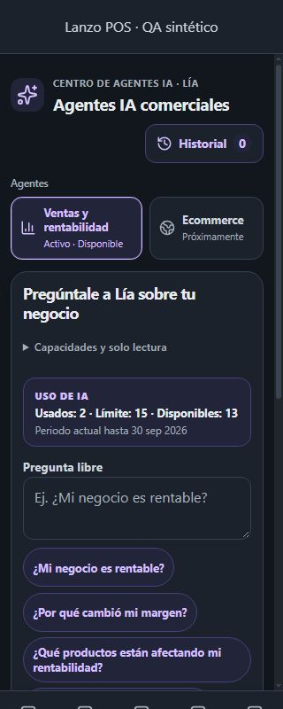
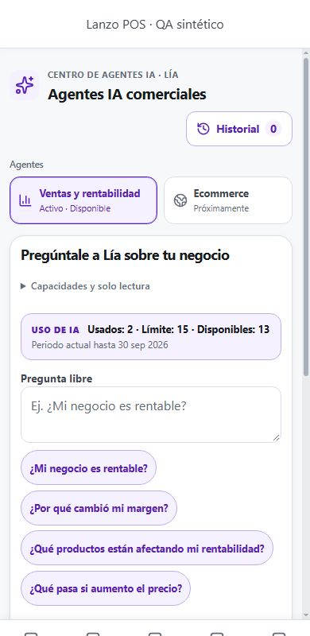
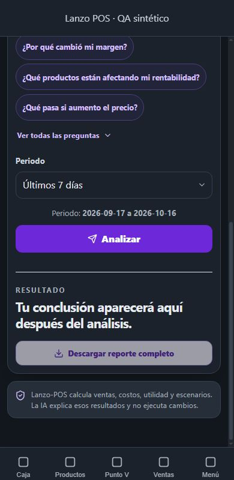
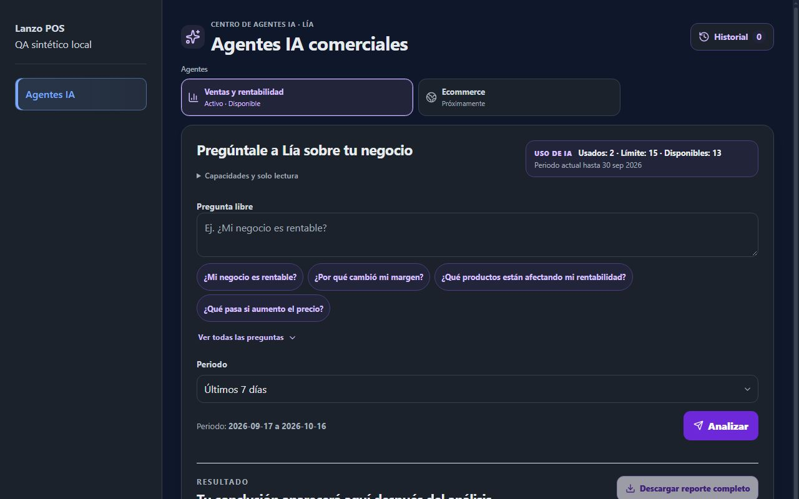

# Agentes IA PRO — refinamiento visual R1

PR existente: [#358](https://github.com/fdxruli/Lanzo-POS/pull/358), Draft. Rama: `feat/ai-agents-pro-responsive-workspace-r1`.
HEAD inicial comprobado: `70a30960ba9b8937f7c28f674769f01630019a04`. Fecha: 2026-10-16.

## Auditoría y causa técnica

| Elemento | Hallazgo confirmado | Corrección acotada |
| --- | --- | --- |
| `index.css` y `Layout.css` | Documento/root con scroll bloqueado; `.content-wrapper` sólo define `overflow-y: auto` desde 1024 px. En móvil, `overflow-x: hidden` del shell produce scroll vertical implícito del shell completo. | Dar al wrapper un scroll explícito sólo cuando contiene la página PRO. No cambiar Layout global. |
| Viewport del shell | `min-height: 100vh` puede superar `height: 100dvh` cuando cambia la interfaz del navegador móvil. | Alinear el mínimo con `100dvh` exclusivamente en PRO móvil. |
| Navbar fija | Su altura es `--mobile-bottom-nav-height` + `--safe-area-bottom`. El contenido anterior se desplazaba detrás de la barra; la reserva al final del documento no delimita el área visible durante el scroll. | Reservar esa altura en el margen inferior del wrapper y transferir la compensación de página a espaciado normal. El área desplazable termina donde empieza el navbar. |
| Fin del documento | Espaciado propio pasa de 1 rem a 0 en distintos breakpoints, independientemente del breakpoint móvil del shell (1024 px). | Unificar la regla PRO hasta 1023 px; mantener dos espacios `--spacing-lg` al terminar y safe areas laterales. |
| Agentes | Ecommerce estaba después del reporte y Ventas tenía una identificación adicional dentro del workspace. | Selector superior de dos opciones, retirando ambas presentaciones anteriores para evitar duplicación. |
| Elementos flotantes | `.fab-pos-button` es CSS legado sin uso en JSX; no es una causa demostrada. AssistantBot puede montarse por permisos/preferencias y tiene sus propias posiciones. | No añadir compensaciones para un FAB inexistente ni cambiar AssistantBot. Revisar sus estados reales en QA autenticado. |

La reproducción local de altura fija **no demuestra** el recorte físico concreto del teléfono del propietario. Sí confirma el scroll implícito anterior y permite comprobar que ahora el viewport de contenido queda fuera de la barra. La variación real de barras del navegador/teclado necesita dispositivo autenticado.

## Implementación

- Dos botones compactos dentro de una región «Agentes», inmediatamente después del encabezado y antes del workspace. No se simulan tabs.
- Ventas y rentabilidad: `aria-pressed="true"`, violeta, «Activo · Disponible», `aria-controls` al workspace. Activarlo lleva el foco a la pregunta; conserva parámetros y no llama servicios.
- Ecommerce: botón nativo `disabled`, «Próximamente», descripción accesible completa. Sigue en el DOM y no ejecuta funcionalidad futura.
- Grid fluido con proporción 1.15:1, iconos, foco visible y mínimo táctil de 60 px. El ajuste de proporción evita partir «Ecommerce» a 320 px.
- CSS de scroll y safe areas condicionado por `.page-container > .commercial-ai-pro-workspace`, hasta 1023 px. Free y el resto del shell conservan sus reglas.
- Sin cambios al componente del modal, los servicios o la zona protegida de respuestas.

## Verificación automatizada de esta mini-fase

- Vitest UI/modal/invariancia/contrato de navegación: **93/93 PASS**, sin skips en la ejecución completa final.
- Servicios: autorización (7), historial (21), cuota (4), servicio del agente (50): **82/82 PASS**.
- Total focal único: **175 pruebas**. La repetición filtrada de tres casos no se suma.
- La primera ejecución UI tuvo tres fallos nuevos por concatenación del nombre accesible del agente con su estado. Se corrigió el JSX añadiendo separación; la ejecución completa posterior aprobó. No se cambiaron hashes de invariancia ni límites de tests.
- ESLint focal: **0 errores / 0 warnings**. Aviso externo de antigüedad de `baseline-browser-mapping`; no se instalan dependencias para este refinamiento.
- Build + postbuild: **PASS**; auditados 21 assets de arranque. Se comprobó que el CSS compilado contiene la proporción final del selector, la reserva del navbar y el shell dinámico. Avisos preexistentes de imports dinámicos/chunks y patrones Workbox sin coincidencias; sin modificar controles.
- React Doctor sobre cambios desde `70a30960`: **90/100, sin incidencias**, dos archivos revisados. No se modifican reglas ni se suprimen diagnósticos.
- CI y URL final del Preview: evidencia de cierre en la descripción del PR, vinculada al HEAD publicado.

Comandos focales:

```text
npx vitest run src/components/ai/__tests__/CommercialAIAgents.test.jsx src/components/ai/__tests__/CommercialAIHistoryModal.test.jsx src/components/ai/__tests__/CommercialAIResponse.invariance.test.js src/components/layout/__tests__/Layout.mobileClearance.test.js --maxWorkers=1
npx vitest run src/services/auth/__tests__/aiAgentAuthorization.test.js src/services/ai/__tests__/salesProfitabilityHistory.test.js src/services/ai/__tests__/aiServiceUsageStatus.test.js src/services/ai/__tests__/salesProfitabilityAgentService.test.js --maxWorkers=1
npx eslint src/components/ai/CommercialAIAgentsPage.jsx src/components/ai/__tests__/CommercialAIAgents.test.jsx
npm run build
```

## QA visual ejecutada y límites

El Preview previo abre **Login de Vercel**; no se accedió a una sesión PRO autenticada. Se usó navegador real sobre una fixture local temporal: DOM renderizado por los componentes reales con mocks de los tests, CSS real de módulo/layout/navbar, shell de navegación representativo y datos exclusivamente sintéticos. No es certificación E2E del Preview. La fixture y su exportador no se incluyen en el producto ni en el conteo de tests.

Anchos observados: **320, 360, 375, 390, 430, 640, 768, 1024 y 1280 px**. Se observaron tema oscuro y claro, y paisaje **844 × 390**. Insets de 34 px inferior y 44 px laterales fueron simulaciones mediante tokens, no hardware iPhone/Android.

| Caso | Evidencia local | Preview/dispositivo real |
| --- | --- | --- |
| QA-VIS-01: contenido fuera del navbar | PASS en fixture: borde inferior del scroll coincide con borde superior de la barra en los siete anchos móviles medidos | Pendiente |
| QA-VIS-02: respiración final | PASS en fixture: aproximadamente 48 px entre nota final y navbar, safe area simulada incluida; sin scroll pendiente al final | Pendiente |
| QA-VIS-03: agentes arriba | PASS en capturas de los nueve anchos | Pendiente |
| QA-VIS-04: selector compacto | PASS local: región completa de aproximadamente 85–95 px según ancho; botones de aproximadamente 60–71 px | Validación de preferencia del propietario |
| QA-VIS-05: activo y Ecommerce | PASS local: violeta/estado explícito frente a opción neutra deshabilitada, ambas visibles | Pendiente |
| QA-VIS-06: escritorio | Revisado visualmente a 1024 y 1280 px; selector acotado y workspace ancho | Validación del propietario |
| QA-VIS-07: temas | Revisados claro y oscuro; selector usa tokens existentes | No se certifica WCAG completo |
| QA-VIS-08: historial | Vacío, detalle extenso y confirmación revisados a 390 px; diálogo 844 px, scroll interno, z-index 1100 frente a navbar 100. Lista revisada a 1280 px. Final del reporte largo alcanzable dentro del diálogo | Interacción E2E pendiente; cubierta por tests de React |

[Mediciones del navegador](assets/ai-refinement-r1/measurements.json). La medición inicial a 320 px detectó la partición de Ecommerce; la captura final y las mediciones de fin de scroll corresponden al ajuste de proporción final. Los primeros valores `top` de ese JSON registran también la iteración previa, no deben interpretarse como métricas finales uniformes.






### QA pendiente del propietario en el Preview final

1. Abrir `/agentes-ia` con acceso PRO; confirmar selector, disponibilidad y preferencia visual.
2. Llegar al final con gesto táctil, rotar, mostrar/ocultar barras del navegador y abrir/cerrar teclado. Comprobar navbar, nota final y CTA.
3. Repetir con AssistantBot cerrado/abierto y, si corresponde, con productos en carrito. Su overlay global no fue modificado ni certificado en la fixture.
4. Abrir historial, recorrer un reporte largo, volver, descargar y cancelar/confirmar borrado; cerrar y comprobar foco/scroll/estado principal.
5. Repetir en Free/Local y Staff sin permiso. Los contratos automatizados de Free/autorización siguen aprobando; no se declara QA visual autenticado Free ejecutado.

## Garantías

`AnalysisResult`, adaptador histórico y CSS original del reporte: protegidos por hashes originales, sin cambios. Ruta Free/showcase: hash original conservado. Historial funcional, cuota, permisos, multitenancy, provider flow, descargas y almacenamiento: sin modificaciones. Sin nuevas dependencias, migraciones, Supabase/Edge Functions, datos financieros reales, producción ni merge. Se conserva el único PR #358 en Draft.
