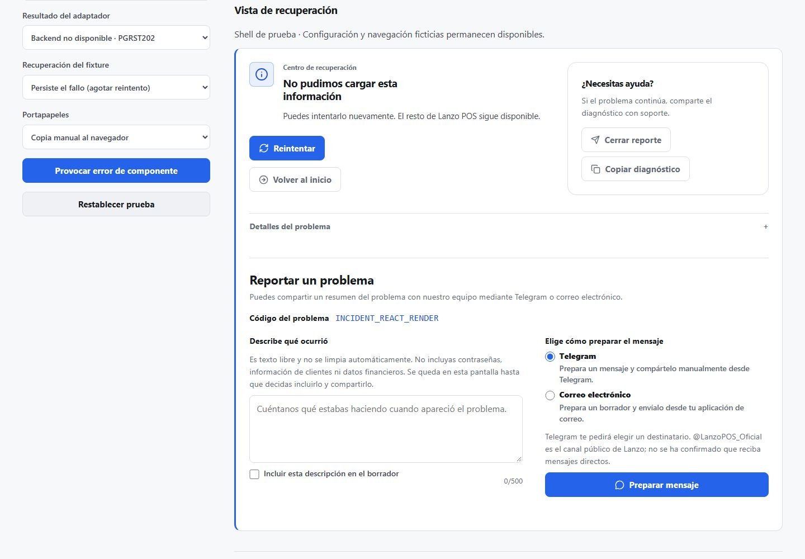
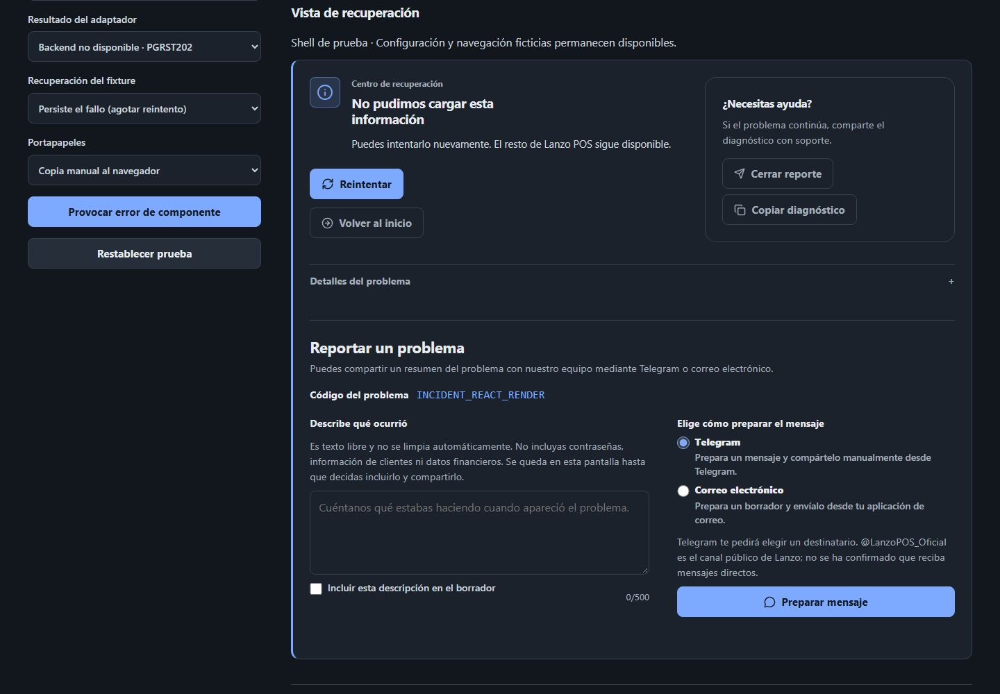
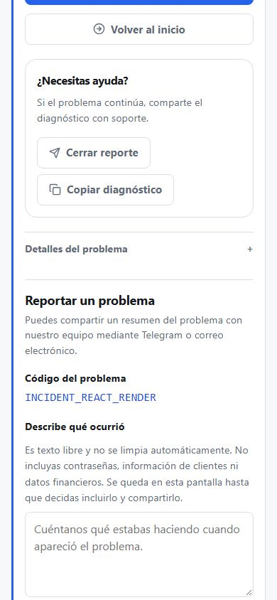
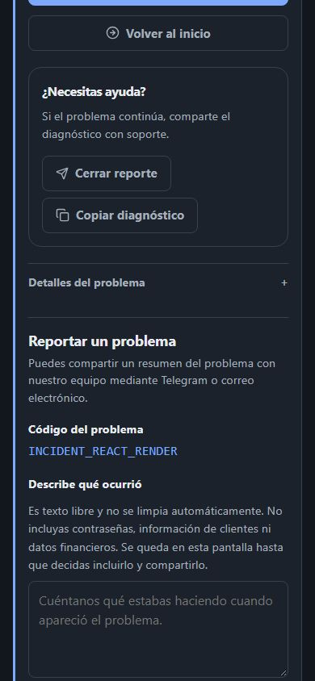

# Mini-fase 4.3 — contacto manual de soporte

## Alcance y diagnóstico

La fase corrige cuatro problemas de la experiencia anterior: el envío remoto dependía de una RPC que aún no está certificada en producción; la copia principal era JSON; el formulario quedaba dentro de la ayuda lateral en móvil; y su expansión dejaba espacio vacío en la columna vecina en escritorio.

La nueva ruta se limita a preparar mensajes para Telegram o correo. La persona revisa, copia y comparte desde la aplicación externa. La recepción remota preparada en fases anteriores y el reporter técnico se conservan como contratos separados; el flujo de contacto no los monta ni los llama.

## Arquitectura del formulario

`IncidentRecoveryPanel` es dueño de un único estado de apertura. El disparador conserva `aria-expanded`/`aria-controls`; al abrir carga de forma diferida `IncidentSupportContactForm` en una región hermana del layout de recuperación. Cerrar desde el disparador restaura el foco al mismo control. El panel y el error original conservan su estado.

El formulario comparte un único generador de mensaje y un único editor entre los dos canales. Telegram genera un selector para elegir destinatario; correo genera `mailto:` con asunto y cuerpo. Ninguna acción intenta enviar ni muestra confirmación de entrega.

## Mobile-first y composición de escritorio

En anchos estrechos, descripción y canal aparecen en una columna, en flujo vertical, con textarea reconocible, controles de al menos 44 px, texto de privacidad, scroll natural y sin footer fijo. La ayuda queda antes del formulario; el formulario no se monta dentro de esa región ni crea tarjetas internas.

En escritorio, el contenido de descripción y canal puede ocupar dos columnas dentro del formulario; la región de contacto sigue debajo del grid superior de recuperación y utiliza todo el ancho de ese panel. No se usa posicionamiento absoluto ni portales.

El diseño usa las superficies y tokens existentes, separadores discretos y ambos temas. Las capturas se obtuvieron en el laboratorio aislado del propio PR a 390×844 y 1440×1000, con el error de React QA-01 y sin datos comerciales. Las dimensiones de los JPEG fueron verificadas. Son evidencia de la interfaz del panel, no una sesión comercial completa.

### Escritorio, tema claro — 1440×1000



### Escritorio, tema oscuro — 1440×1000



### Móvil, tema claro — 390×844



### Móvil, tema oscuro — 390×844



## Canales y contrato del mensaje

El encabezado explica que el resumen se comparte mediante Telegram o correo. Telegram deja elegir el destinatario y aclara que `@LanzoPOS_Oficial` es un canal público sin recepción de mensajes directos confirmada. Correo reutiliza el contacto existente de Lanzo y prepara un asunto claro.

El texto se genera desde una allowlist: código seguro, sección sanitizada, categoría, versión y conectividad cuando existen. Nunca usa JSON como mensaje principal. El mensaje tiene límite de 1200 puntos de código. No incluye stacks, mensajes internos, query strings, UUID, tokens, licencias, clientes ni datos financieros.

La descripción libre admite hasta 500 caracteres y no se sanitiza. Está vacía y excluida del borrador por defecto; una casilla explícita la incorpora y la vista previa permite revisarla antes de copiar o abrir otra aplicación. No se persiste ni se envía a telemetría.

## Privacidad, operación offline y seguridad

- El flujo visual no ofrece envío a Supabase, consentimiento de transmisión, estado de recepción, folio, confirmación remota ni promesa de entrega.
- No se añadió ni ejecutó una migración; no se modificó Supabase ni producción.
- La preparación y copia permanecen disponibles offline. Abrir la aplicación externa puede necesitar conexión. No existe cola persistente, reintento automático ni acceso al outbox comercial.
- El borrador queda ligado a la incidencia y a su guardia de contexto. Un cambio de negocio, actor o sesión lo invalida.
- La clasificación, el presupuesto de reintento, los bloqueos financieros, el aislamiento del actor/tenant, la recuperación de IndexedDB y la captura local de incidentes se conservan.
- El reporter técnico y sus contratos de recepción futuros permanecen disponibles para fases posteriores, pero el componente nuevo no los importa ni ejecuta.

## Pruebas y compilaciones locales

- Suite focal de desarrollo antes del ajuste final de interfaz: **10 archivos / 107 pruebas PASS**.
- En el HEAD candidato tras alinear los mocks del icono de Telegram: **4 archivos / 52 pruebas PASS**, incluidos los dos tests existentes de ErrorBoundary que bloqueó inicialmente CI; ESLint focal: **PASS**.
- Después de retirar el botón de cierre duplicado: **IncidentRecovery.ux.test.jsx, 8/8 PASS**, incluida la restauración del foco.
- ESLint focal, sin errores ni advertencias configuradas: **PASS**. Se mostró únicamente el aviso preexistente de `baseline-browser-mapping` desactualizado.
- Contrato estático de reporter técnico: **4/4 PASS**, solo lectura.
- `git diff --check`: **PASS**.
- Matriz DOM en ambos temas: **14/14 tamaños/orientaciones sin overflow horizontal**. 320×568, 360×740, 375×667, 390×844, 430×932, 600×800, 768×900, 820×900, 1024×900, 1280×1000, 1440×1000, 1920×1080, 844×390 y 1280×600. El formulario usa una columna hasta 1024 px y dos columnas internas a partir de 1280 px en el shell QA.
- Build administrativo y build público previos al último ajuste visual: **PASS**. Se regenera abajo el build aislado de QA para la captura final; los avisos de imports mixtos y patrones PWA son preexistentes.
- React Doctor observó dos avisos: teardown del class component de ErrorBoundary (suscripciones y timers sí se limpian en `componentWillUnmount`) y complejidad de `IncidentRecoveryPanel`. No se añadieron supresiones.

## CI del PR

Resultados finales del código en `eeb83fd15616d0182d5788b0d0f6c87b44df16cb`. Los siete workflows finalizaron con éxito tras repetir Actor Runtime completo en el intento 2 sobre el mismo SHA.

| Gate | Resultado del nuevo HEAD |
| --- | --- |
| [PR127 Global Comparison](https://github.com/fdxruli/Lanzo-POS/actions/runs/39212727314) | **SUCCESS**. 99 fallos compartidos, 0 candidate-only, 0 nuevos, 0 identidades sin resolver y 1 resuelto. Las suites globales siguen teniendo fallos comunes. |
| [Actor Runtime](https://github.com/fdxruli/Lanzo-POS/actions/runs/39212727609) | **SUCCESS, intento 2**. BASE: 5,278 pass / 75 fail / 52 skip en ambas ejecuciones. CANDIDATE: 5,447 pass / 75 fail / 52 skip en ambas. Diferencial: 0 regresiones nuevas, 93 fallos preexistentes estables, 0 fluctuantes. |
| [Actor Scoped Storage](https://github.com/fdxruli/Lanzo-POS/actions/runs/39212727336) | **SUCCESS**. BASE: 5,278 pass / 75 fail / 52 skip en ambas ejecuciones. CANDIDATE: 5,447 pass / 75 fail / 52 skip en ambas. Diferencial: 0 regresiones nuevas, 93 fallos preexistentes estables, 0 fluctuantes; objetivos focales 50/50. |
| [Dexie Recovery](https://github.com/fdxruli/Lanzo-POS/actions/runs/39212727570) | **SUCCESS**. |
| [Ecommerce Public](https://github.com/fdxruli/Lanzo-POS/actions/runs/39212727493) | **SUCCESS**. |
| [Store Git Runtime](https://github.com/fdxruli/Lanzo-POS/actions/runs/39212727659) | **SUCCESS**. |
| [Incident Recovery QA Lab / PWA](https://github.com/fdxruli/Lanzo-POS/actions/runs/39212727404) | **SUCCESS**. |

El primer intento de Actor Runtime (`39212727609`, intento 1) falló por una única observación candidate-only en `ProductFormV2.test.jsx > uses the latest batch-confirmed parent version on an apparel partial-save retry`; ocurrió en la primera repetición del candidato, no apareció en la segunda y BASE pasó ambas. El test no está modificado por esta mini-fase y pasó localmente (1/1). El intento completo 2 sobre el mismo SHA pasó ambas repeticiones del candidato, generó el diferencial final con 0 regresiones nuevas y cerró el gate con SUCCESS. Se conserva aquí la observación inicial por transparencia.

## Checklist manual del propietario

- [ ] Welcome en escritorio y móvil.
- [ ] Ventas en escritorio y móvil; confirmar que mantiene su shell.
- [ ] Abrir el reporte y comprobar que se extiende bajo las dos columnas.
- [ ] Describir un problema; comprobar el límite y que no se incluya por defecto.
- [ ] Elegir Telegram, preparar y revisar el mensaje antes de compartirlo.
- [ ] Elegir correo y revisar asunto y cuerpo del borrador.
- [ ] Cerrar el reporte y comprobar la restauración de foco.
- [ ] Probar temas claro y oscuro, scroll hasta la última acción y privacidad.
- [ ] Completar la matriz de ancho/orientación, zoom, teclado móvil y lector de pantalla.

`LOCALHOST_OWNER_QA: PENDING`. Las capturas automáticas no sustituyen el QA físico del propietario.

## Instrucciones para localhost

Desde una copia Git separada, mantener intacta la carpeta del propietario con errores intencionales:

```powershell
git fetch origin
git switch feat/incident-recovery-center-r1
git pull --ff-only origin feat/incident-recovery-center-r1
npm ci
npm run dev
```

Abrir la URL local que imprime Vite. Reproducir los errores ya conocidos de Welcome o Ventas y usar «Reportar problema» desde el Centro de Recuperación. No hace falta usar Vercel Preview, realizar ventas ni enviar el mensaje; para Telegram y correo, revisar la vista previa antes de decidir si se abre una aplicación externa.

## Riesgos y estado

Falta el QA visual/físico del propietario en su laptop, además de zoom real, teclado móvil y lector de pantalla. Las capturas representan el shell QA controlado y el panel real de recuperación; la configuración del laboratorio ocupa una columna propia.

`SUPABASE_REPORTING_UI: DISABLED` · `REMOTE_REPORT_SUBMISSIONS: NONE` · `MIGRATIONS_APPLIED: NONE` · `PRODUCTION_CHANGES: NONE` · `MERGE_STATUS: NOT_MERGED` · `READY_FOR_PRODUCTION: NO`.
