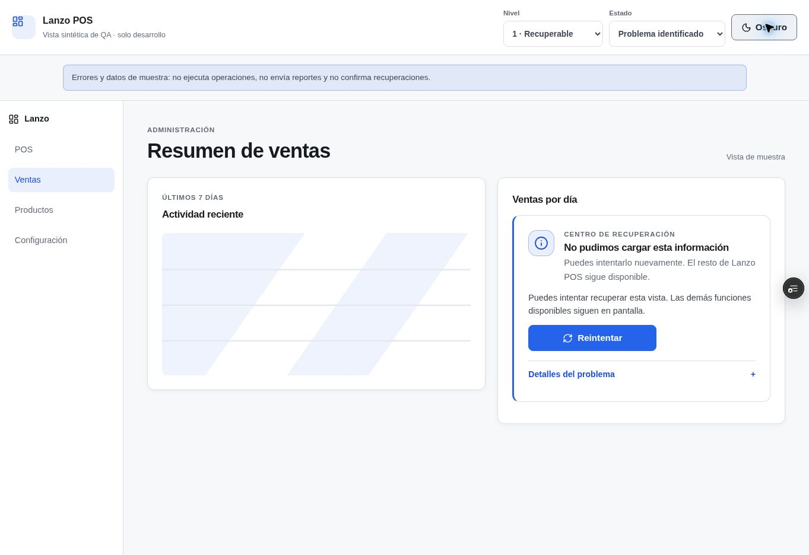
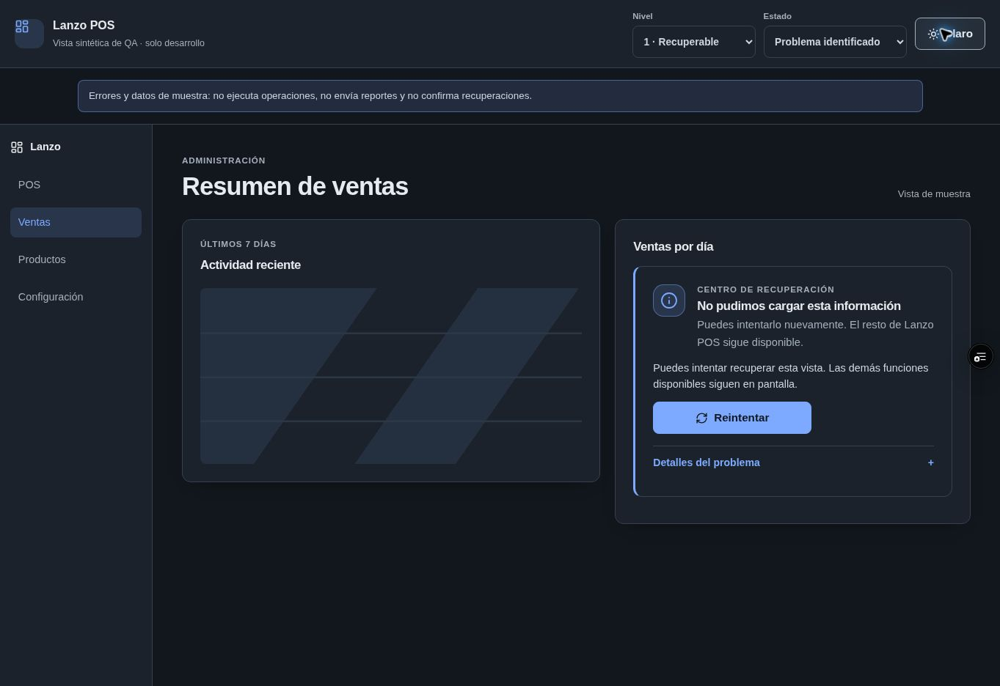
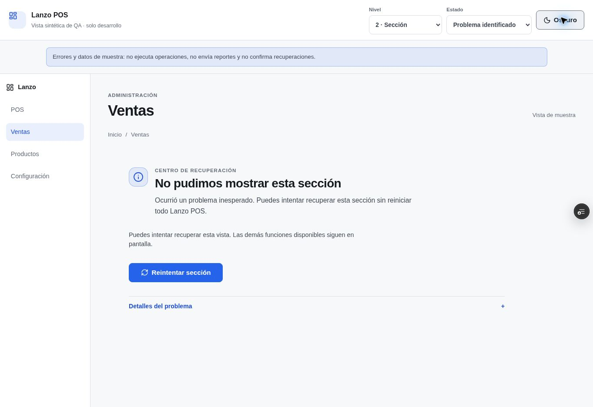
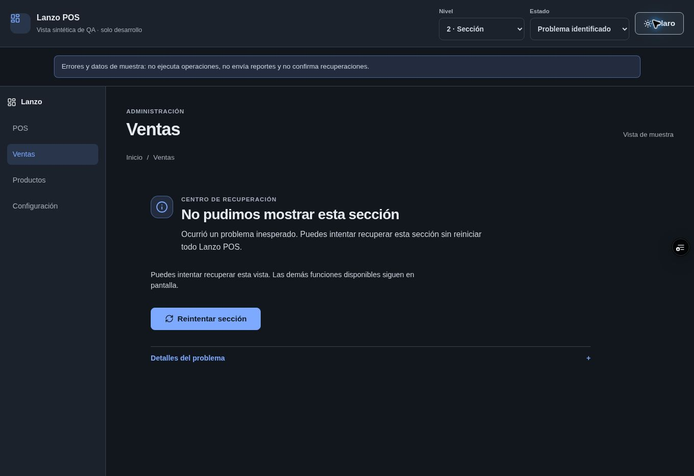
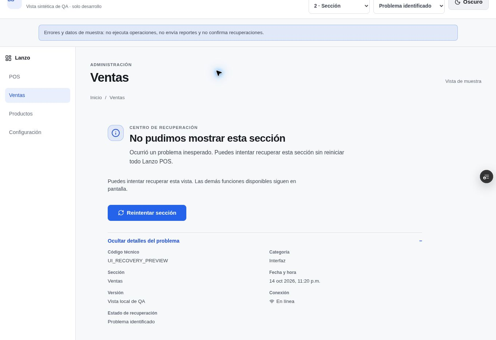
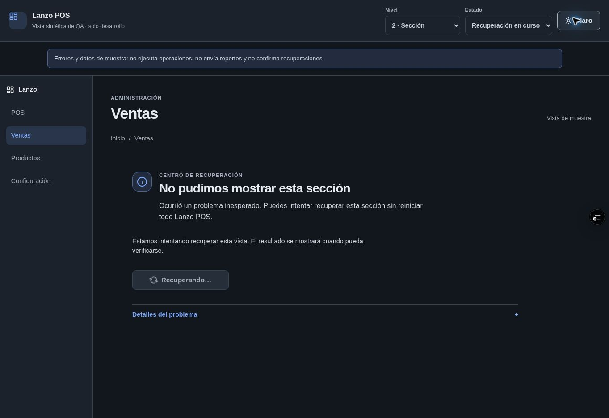
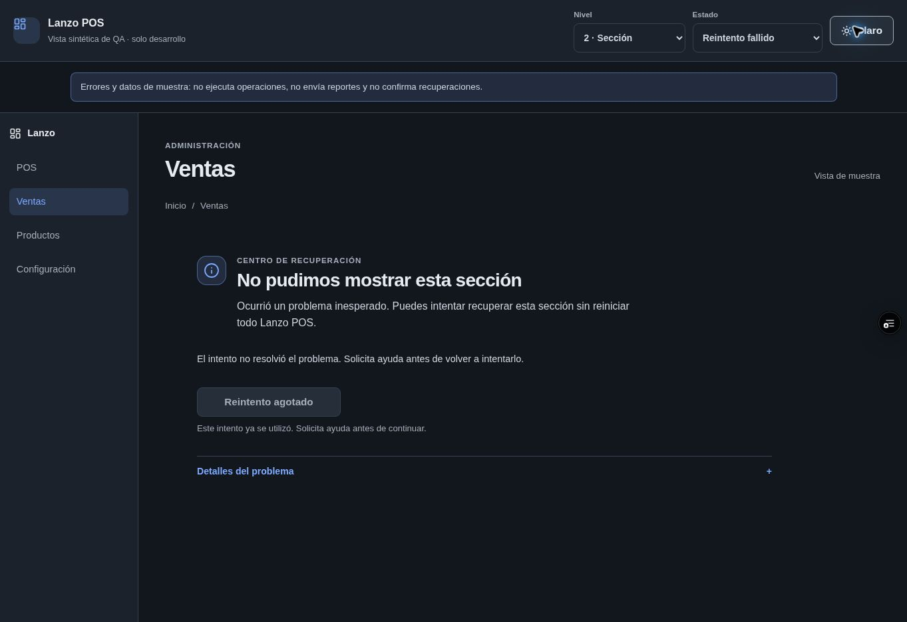
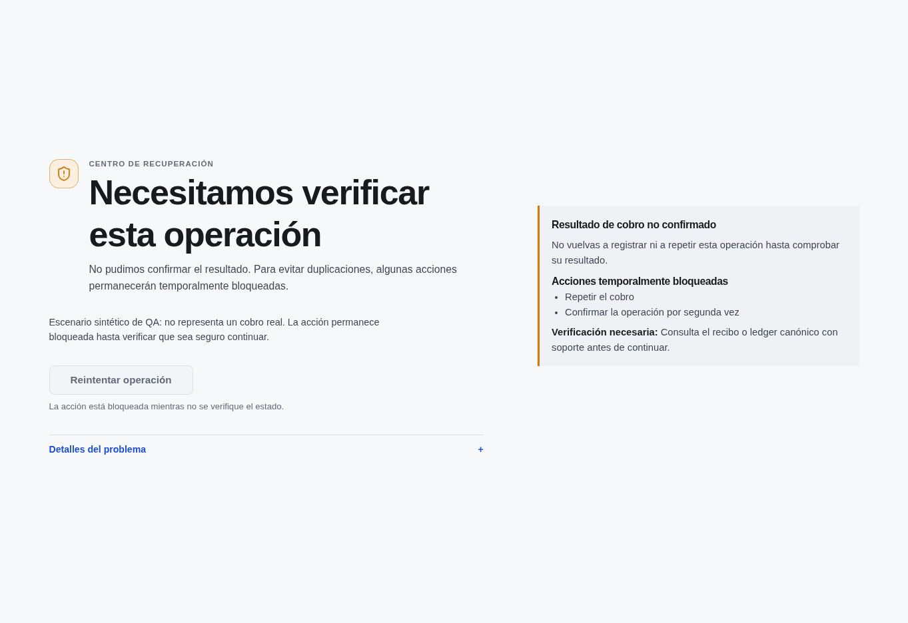

# LANZO-POS — Centro de Recuperación de Incidencias · Fase 2 R1

## Estado de entrega

- **Estado:** implementación publicada, Preview verificado; pendiente aprobación de QA manual.
- **PR:** [#357](https://github.com/fdxruli/Lanzo-POS/pull/357), conserva `OPEN / Draft`.
- **Rama:** `feat/incident-recovery-center-r1`.
- **HEAD inicial:** `e8f61b90fb40465d9849dbea2ec54d235378352f`.
- **HEAD final de implementación:** `df171af357e1eedfd8d616c34fc99ee4e8e2474f`.
- **Cambios de producción:** ninguno. No hubo despliegue a Production, migraciones ni escrituras remotas.
- **Merge:** no realizado. Esperar aprobación de QA manual.

## Decisiones UX y arquitectura

1. Se conserva la clasificación de Fase 1 (`recoverable`, `section_failure`, `critical_blocker`) y se presenta desde un panel común que recibe la gravedad ya clasificada. No se duplica la clasificación.
2. Los errores de componentes secundarios quedan limitados al componente; fallos de ruta quedan en la región principal bajo el shell administrativo. El layout, navegación, not-found 404 y rutas de tienda no se sustituyen por el ErrorBoundary administrativo.
3. Las acciones se ordenan con un único CTA contextual. Reintentos y actualizaciones respetan los límites existentes, `single-flight`, actor/sesión/tenant vigentes, conectividad y operaciones en curso. No se agrega reload genérico ni recuperación financiera automática.
4. Los detalles se mantienen plegados y reutilizan `classifyIncident`, `buildSafeIncidentReport` y `getSafeIncidentMetadata`. Copiar diagnóstico usa el reporte seguro; un estado de copiado aparece sólo tras resolver el portapapeles. Contactar soporte explica que se abrirá correo y el usuario debe enviar el mensaje.
5. Las operaciones críticas se presentan con texto específico, acciones bloqueadas y verificación necesaria. El resultado de un cobro ambiguo no se reintenta ni se marca como recuperado sin evidencia canónica.
6. Los errores asíncronos se capturan localmente sólo para categorías relevantes, se deduplican y pueden mostrarse como aviso discreto. Warnings de consola no generan avisos; no se envían datos a servicios remotos.
7. El tema usa variables existentes de Lanzo y hereda claro/oscuro. Los estilos no contienen `!important`; usa áreas seguras, scroll natural, `100vh` con `100dvh`, foco visible, `prefers-reduced-motion` y botones táctiles de 44 px.
8. `/__qa/incident-recovery` es una galería de errores y datos sintéticos habilitada sólo en desarrollo y Preview Vercel. El branch de producción se elimina durante el build y no representa una transacción real.

### Matriz visual antes/después

| Superficie | Antes | Después |
| --- | --- | --- |
| ErrorBoundary raíz | Overlay oscuro forzado, franja roja, panel técnico prominente, acciones en competencia | Presentación por gravedad; sección integrada, shell conservado si es seguro; bloqueo independiente y neutral |
| Widget local | Fallback sin jerarquía consistente | Mensaje breve y reintento en el área del widget; el resto sigue visible |
| Ruta administrativa lazy | Pantalla de alto completo y actualización como acción general | Recuperación dentro de la región de contenido, límite de un intento y guardas de contexto/operación |
| Errores globales asíncronos | Registro DevConsole sin contexto visible | Aviso local deduplicado, discreto y con detalles plegados |
| Inicio/IndexedDB | Tarjetas y mensajes desconectados del sistema visual | Superficies neutrales con tokens y recuperación preservada; IndexedDB/outbox no se limpian |
| Tienda pública | Fallback separado del shell administrativo | Mantiene identidad pública y garantías de carrito/reintento existentes |
| 404 | Pantalla de navegación | Sigue siendo independiente, no se clasifica como incidente |

## Integración y estados de recuperación

- Estados de UI: `detected`, `recovering`, `verified`, `failed`, `blocked` y `action_required`; `preserved` sólo se comunica cuando una comprobación lo respalda.
- `verified` requiere que el mecanismo de recuperación haya completado y la vista vuelva a renderizar; quitar el fallback por sí solo no confirma éxito.
- Los metadatos visibles permitidos son código seguro, categoría, sección (o “No determinada”), fecha, versión, conexión y estado de recuperación. No se presentan token, licencia completa, UUID de tenant, fingerprint, query, PII, importes, transacciones ni stack crudo.
- La galería sintética puede mostrar recuperación en curso, fallida o bloqueada; jamás confirma un resultado financiero.
- No se añade persistencia de incidentes, reporte remoto, Supabase, Telegram, tickets nuevos ni migraciones. Esos trabajos quedan para Fases 3/4.

## Archivos modificados

- `docs/reports/INCIDENT.RECOVERY.PHASE2.R1.md`
- `docs/reports/phase2-visuals/lanzo-f2-level1-dark.jpg`
- `docs/reports/phase2-visuals/lanzo-f2-level1-light.jpg`
- `docs/reports/phase2-visuals/lanzo-f2-level2-dark.jpg`
- `docs/reports/phase2-visuals/lanzo-f2-level2-details-open-light.jpg`
- `docs/reports/phase2-visuals/lanzo-f2-level2-light.jpg`
- `docs/reports/phase2-visuals/lanzo-f2-level2-recovering.jpg`
- `docs/reports/phase2-visuals/lanzo-f2-level2-recovery-failed.jpg`
- `docs/reports/phase2-visuals/lanzo-f2-level3-blocked-desktop.jpg`
- `src/App.jsx`
- `src/architecture/__tests__/adminLazyRouteRecoveryArchitecture.test.js`
- `src/architecture/__tests__/adminStartupRecoveryArchitecture.test.js`
- `src/components/common/AdminIncidentNotice.css`
- `src/components/common/AdminIncidentNotice.jsx`
- `src/components/common/AdminLazyRouteRecoveryFallback.jsx`
- `src/components/common/AdminRouteRecoveryRegion.jsx`
- `src/components/common/AdminStartupRecoveryScreen.css`
- `src/components/common/AdminStartupRecoveryScreen.jsx`
- `src/components/common/DatabaseRecoveryGate.jsx`
- `src/components/common/ErrorBoundary.css`
- `src/components/common/ErrorBoundary.jsx`
- `src/components/common/IncidentRecoveryPanel.jsx`
- `src/components/common/IncidentRecoveryQaGallery.css`
- `src/components/common/IncidentRecoveryQaGallery.jsx`
- `src/components/common/PosApplicationBootstrap.jsx`
- `src/components/common/__tests__/AdminIncidentNotice.test.jsx`
- `src/components/common/__tests__/AdminLazyRouteRecoveryFallback.test.jsx`
- `src/components/common/__tests__/DatabaseRecoveryGate.test.jsx`
- `src/components/common/__tests__/ErrorBoundary.clipboard.test.jsx`
- `src/components/common/__tests__/ErrorBoundary.phase2.test.jsx`
- `src/components/common/__tests__/PosApplicationBootstrap.runtimeRecovery.test.jsx`
- `src/components/common/__tests__/PosApplicationBootstrap.test.jsx`
- `src/components/dashboard/TrendChart.css`
- `src/components/dashboard/TrendChart.jsx`
- `src/components/dashboard/__tests__/TrendChart.incidentRecovery.test.jsx`
- `src/components/ecommerce/public/PublicStoreErrorBoundary.css`
- `src/components/ecommerce/public/PublicStoreErrorBoundary.jsx`
- `src/components/ecommerce/public/__tests__/PublicStoreErrorBoundary.test.jsx`
- `src/components/layout/Layout.jsx`
- `src/index.css`
- `src/main.jsx`
- `src/router/__tests__/adminNotFoundRouting.test.jsx`
- `src/services/devConsoleCapture.js`
- `src/services/diagnostics/incidentDiagnostics.js`
- `src/services/diagnostics/incidentEventCenter.js`
- `src/services/diagnostics/__tests__/incidentEventCenter.test.js`
- `src/tests/ErrorBoundary.test.jsx`
- `vite.config.js`

## Resultados automatizados locales

- Suite focal de recuperación, shell/rutas, accesibilidad, evento global y guards de actor/tenant/finanzas/PWA: **28 archivos, 228 tests PASS**.
- `npm run build`: **PASS**; auditoría posterior confirma **22 assets de inicio** y cero rutas Local de núcleo en precache.
- `VERCEL_ENV=preview npm run build`: **PASS**; **23 assets de inicio**, 35 entradas de precache. Incluye los chunks de la galería QA sólo en Preview.
- `npm run build:store`: **PASS**, 1,847 módulos transformados.
- ESLint focal de todos los archivos JS/JSX modificados: **PASS**.
- `git diff --check`: **PASS**.
- `npm run lint` completo: **FAIL de baseline del repositorio**, con 162 errores y 177 warnings en archivos fuera de este cambio. Los errores observados incluyen SetupModal, Layout.reportAuthorization.test, SplitBillModal.test, utilidades de pruebas antiguas y otros módulos no modificados. No se cambiaron reglas ni tests para ocultarlos.
- `npm run test:ci` completo: **5,179 tests PASS, 88 FAIL, 52 SKIP**, en 587 archivos (544 archivos pasan; 43 tienen fallos); no es un gate verde. Se compararon en el HEAD inicial tres grupos fallidos representativos y reproducen exactamente allí: `BackupRiskEvaluator.test.js` (8, falta `localStorage` en entorno Node), `useStoreSync.test.js` (4, método legacy ausente) y dos casos de `ecommercePosInventoryResolution.test.js` (respuesta stale). El código y tests de esos módulos no forman parte de Fase 2. Los skips son condiciones explícitas de esos tests; no se cuentan como aprobados.
- Los fallos globales restantes no se atribuyen a Fase 2 sólo por esta ejecución; la suite focal de la superficie modificada y los guards relevantes sí pasa. Requieren seguimiento por el gate PR127/diferencial remoto.

## Workflows remotos de referencia previos a Fase 2

Los workflows ejecutados sobre el HEAD inicial `e8f61b9` confirmaron la Fase 1:

- [PR127 Global Comparison — run 38678204591](https://github.com/fdxruli/Lanzo-POS/actions/runs/38678204591): **SUCCESS**.
- [Shared Terminal Actor Runtime Validation — run 38678204622](https://github.com/fdxruli/Lanzo-POS/actions/runs/38678204622): **SUCCESS**. BASE/CANDIDATE y su diferencial se ejecutaron y concluyeron. “Manual whitespace hygiene classification” se omitió porque sólo aplica a `workflow_dispatch`; la higiene bloqueante del evento PR pasó. “Publish idempotent closeout report” se omitió porque el job sólo publica para la rama `feat/shared-terminal-actor-runtime`, no para esta rama. No se cuentan como pruebas ejecutadas.
- [HOTFIX Dexie Recovery Validation — run 38678204723](https://github.com/fdxruli/Lanzo-POS/actions/runs/38678204723): **SUCCESS**.
- [Ecommerce Public Phase 4 Validation — run 38678204549](https://github.com/fdxruli/Lanzo-POS/actions/runs/38678204549): **SUCCESS**.
- Sobre `df171af357e1eedfd8d616c34fc99ee4e8e2474f`, consulta el desglose de workflows y pasos en la sección de QA.

## Coordinación con PR #338 y #352

- PR [#338](https://github.com/fdxruli/Lanzo-POS/pull/338) continúa `OPEN / Draft`; su head es `fb17e9a43929d54087ab937cb760a8cd6e087c36` y no es mergeable a la fecha de revisión. Comparte superficie en `App.jsx`, `main.jsx`, `vite.config.js` y pruebas de arquitectura. No se integró ni se intentó resolver su estado de merge.
- PR [#352](https://github.com/fdxruli/Lanzo-POS/pull/352) continúa `OPEN / Draft`; su head es `d758f69b2119f1bc346eb0ac86ba0a74c0265668`. Mantiene interlocks de actualización con caja/operación activa. Fase 2 no cambia `adminServiceWorker` ni el slice PWA; sólo añade precache para el shell y chunks incidentales. La validación conjunta sigue pendiente y no se integró ese PR.
- No se creó rama o PR nuevo, no se hizo rebase/merge y no se forzó el push.

## Preview y QA manual

- **Preview:** [https://lanzo-2ost7em15-fdxrulis-projects.vercel.app](https://lanzo-2ost7em15-fdxrulis-projects.vercel.app), deployment `GAPQYL8bzufVNtCmw2urank8F5G3`, estado `READY` para el HEAD de implementación. Galería QA: [/__qa/incident-recovery](https://lanzo-2ost7em15-fdxrulis-projects.vercel.app/__qa/incident-recovery).
- **Evidencia visual comprobada en Preview:** las capturas siguientes se tomaron en Chrome sobre el deployment. El viewport disponible fue escritorio (~1365 px); no se pudo fijar ancho móvil desde esta herramienta. Las capturas demuestran los estados renderizados en Preview, no reemplazan la revisión manual ni prueban dimensiones móviles.

| Evidencia | Captura |
| --- | --- |
| Nivel 1 · claro |  |
| Nivel 1 · oscuro |  |
| Nivel 2 · claro, detalles cerrados |  |
| Nivel 2 · oscuro |  |
| Nivel 2 · detalles abiertos |  |
| Nivel 2 · recuperación en curso |  |
| Nivel 2 · recuperación fallida |  |
| Nivel 3 · cobro bloqueado |  |

- Nivel 3 en móvil y anchos 320/360/390/430 px: pendiente de QA manual en emulación o dispositivo real.
- La galería muestra datos sintéticos de recuperación, nunca inicia operaciones reales, no envía informes ni confirma cobros.

### Workflows Fase 2 (estado observado: 2026-10-15 05:24 UTC)

- [PR127 Global Comparison — run 38685951558](https://github.com/fdxruli/Lanzo-POS/actions/runs/38685951558): **IN_PROGRESS**. Las suites globales PR y main terminaron `SUCCESS`; extracción de fallos candidate-only también pasó. La evidencia focal candidate-only seguía ejecutándose; la evidencia base, normalización y carga de comparación estaban pendientes.
- [Shared Terminal Actor Runtime Validation — run 38685951649](https://github.com/fdxruli/Lanzo-POS/actions/runs/38685951649): **IN_PROGRESS**. La resolución del base y el job focal de Actor Runtime/tenant/auth/ESLint/builds terminaron `SUCCESS`. Las repeticiones observacionales de suite completa para candidate y base seguían ejecutándose. El paso “Manual whitespace hygiene classification” quedó `SKIPPED` porque sólo aplica a `workflow_dispatch`; el chequeo bloqueante de whitespace para PR pasó. El paso omitido no se cuenta como prueba.
- [Shared Terminal Actor Scoped Storage Validation — run 38685951465](https://github.com/fdxruli/Lanzo-POS/actions/runs/38685951465): **IN_PROGRESS**. Resolución del base y job focal de actor/storage/handoff/tenant/sync/POS/ESLint/builds terminaron `SUCCESS`. Las repeticiones observacionales de candidate y base seguían ejecutándose.
- [Ecommerce Public Phase 4 Validation — run 38685951614](https://github.com/fdxruli/Lanzo-POS/actions/runs/38685951614): **SUCCESS**.
- [HOTFIX Dexie Recovery Validation — run 38685952243](https://github.com/fdxruli/Lanzo-POS/actions/runs/38685952243): **SUCCESS**.
- [Vercel Preview — deployment GAPQYL8bzufVNtCmw2urank8F5G3](https://vercel.com/fdxrulis-projects/lanzo-pos/GAPQYL8bzufVNtCmw2urank8F5G3): **READY**, SHA verificado `df171af357e1eedfd8d616c34fc99ee4e8e2474f`.

Checklist para propietario:

- [ ] Abrir el Preview y `/__qa/incident-recovery`; confirmar texto “sintético”, sin operaciones ni envíos.
- [ ] Nivel 1 desktop, claro/oscuro: fallo sólo en widget, gráfico y shell todavía visibles; reintento en área local.
- [ ] Nivel 2 desktop/móvil, claro/oscuro: navegación conservada; región principal, un CTA, detalles cerrados/abiertos.
- [ ] Nivel 2 a 320, 360, 390 y 430 px: sin overflow, scroll natural, botones de al menos 44 px y sin controles ocultos.
- [ ] Nivel 3 desktop/móvil: foco en el título, resto de shell inerte, resultado financiero no repetible hasta verificación, bloqueos y canal de soporte claros.
- [ ] Seleccionar `recovering`, `failed` y `blocked`: no hay éxito falso ni ciclo de reintentos.
- [ ] Usar teclado: orden de foco, `focus-visible`, disclosure accesible, retorno de foco tras recuperar.
- [ ] Forzar estado offline: el shell Local permanece disponible y el texto no afirma pérdida o seguridad no comprobada.
- [ ] Cambiar actor/tenant durante una acción diferida: la acción vieja queda bloqueada.
- [ ] Con caja/checkout activo, comprobar que no se ofrece ni ejecuta reload/update inseguro.
- [ ] Error de IndexedDB: gate conserva stores/datos/outbox; no ofrece limpieza amplia.
- [ ] Error público: identidad de tienda y carrito siguen preservados según la garantía existente.
- [ ] Ruta inexistente: sigue en 404 independiente.
- [ ] Error asíncrono relevante: aviso único y deduplicado; warning de consola no crea alerta.
- [ ] Copiar diagnóstico: sólo campos saneados; correo abre el cliente e indica que el usuario debe enviar.

## Riesgos y límites pendientes

- La suite completa local y ESLint global siguen rojos por fallos fuera del alcance; no se deben esconder. Revisar resultados por PR127/diferencial y distinguir baseline de candidate-only.
- El contraste visual en monitores y móviles reales, tecnología de asistencia, offline prolongado, IndexedDB físicamente corrupto, cross-tab con caja activa y cobro ambiguo requieren QA manual; los tests no certifican esos dispositivos ni operaciones reales.
- La galería usa fixtures y no valida un flujo de usuario real ni backend de reportes.
- La aprobación de QA manual es bloqueante antes de marcar `READY_FOR_PHASE_3`.
- Reservado para Fases 3/4: persistencia/envío remoto, Supabase, Telegram, tickets, monitoreo remoto, tablas, migraciones, gestión de incidentes central y retención.

## Estado final esperado

`DESIGN_IMPLEMENTATION=COMPLETE` · `RECOVERY_INTEGRATION=COMPLETE` · `PREVIEW=READY_FOR_MANUAL_QA` · `PRODUCTION_CHANGES=NONE` · `MERGE_STATUS=NOT_MERGED` · `READY_FOR_PHASE_3=NO (QA manual pendiente)`.
