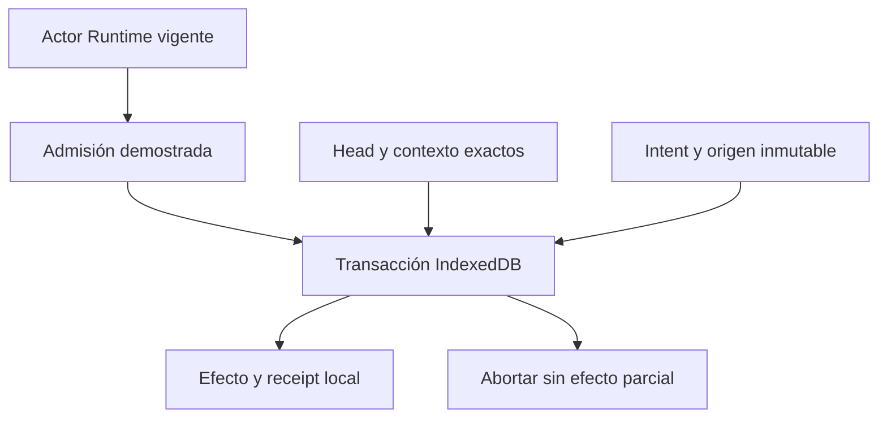

# LANZO POS — FASE 3.2A.3 — AUTHORITY V2 DESIGN

Fecha de revisión: **21 de octubre de 2026, America/Mexico_City**. Repositorio: `fdxruli/Lanzo-POS`.

## 1. Resumen ejecutivo y decisión

**Estado: `TRANSITION_CONTRACT_UNRESOLVED`. Arquitectura base: D.** El diseño de integración queda documentado para revisión; **no es una autorización de implementación, merge, Preview ni activación**.

D ofrece un punto de autoridad local transaccional para participantes actualizados: head único por tenant y dominio, contextos individuales, revocación por identidad exacta, intents de origen inmutable y validación en la misma transacción IndexedDB del efecto. Actor Runtime sigue siendo la autoridad de identidad, sesión, dispositivo, permisos y vencimiento. BroadcastChannel y StorageEvent sólo provocan relecturas.

La restricción aprobada por el propietario puede proteger **las nuevas escrituras de v2** ante incertidumbre. No demuestra que una versión antigua haya dejado de escribir. No se encontró una estrategia que, bajo las restricciones del encargo, pruebe admisión universal frente a clientes antiguos activos, congelados, restaurables u offline. T1 prepara participantes; T2 puede proteger fronteras cloud instrumentadas; T3 necesita evidencia externa y control del alcance que hoy no existen como contrato del producto. Ninguna se declara una solución universal.

La revisión identifica **91 rutas** de preparación, commit, recuperación, sincronización y mantenimiento en la matriz adjunta, con las **19 columnas requeridas**. Se recorrieron estáticamente **839 archivos JS/JSX no-test**, sin errores de parseo, obteniendo **1,052 candidatos textuales/AST de escritura/transacción/RPC**. Esa búsqueda incluye falsos positivos (por ejemplo Set.add) y llamadas dinámicas; es un índice de revisión, no 1,052 commits financieros ni cobertura ejecutada. Las rutas genéricas por store requieren una política explícita por tabla antes de cualquier activación; no se declara cobertura financiera integral por contar coincidencias.

Evidencia nueva: **71/71 asserts de R3 repetidos**, **18/18 asserts nuevos de admisión/recuperación**, **50/50 tests focales existentes sobre main**. Los 71 incluyen cinco detecciones de contraejemplos; los 18 incluyen una detección de writer sin fence y modelos condicionales. Chromium **143.0.7499.0**: **29 observaciones, 20 PASS acotados, 7 FAIL conocidos, 2 PENDING**. No sumar estas observaciones a las 29 históricas de R3. No hubo ventas, pagos, cambios de negocio, SQL, migraciones, producción, PR ni merge.

## 2. Baseline y separación de árboles

| Referencia | SHA / resultado |
| --- | --- |
| main vigente al iniciar | `f48aab53634663438a06dc5187fa7e6d17b74fb3` |
| Árbol main | `19f238828452198226159303bb24dfd832a53416` |
| Rama anterior recuperada | `research/actor-context-invalidation-contract-r1` |
| R3 exacto | `a6a3b16232f11c27eb547317bd371bd90bc25618` |
| Árbol R3 | `90eb1c80c468384b7b9407db3fd4967f1d5f9cb5` |
| Nueva rama | `research/actor-authority-financial-admission-r1` |
| Checkpoint inicial de esta fase, no despliegue | `3b362d3ffa0919ae1bf61d92a13e7a09d931dc99` |
| Árbol checkpoint inicial | `85eae078a84c4112d9c9a634fb0840fd38ce613a` |
| Checkpoint final | El commit que contiene este informe; SHA se registra en la constancia posterior y en la entrega |

Se clonó el repositorio y se creó un worktree desde R3. No había AGENTS.md aplicable en el árbol recuperado. No se usó reset destructivo, clean, force push ni se alteraron ramas ajenas. `main` permanece separado para inspección y tests existentes.

**R3 no tiene el mismo src que main.** Diferencias heredadas verificadas:

- `src/services/auth/actorScopedStorage.js`: corrección focal de hints tardíos, aún parcial.
- `src/services/auth/actorSessionRuntimeBridge.js`: filtrado por binding/generación/token del evento.
- `src/services/auth/__tests__/actorLateContext.integration.test.js`: fixture EXP14 reconstruido en fase anterior.

Esta fase no añade ni modifica src, package.json, lockfile, worker, schema ni migraciones. La comparación contra R3 para esos elementos es vacía. Las fuentes del inventario financiero se extrajeron de **main exacto**, no del árbol heredado de investigación. Los 71 asserts de R3 ejercitan el árbol de investigación; los 50 tests financieros se ejecutaron en main. No se confunden ambos baselines.

## 3. Antecedentes recuperados y alcance de sus pruebas

Se recuperaron completos los seis informes obligatorios. Los primeros cuatro provienen de los archivos persistentes del propietario; los dos últimos están también versionados en R3. La evidencia de nombres, tamaño, hash y resumen se conserva en `scripts/qa/actor-authority-admission/evidence/antecedents.json`.

| Informe | Conclusión conservada |
| --- | --- |
| LANZO.PWA.LIFECYCLE.PHASE3.AUDIT.R1.md | F-01 disponibilidad de pestañas; F-02 vencimiento visible; auditoría de lectura, QA físico pendiente |
| LANZO.PWA.LIFECYCLE.PHASE3.2.IMPLEMENTATION.R1.md | Nuevo mutex no excluye al hook legacy; B-01 HOLD; no dos ventas demostradas |
| LANZO.PWA.LIFECYCLE.PHASE3.2.B01.RESOLUTION.R1.md | Checkout anterior ausente entonces; APIs de HTTP/LAN medidas en fixture, no laptops físicas |
| LANZO.PWA.LIFECYCLE.PHASE3.2A.F02.R1.md | EXP14: evento antiguo bloquea sesión nueva; código original no publicado se perdió; no confundir SHA local con checkpoint remoto |
| LANZO.ACTOR.SCOPED.STORAGE.LATE.CONTEXT.HARDENING.R1.md | Fix focal de hints no resuelve LC13; invalidate tardío A sobrescribe durable B |
| LANZO.ACTOR.CONTEXT.INVALIDATION.ARCHITECTURE.R1.md | D viable con condiciones entre participantes; legacy, Dexie upgrade aislado y callback Runtime sin fence refutados |

Se leyeron el prototipo, tests, runner Chromium, README e informes de evidencia/checkpoints de R3. Sus datos son sintéticos. El modelo de Runtime del prototipo no autentica Admin/Staff, no aplica la política de 168h y no ejecuta finanzas comerciales. La prueba runtime-boundary usa controller real con un contador, no una venta.

## 4. GitHub, PR abiertos y Vercel

| PR | Estado observado | HEAD exacto | Base |
| --- | --- | --- | --- |
| #338 | OPEN / Draft / mergeable=false | `fef7205f76b173025f503e60d0968f446f741e78` | main; metadata base SHA `f014a1f340ed78335d3e704eefff49cda8465115` |
| #352 | OPEN / Draft / mergeable=false | `d758f69b2119f1bc346eb0ac86ba0a74c0265668` | rama #338; metadata base SHA `fb17e9a43929d54087ab937cb760a8cd6e087c36` |

No nuevos merges posteriores al main citado al iniciar. La búsqueda reciente encontró #364/#365/#366 y #357, además de #338. #365/#366 ya son antecedentes de main. No se alteró ninguno.

Se inspeccionaron cuerpos reales de funciones y diffs de #338/#352, además de nombres de archivos. El body de #352 sigue citando candidato `1199af3…`, distinto del HEAD real `d758f69…`; el body de #338 conserva un cierre histórico de 3C. Por ello el estado de CI descrito allí **no se atribuye automáticamente a sus heads actuales**. No se hizo una nueva certificación de CI, merge-tree o integración conjunta.

Los proyectos Vercel `lanzo-pos` y `lanzo-store` se consultaron sólo para metadatos. Production observado: POS `dpl_7E212PvkFiHe2DK8SaiTEn3ANxJ5`, Store `dpl_9NncrioVoguJwZS9LWFNYUAATEoX`, READY. Ambos deployments se verificaron por metadatos `githubCommitSha` en el main exacto `f48aab53634663438a06dc5187fa7e6d17b74fb3`; READY por sí solo no certifica finanzas. No se leyeron valores de variables de entorno.

R3 ya desactiva despliegues para su rama y la rama focal anterior. El checkpoint inicial añade **sólo** la exclusión de la nueva rama en `vercel.json` y `store/vercel.json`, antes de crear la ref remota. La lista de deployments de ambas ramas de investigación devolvió cero al verificar. Los experimentos no se importan desde src ni las entradas Vite. No se construyó ni publicó una Preview.

## 5. Cuatro autoridades que deben coexistir

| Autoridad | Prueba necesaria | No sustituye |
| --- | --- | --- |
| Autenticación | Credenciales/evidencia legítimas según Admin/Staff, sesión y dispositivo | Permisos ni exclusividad operativa |
| Actor Runtime | Actor, tenant/DB, sesión, dispositivo, generación local, permiso y plazo efectivos vigentes | Propiedad compartida de documento ni commit atómico |
| Propiedad operativa | Binding exacto del propietario en un head transaccional del dominio admitido | Autenticación, autorización de la tabla/acción o retiro universal de legacy |
| Autoridad de commit | Runtime + permiso + admisión + head/contexto + intent/origen/idempotencia en la frontera que confirma el efecto | Una comprobación anterior a un await ni el éxito visual |

**Invariante:** una operación protegida sólo publica un efecto si cumple todas las pruebas aplicables en su frontera. Ningún durable granted puede rehidratar por sí mismo un grant Runtime. Un lock de navegador no demuestra legitimidad financiera. Una respuesta SQL confirmada tampoco concede autoridad para operar como el actor siguiente.

## 6. Alcance del dominio coordinado y amenazas

Dominio local = **origen/storage partition + perfil de navegador + DB física del tenant + identidad durable de instalación/DB**. Deben participar todos los documentos, pestañas, PWA/ventanas y workers que escriben esa DB. El identificador tenant no crea un mutex global entre dispositivos. Perfiles, otros orígenes, preview, puertos LAN y diferentes laptops no comparten IndexedDB; PRO conserva su multidevice y las cajas/estaciones existentes.

El protocolo coordina código participante confiable. No es defensa frente a XSS, extensiones o JavaScript malicioso del mismo origen con acceso directo a IDB. ADM-18 modela el límite de un writer que omite el contrato; no crea un exploit financiero contra Lanzo. Servidor, RLS y autenticación mantienen su perímetro propio.

No se permite derivar ausencia legacy de una DB vacía, inexistencia del head, listado SW vacío o nuevo token. Un documento antiguo puede estar congelado antes de abrir la DB, o reabrirla después.

## 7. Arquitectura D: punto de linealización



El grant se linealiza al commit de la TX que compara predecesor y publica head/contexto. Un revoke se linealiza al commit de su TX y sólo retira el owner si aún coincide. El efecto se ordena con grants/revokes mediante scopes readwrite solapados que incluyen el store de autoridad **en la misma DB**. Que IDB cierre una conexión al upgrade no obliga al writer a utilizar este protocolo.

Para un efecto concurrente con revoke existen dos órdenes válidos: efecto admitido y confirmado antes de revocación; o revocación anterior y efecto rechazado. No se promete deshacer una venta ya confirmada. El momento de autorización transaccional debe estar definido, no confundirse con impresión, render, llegada de la respuesta o fsync del disco.

## 8. AuthorityHead — contrato conceptual

```ts
type AuthorityHead = {
  tenantOpaqueId: string;
  authorityDomainId: string;
  databaseIncarnation: string;
  protocolVersion: 2;
  minimumWriterContract: 2;
  status: 'UNADMITTED' | 'GRANTED' | 'RESTRICTED' | 'REVOKED' | 'RECOVERY_REQUIRED';
  ownerContextId: string | null;
  revision: number;                 // entero seguro, generado por TX; nunca Date.now()
  bindingRef: string | null;
  admissionEpoch: string | null;    // refiere evidencia de frontera, no un ACK/TTL
};
```

Clave primaria conceptual compuesta tenant+dominio; una DB tenant puede usar una única fila head y aun así validar ambas identidades. Revision se incrementa dentro de TX; overflow falla cerrado. Un grant compara **revision+owner+estado+incarnation esperados**, no sólo un timestamp. Tokens nuevos nunca se reutilizan; tombstones impiden ABA. El head no contiene contraseña, bearer token, licencia completa o refresh token.

`admissionEpoch` no es un mecanismo mágico: su emisor/verificador real permanece sin resolver para el parque legacy. Persistir un booleano no demuestra exclusividad. Ante falta/corrupción/versión desconocida: RESTRICTED; nunca reconstruir head concediendo autoridad desde la sesión actual.

## 9. ActorContext — contrato conceptual

```ts
type ActorContext = {
  tenantOpaqueId: string; authorityDomainId: string; databaseIncarnation: string;
  contextId: string; bindingRef: string;
  actorType: 'admin' | 'staff'; actorOpaqueRef: string;
  sessionOpaqueRef: string; deviceOpaqueRef: string;
  localRuntimeGeneration: number; tenantRuntimeGeneration: number;
  protocolVersion: 2;
  status: 'PREPARED' | 'GRANTED' | 'SUPERSEDED' | 'REVOKED';
  grantedAtRevision: number | null;
};
```

Identidad opaca/referencia mínima para comparar bindings; no almacenar credenciales secretas como evidencia de coordinación. Conservar la fuente legítima de sesión en su contrato actual, con acceso restringido; opacidad no reemplaza cifrado ni permisos. Un handle sólo lo emite el proceso que completó el flujo legítimo, se registra en un WeakSet/registro privado y no se recrea de JSON arbitrario. ContextId durable no es una capability financiera portable.

LocalRuntimeGeneration sólo ordena eventos de **esa instancia**. Dos documentos con generation=1 son normales. Revocar A escribe `[tenant,dominio,A]`; sólo cambia head si su binding exacto sigue siendo owner. No toca la fila B. Hints viejos no crean ni revocan autoridad; piden relectura del binding capturado, y la reacción Runtime se dirige a ese mismo contexto.

## 10. OperationalIntent — contrato conceptual

```ts
type OperationalIntent = {
  tenantOpaqueId: string; authorityDomainId: string; databaseIncarnation: string;
  operationId: string; operationType: string; requestContractVersion: number;
  originActor: { type: string; opaqueRef: string };
  originContextId: string; originSessionRef: string; originDeviceRef: string;
  originRuntimeGeneration: number; originTenantGeneration: number;
  idempotencyKey: string; requestHash: string;
  targetIds: string[]; expectedVersions: Record<string,string>;
  state: 'PREPARED' | 'LOCAL_COMMITTED' | 'DISPATCHING' | 'PENDING_RECEIPT'
    | 'REMOTE_COMMITTED' | 'PROJECTION_PENDING' | 'COMPLETED' | 'CONFLICT'
    | 'ABORTED_BEFORE_DISPATCH' | 'MANUAL_RECONCILIATION_REQUIRED';
  dispatchAttemptCount: number;
  receiptRef: string | null; projectionReceiptRef: string | null;
  recoveryLeaseId: string | null; recoveryLeaseRevision: number;
};
```

El payload o su referencia durable se valida y conserva con K/H; no se muta al recuperar. Mantener el ledger financiero actual como origen canónico para PRO: añadir vínculo versión/contexto a ese ledger o un índice operacional, **no crear dos ledgers independientes que discrepen sobre el resultado**. Sólo una TX puede publicar efecto local+receipt+estado local. Una transición de estado sin receipt no inventa un cobro.

Una fila outbox PENDING de un efecto **local confirmado** no equivale a resultado financiero ambiguo. Puede conservarse al cambiar de actor, sin mover origen, mientras un contrato de sync autorizado deduplica su envío. En cambio PREPARED activo, DISPATCHING, PENDING_RECEIPT, checkout sin resolución y proyección financiera inconsistente bloquean el handoff correspondiente hasta resolución explícita. No usar “todo PENDING para siempre” como política genérica ni un TTL como prueba de cancelación.

## 11. Orden de operaciones, estados y reglas atómicas

1. Autenticar/restaurar con el contrato actual; conservar límites y permisos.
2. Suspender nuevas escrituras protegidas mientras se prepara la instancia. Preparar hashes/lecturas necesarias fuera de TX; conservar datos del actor anterior.
3. Inspeccionar admisión y operaciones sin reclamar su origen. Si no existe prueba de la frontera, no pasar de RESTRICTED aunque no haya head.
4. Grant en TX: validar DB/incarnation, ticket/runtime vigente, revisión/predecesor exactos, evidencia admisión compatible y pendientes relevantes. Insertar contexto nuevo y sustituir head; marcar anterior superseded sólo si el cambio autorizado corresponde.
5. Tras complete, revalidar el ticket antes de emitir un handle. Si se perdió Runtime después del commit, **no anunciar éxito**: retirar sólo ese contexto recién creado y conservar diagnóstico. No fingir rollback de la memoria y de IDB como una transacción única.
6. Para cada nueva operación: capturar handle, generar identidad/K/H fuera de TX, crear intent asociado en TX bajo el fence. Cada efecto posterior usa la misma identidad.
7. Ejecutar efecto local con autoridad/contexto/intent en la misma TX; revalidar Runtime de forma síncrona al entrar y tras awaits IDB. Publicar éxito sólo tras complete.
8. Dispatch cloud: registrar durablemente intento y estado antes del envío, luego salir de TX. Servidor verifica su propia autoridad. No esperar RPC, timers, crypto o impresión dentro de TX IDB.
9. Suspend/resume no es handoff: al reanudar revalidar antes del siguiente efecto; si cambió owner se rechaza. No renovar evidencia por volver al foco.

Permisos/vencimiento se consultan con el controller actual, incluida su semántica stateful de expiración. La garantía se formula en el punto de autorización dentro de la transacción y el orden serial con revocaciones; **no es una promesa de comparar el reloj atómicamente con el fsync físico o con la entrega de oncomplete**. Un plazo que vence no se extiende por el head. Las transiciones de revocación deben entrar al mismo dominio durable; la retirada inmediata en memoria impide nuevas acciones mientras se publica la revocación dirigida.

## 12. APIs propuestas: contrato común

Ninguna API siguiente está implementada en src. `OperationalHandle` es inmutable, privado al emisor, con binding de Runtime, tenant/DB/incarnation, contexto y revisión. `AdmissionState` no reemplaza Runtime. Los errores son códigos semánticos diferenciados de licencia, contraseña, red y DB corrupta.

| API y parámetros | Resultado y precondiciones | Consulta / TX | Errores y garantías | Offline / obsolescencia / storage / Runtime |
| --- | --- | --- | --- | --- |
| `prepareOperationalContext({runtimeHandle, tenantDbRef, capabilitySet})` async | PreparedTicket sin permisos de escritura; sesión, permiso de inspección y tenant actuales | Preparar referencias/hash fuera TX; readonly head/contextos/intents en DB exacta | ACTOR_STALE, TENANT_STALE, UNSUPPORTED_PROTOCOL; preparar no concede | Sin red adicional para Admin elegible; ticket viejo se descarta; storage falla restringido; Runtime se revalida tras awaits |
| `grantOperationalContext({ticket, expectedHead, admissionEvidence, mode})` async | GrantedHandle sólo con frontera demostrada; `mode` new-write o recovery acotada, nunca sustitución implícita | rw head+contexts+intent-index+checkout; comparar owner/revision/incarnation; revalidar pending dentro TX | ADMISSION_UNPROVEN, HEAD_CONFLICT, HANDOFF_PENDING, STORAGE_UNAVAILABLE, CORRUPT_AUTHORITY; un ganador por predecesor participante | No necesita servidor para mantener admisión Local ya legítima; no emite handle si actor cambia antes de retorno; no fallback que conceda |
| `captureOperationalHandle({permission, operationType})` sync | Handle en memoria emitido por el flujo legítimo; Runtime actual y granted local | Sin IO; no inventar read durable síncrona | OPERATIONAL_NOT_GRANTED, PERMISSION_DENIED; captura no garantiza un commit futuro | Síncrona offline; cambio local rechaza; ausencia de DB no puede comprobarse aquí y debe comprobarse en TX |
| `assertOperationalAuthority({tx, handle, operationDescriptor})` async IDB | Binding y versión admitidos en scope existente; no abre TX separada si se usa para efecto | Lectura head/context+intent en TX del caller; Runtime asserts síncronos | HEAD_STALE, ORIGIN_MISMATCH, ADMISSION_RESTRICTED, TX_SCOPE_INVALID; sólo válida dentro de esa TX | Offline; no retorna capability reutilizable; fallo IDB aborta; nunca sustituye `handle.assertCurrent(permission)` |
| `runFencedLocalTransaction({handle, descriptor, stores, execute})` async | Receipt/result después complete; descriptor allowlisted operación/K/H y origen | TX rw misma DB con head/context/intent/receipt+todos stores del efecto; callback sólo IO IDB de esa TX | TX_ABORTED, STALE, HASH_CONFLICT, UNSUPPORTED_PATH; ningún efecto parcial en esa TX | Sin red; actor/tenant cambiado aborta antes publicación; error no se presenta como no cobrado si el commit quedó ambiguo |
| `revokeOwnedContext({ownedContextRef, reason})` async | RevocationReceipt con changedOwner boolean; handle/ref emitido al caller | Retirada local síncrona primero; rw contexto exacto + head condicional | UNKNOWN_CONTEXT, STORAGE_UNAVAILABLE; no revoca sucesor ni reutiliza token | Offline; caller viejo sólo revoca A; si storage falla, retirar capacidad local y no asumir revocación durable |
| `inspectPendingOperations({viewerHandle, tenantDbRef, cursor})` async | Lista mínima autorizada de intents/receipts; lectura no adopta ni cobra | readonly índice+intents+receipts con tenant exacto; paginado | READ_FORBIDDEN, TENANT_STALE, STORAGE_UNAVAILABLE | Admin offline elegible puede inspeccionar lo autorizado; Staff sigue contrato actual; no mostrar datos a actor bloqueado |
| `recoverPendingOperation({recoveryHandle, operationId, action, expectedState, expectedLeaseRevision})` async | RecoveryOutcome; origen inmutable, capacidad exacta por operación | Claim/read TX local; consulta remota fuera; proyección/receipt TX local separada con fence recovery | RECOVERY_ORIGIN_MISMATCH, LEASE_LOST, RECEIPT_UNAVAILABLE, MANUAL_REQUIRED; no reasigna ni redispatch ambiguo | Offline sólo evidencia local verificable; receipt cloud pendiente espera red; actor obsoleto no persiste respuesta en otro tenant |
| `getOperationalAdmissionState({viewerHandle, tenantDbRef})` async; snapshot UI sync separado | State+reason+acciones soportadas; ninguna concesión por UI | readonly head+context+pending+evidencia frontera, todas sujetas a permisos | No storage -> estado storage-inaccessible, no “licencia inválida”; no head -> unproven | Sin red obligatoria; snapshot sync es informativo; transacción de efecto siempre vuelve a comprobar |

`assertOperationalAuthority()` readonly en una TX independiente sirve **sólo diagnóstico/preflight**. No protege una TX posterior. No reemplazar masivamente asserts síncronos por esta API. Debe revisarse cada consumidor, su permiso, identidad capturada, TX y posibles reentrancias. No utilizar `Dexie.waitFor()` para mantener una TX de dinero abierta durante una llamada de red.

## 13. Mapa y matriz de commits financieros

La matriz íntegra, por módulo y ruta, está en [LANZO.ACTOR.AUTHORITY.V2.COMMIT.MATRIX.R1.md](LANZO.ACTOR.AUTHORITY.V2.COMMIT.MATRIX.R1.md). También se entrega JSON estructurado en `scripts/qa/actor-authority-admission/evidence/commit-matrix.json`. Las 19 columnas contienen módulo, función, archivo/líneas, operación, plan, ubicación, stores, actor, validación actual, commit, TX, K, pending, recovery, TOCTOU, fence, riesgo, prueba actual y prueba adicional.

| Frontera actual en main | Efecto real | Propuesta / cobertura |
| --- | --- | --- |
| db/sales executeSaleTransaction L670–705 aprox.; rango exacto en matriz | Venta+folio+stock/lotes+fiado/eventos+log | Ampliar scope con autoridad/intent/receipt; no fence sólo alrededor del await |
| executeSplitOpenTableOrderTransaction | Hijos, padre cancelado split, log y efectos inventario/crédito | Mismo fence, preservar parentExpectedVersion y cardinalidad de splitIntent en #338 |
| cashLocalRepository y cajaService inline | Apertura, entradas/retiros, ajustes, cierre y acumulados | Actor/estación no se transfieren por contexto; ampliar TX caller para inline |
| customerCreditRepository local | Ledger, saldo cliente, asignación a notas y caja | Capturar actor antes de TX; K estable; cubrir no efectivo; station awaits fuera de TX |
| db/layaways | Reserva/anticipo, pagos pendientes/confirmación, cancel/refund, entrega/conversión | Algunas fases son TX distintas; todas necesitan fence y receipt/saga coherente |
| inventoryEntryService | Stock/lote+evento+outbox en TX única | Buen punto de integración; preservar requestHash/local_only/originActor |
| inventoryFlow y products | Reservas/liberaciones, deducciones, creación/edición lotes y recetas | Fencing por TX; agrupar orden/reserva si son un solo efecto o diseñar intent compensable |
| financialIntentLedger | Preparación, dispatch marker, lease, receipt, proyección | Lease recovery no equivale a owner operativo; distinguir captura original y ejecutor recovery |
| outbox/orchestrator | Estado cola, push handler, ack, pull y cursores | Claim CAS durable por operación; no inProgress de memoria como exclusión entre documentos |
| generalRepository / backupRestore / autoheal | Writes indirectos por tabla dinámica / import / reparación | Perímetro obligatorio; denegar mutación protegida sin descriptor/capacidad, sin abrir bypass mantenimiento |

**Corrección de una lectura fácil de sobredimensionar:** el comentario de db/sales dice “Venta + Deltas en sync_outbox + Proyección”, pero el scope explícito de esa TX incluye **INVENTORY_EVENTS** y no enumera OUTBOX. No se declara que todo outbox sea atómico con la venta por ese comentario. Deben verificarse hooks/handlers y su scope real; inventoryEntryService sí incluye explícitamente OUTBOX en la TX.

Carrito en Zustand/localStorage, distribución de comensales y cálculo de descuentos son preparación. Imprimir, WhatsApp y actualizar estadísticas después del pago son efectos posteriores. El éxito de esos efectos no prueba el commit; su fracaso no autoriza repetirlo. El split draft actual vive en storage separado: no puede venderse como parte de la TX financiera IDB; conservarlo como borrador protegido o mover sólo los metadatos de commit al dominio transaccional en una implementación futura.

## 14. TOCTOU y fronteras que requieren tratamiento propio

| Ventana | Riesgo/contraejemplo | Cierre propuesto |
| --- | --- | --- |
| Assert Runtime -> await repositorio -> TX | Otro documento sustituye autoridad; el Runtime aún no recibió hint | Leer head/contexto dentro de TX de efecto |
| Leer head en TX readonly -> abrir TX de negocio | Grant/revoke entre ambas | Una sola TX rw que solape autoridad y efecto |
| Leer localStorage -> setItem condicional | Otro documento publica B entre llamadas | No es CAS; abandonar como fuente autoritativa v2 |
| Crear intent -> dispatch -> timeout | Remoto pudo confirmar aunque cliente no tenga respuesta | K/H durable, receipt-first, fence servidor propio |
| Proyectar respuesta -> marcar APPLIED en otra TX | Crash deja efecto aplicado/status pendiente | Receipt de proyección y marker atómicos con efecto, o proyección idempotente verificable por entidad |
| read outbox -> markProcessing -> envío | Dos instancias seleccionan la misma fila; timeout local no cancela remoto | Claim por revisión/origen en TX; mismo K/H; servidor deduplica |
| Capturar station/actor después de iniciar abono | Se atribuye trabajo preparado por A al actor posterior | Captura original antes de awaits y binding inmutable |
| Cambiar tenant y reutilizar db proxy | Resolver otra DB al abrir una TX posterior | Capturar DB física/incarnation y handle tenant, comprobar todos |
| getState expira -> subscriber invalida actual | Una notificación de A puede tocar B si selecciona singleton tarde | Target/ref A explícito y comparación exacta; no publicar locked sobre B |
| Import o autoheal fuera del wrapper POS | Mutación protegida ignora nueva autoridad | Política por tabla/caller y capacidad mantenimiento/repair verificada |

Una RPC cloud, localStorage, impresión externa, varias DB IndexedDB y el servidor no caben en una única transacción local. En esos casos diseñar una saga/receipt específico; **no declarar cobertura por fence local**.

## 15. Ownership de operaciones y handoff

Origen financiero inmutable = actor+sesión/contexto originales+tenant/DB/incarnation+device+K/H. RecoveryExecutor es una identidad aparte, autorizada para una acción concreta, que nunca cambia originActor. Preservar el comportamiento existente: una sesión posterior del **mismo actor** puede recuperar evidencia cuando coinciden tenant/DB/device y contrato; una sesión/contexto exactos distintos no convierten por sí solos toda recuperación en prohibida.

La función actual `assertFinancialIntentRecoveryAuthority` comprueba actor, tenant/DB y dispositivo; la equivalencia explícitamente permite sesión/generación posterior del mismo actor. El diseño no debe endurecerlo accidentalmente hasta causar un deadlock permanente tras reload. A la vez, el nuevo Admin B no recibe la venta A por tener permisos más altos.

Secuencia A pendiente -> B solicita autoridad: B puede autenticar su identidad según el contrato existente, pero **no recibe grant operativo para nuevas escrituras**. Mostrar pending mínimo sólo si tiene permiso de inspección. A puede reautenticarse y obtener capacidad recovery limitada, sin exigir previamente un grant de nuevas operaciones que el propio pending bloquea. La capacidad permite lookup/proyección/resolución del intent exacto; no ventas nuevas ni editar payload. Una vez confirmado/abortado de forma verificable, la TX de handoff vuelve a revisar pendientes y predecesor.

Si A nunca puede volver a autenticarse: no reasignar, borrar, cambiar K ni “desbloquear por tiempo”. Mantener MANUAL_RECONCILIATION_REQUIRED. Un procedimiento excepcional owner/support requerirá prueba de identidad, evidencia independiente del resultado y audit trail `performedBy`, conservando `originActor`. Ese mecanismo **no existe aprobado ni implementado en esta fase**. Sin contrato, la operación queda preservada y la restricción aplicable permanece. Esta decisión afecta disponibilidad y debe revisarla el propietario.

## 16. Recuperación de intents, receipts y resultados ambiguos

| Evidencia durable | Acción permitida | Bloqueado | Criterio de resultado |
| --- | --- | --- | --- |
| PREPARED, cero intentos, ningún efecto, no dispatch posible según contrato | Revisar primer dispatch o cancelar preparación explícitamente bajo fence | Nueva K para simular que nunca existió | Abort/primer envío sólo si se demuestra no dispatch y origen/permiso actuales |
| LOCAL_COMMITTED con receipt completo | Mostrar resultado autorizado; reimprimir; continuar efectos concretos | Repetir venta/delta/entrada | Receipt local+filas/log coherentes de misma TX |
| DISPATCHING o PENDING_RECEIPT | Consultar receipt K/H/origen/servidor; conservar payload | Reenvío indiscriminado o revertir stock por timeout | Completed remoto coincidente; NOT_FOUND después intento no basta para resend |
| Receipt PROCESSING | Esperar/consultar con backoff acotado; no renovar autoridad por polling | Cobro nuevo o claim con actor B | Servidor debe terminar o definir recuperación; TTL cliente no decide |
| Receipt COMPLETED + projection pending | Aplicar/repair proyección exacta bajo capacidad recovery, sin nuevo cobro | Ejecutar operación financiera otra vez | Receipt y request/origen coinciden; proyección idempotente con marker |
| Receipt CONFLICT o hash diferente | Inspección/conciliación autorizada | Sobrescribir el payload o nueva K automática | Resolución explícita; no éxito inventado |
| Storage/receipt inaccesible | Preservar y explicar incertidumbre | Dar operación por fallida sin efecto | Mantener pendiente hasta evidencia verificable |
| Outbox PENDING de efecto local confirmado | Sync con origen inmutable y dedupe del handler | Adoptar fila como B | ACK/receipt handler; no modifica resultado financiero local ya confirmado |

El ledger actual distingue PREPARED, DISPATCHING, PENDING_RECEIPT, BLOCKED, COMPLETED y CONFLICT. La propuesta adapta estos estados sin reescribir la historia. La clave K y hash H actuales conservan su contrato/canonicalización; no recalcular una operación antigua con una nueva versión y asumir equivalencia.

**Ruta que exige integración separada:** el abono cloud de `customerCredit/customerCreditRepository.processPayment` llama a `pos_record_customer_payment` con una K generada a partir de `customerId:Date.now()` y no crea el ledger financiero canónico dentro de esa función. Una segunda llamada puede tener otra K. No se demostró un doble abono, pero esta ruta debe tener intent previo y mecanismo de receipt equivalente antes de decir que toda operación PRO está cubierta por el ledger de caja/ventas.

## 17. Matriz posterior a crash

| Momento | Evidencia y owner | Permitido / bloqueado | Éxito, retry y conciliación |
| --- | --- | --- | --- |
| Antes de crear intent | Draft A sujeto a permisos; nada confirmado | Conservar draft; no declarar pago | Repreparar con A sólo si no existe intent/efecto previo |
| Intent creado antes de efecto local | PREPARED A/K/H | Inspección/recovery A; B no hereda | Cancelar preparación o primer efecto bajo fence, demostrando no dispatch |
| Durante TX IndexedDB abortada | No efecto parcial de esa TX; intent previo puede seguir pending | No compensar algo que se revirtió íntegro | Releer receipt y datos; retry misma operación si abort demostrado |
| Commit local completado, UI no mostró éxito | Venta/log/receipt de A | Mostrar/reimprimir autorizado, sin cobro nuevo | Resultado durable manda; no status React |
| RPC enviada, respuesta perdida | DISPATCHING A, K/H, marcador envío | Lookup; bloquear incompatibles | Sólo receipt/resultado remoto autoritativo permite éxito; no fallback local |
| Remoto completo, almacenamiento local falla | Receipt remoto; intent local puede seguir ambiguo | Esperar storage; recuperación A después | Persistir/proyectar receipt al recuperar; no deshacer servidor por revocación local |
| Outbox PROCESSING al cerrar navegador | Fila origen A/K; lease scheduler puede expirar | Reclaim de trabajo exacto autorizado, no adopción de efecto | Lookup/dedupe handler; misma K/H; doble worker no duplica efecto |
| PWA update esperando con pending | Assets waiting y operaciones A intactos | Descargar recursos; conservar aviso; no reload forzado | Actualizar sólo cuando barrera real lo permita; update no limpia pending |
| Actor cambia durante lookup | Ticket recovery A obsoleto; receipt pertenece a A | No aterrizar respuesta en tenant B ni conceder B | Conservar pending; volver a consultar desde recovery legítimo; no pérdida remota |
| Original A no disponible | Evidencia permanece A | Lectura mínima por permisos; no reasignación | Intervención excepcional sin contrato permanece pendiente |

Atomicidad IDB lógica no equivale a garantía contra fallo eléctrico, corrupción física o evicción del origen. No ensayadas aquí. Persistencia del navegador y respaldo íntegro son requisitos operativos distintos.

## 18. Invariantes de actor, tenant, admisión y evidencia

1. Nunca construir authority desde un ACK, worker actualizado, ausencia de pestañas o durable granted aislado.
2. ContextId único por preparación, no token portable. Generación local no ordena documentos.
3. Revoke A no cambia head B; revoke vigente sí retira capacidad; hints no resucitan.
4. Dos grants mismo predecesor/revisión no ganan ambos; no TTL de propietario que habilite al sucesor.
5. Head y efecto local comparten DB y TX; directory no es una DB de coordinación atómica con negocio.
6. Permisos Runtime, plazo Admin y política Staff se mantienen. Una capacidad recovery no equivale permiso de venta.
7. Operación conserva actor/contexto/device/tenant/K/H; executor recovery se registra aparte.
8. Receipt tardío no se descarta como “no cobrado” ni cambia de dueño; resultado confirmado no se revierte por perder UI/actor.
9. No auto-borrado de intents/outbox por estado terminal o antigüedad sin política de retención probada.
10. Datos de lectura siguen protegidos. ADMISSION_RESTRICTED no abre un panel libre de datos.
11. Legacy fuera del protocolo mantiene facultades antiguas: el diseño no certifica su retiro por silencio.
12. Rollback no baja esquema, no devuelve authority a v1 ni restaura un snapshot como si no hubiera habido cobros.

## 19. Reglas de admisión de v2

Estados propuestos separados de Runtime y licencia:

| Estado | Entrada | Nuevas escrituras protegidas | Salida permitida |
| --- | --- | --- | --- |
| ADMISSION_PENDING | Arranque/reanudación con comprobación en curso | Denegadas | Resultado leído de DB+prueba de frontera; sin timeout que otorgue |
| ADMISSION_GRANTED | Prueba admisión válida para dominio/incarnation + Runtime y owner exactos | Sólo mediante fence de cada ruta | Revalidación por efecto; revocación/restricción si deja de cumplir |
| ADMISSION_RESTRICTED | Frontera legacy incierta, antiguo detectado o storage inaccesible | Denegadas | Exclusividad demostrada por procedimiento verificable, no “Continuar” manual |
| ADMISSION_REJECTED | Identidad/tenant/dispositivo/permiso inválido | Denegadas | Flujo legítimo de autenticación/corrección; sin diagnosticarlo como legacy |
| RECOVERY_REQUIRED | Resultado pendiente/ambiguo o checkout no conciliado | Denegadas según conflicto | Recovery exacta autorizada y transición TX vuelve a revisar |

`ADMISSION_GRANTED` requiere conjuntamente: dominio físico inequívoco; versión de contrato soportada; identidad Runtime vigente; prueba **positiva** de frontera que impide writers incompatibles en el alcance prometido; no pending incompatible; CAS del head; capacidad de todos los caminos de commit de cumplir el fence; política de recuperación/rollback validada. **La fase no aporta la prueba positiva para instalaciones históricas existentes.** Por tanto ADM-01 en una DB sin owner no concede automáticamente.

Resolución real de ambigüedad no es un cambio de UI: necesita una evidencia verificable de retiro/enforcement compatible en todo el dominio, además de operaciones resueltas y TX de grant. En la web actual, una afirmación del propio v2 sobre los clientes que no ve no constituye esa evidencia. El fixture puede inyectar la hipótesis `verifiedBoundary=true` para ensayar lógica posterior, pero ese parámetro **no tiene emisor/verificador comercial** y nunca debe copiarse como feature flag.

## 20. Qué pueden demostrar los mecanismos de admisión

| Mecanismo | Qué prueba | Qué no prueba / contraejemplo fuerte | Dependencias navegador | Offline | Recovery/pending | ¿Requiere legacy actualizado? | Dictamen |
| --- | --- | --- | --- | --- | --- | --- | --- |
| BC ACK o StorageEvent | Un participante respondió/avisó | v1 frozen/offline no responde y despierta con código antiguo | Mensajería por origen/perfil | Sólo mensajes entregables | ACK no confirma dinero ni drenaje | Sí para cooperación | INSUFICIENTE |
| Web Lock nuevo | Exclusión entre quienes solicitan el mismo lock | v1 no lo solicita; además HTTP IP puede carecer de API | Secure context y API | Sí entre participantes | Lock no cierra/recupera intents | Sí | INSUFICIENTE para legacy; fuera F-01 |
| clients.matchAll/SW build | Instantánea de clientes visibles/controlados y worker | Apertura posterior, restauración/BFCache y JS v1 en memoria; lista no es un commit fence | SW, scope, secure context, lifecycle | Cache puede servir v1 | No prueba pending drenado | Sí o enforcement aparte | INSUFICIENTE aislado |
| TTL/fecha despliegue/7 días/adopción | Tiempo o observaciones estadísticas | v1 congelado no expira por el reloj del nuevo protocolo; sesión puede ser legítima al reanudar | Timers/reloj no universales | Ninguna exclusión | Reasignar pending por edad pierde origen | No lo corrige | RECHAZADA como prueba |
| Upgrade IndexedDB y versionchange | Serializa upgrade frente conexiones abiertas que lo bloquean; esquema nuevo | Dexie 4.4.3 puede reabrir sin versión; writer omite head en nueva TX; v1 aún no abrió DB | IDB y cliente/hook de apertura | Local | Puede bloquear update con operación en vuelo; no usar delete DB | Actualizar todos los open/write paths o demostrar cierre real | INSUFICIENTE por sí solo |
| Preflight de main unsupported_newer | Protege arranques que efectivamente atraviesan ese preflight | No prueba cada auto-open, tabla capturada, worker ni RPC ya enviada | Router/Dexie/entry point concretos | Local | No quita efecto ya remoto | Debe verificarse ruta por ruta | PENDIENTE como fence completo |
| Nuevo namespace/store v2 | Aísla head de la función fija v1 | v1 escribe en sus tablas/llaves viejas; divergencia o ambos operan | IDB por origen | Sí | Datos duplicados/drenaje pendientes | No basta | RECHAZADA como retirada universal |
| Capability/fence SQL obligatorio | Autoriza/serializa commit remoto en endpoints instrumentados | v1 Local offline no toca servidor; endpoint viejo no instrumentado sigue escribiendo | Servidor no depende SW | Sólo cloud con conexión; no requisito para Local | Receipt e in-flight deben estar en mismo contrato | Puede rechazar legacy en nube tras corte verificado | VIABLE CON CONDICIONES para cloud |
| Procedimiento supervisado gestionado | Puede aportar inventario/terminación de procesos y arranque controlado si existe agente/política externa | Cierre voluntario no verificable, session restore/caché v1, perfil no inventariado; futura apertura de build viejo | Administración SO/navegador confiable, hoy no producto | Operable después sin red si realmente admitido | Antes debe conciliar; no forzar cerrar caja/proceso | Evitar o cercar reingreso legacy | PENDIENTE, alcance acotado |
| Instalación nueva sólo v2 | Podría probar procedencia si provisionamiento confiable y entrada de artefactos controlada | DB vacía/flag self-reported no acreditan que nunca existió legacy ni evitan abrirlo luego | Distribución/gestión confiables por diseñar | Potencialmente local | Ningún intent histórico debe ignorarse | No si frontera realmente impide ingress viejo | PENDIENTE, no vía de escape actual |

No se afirma una imposibilidad absoluta de cualquier solución futura. Se rechazan garantías que no se siguen de la evidencia bajo el alcance web actual.

## 21. Convivencia legacy activa, congelada, offline y restaurada

- **v1 activo:** v2 detectado puede restringirse; no escribir un locked global para hacer que v1 se retire. Un hook de UI secondary no demuestra que no quede un callback/commit en vuelo.
- **v1 congelado/BFCache:** ausencia de handlers/ACK no libera head ni prueba desaparición. Al despertar puede conservar versión, credenciales y referencias. v2 permanece restringido sin prueba externa.
- **v1 offline:** SQL no retira sus operaciones Local. Tras reconexión se necesita detectar conflictos y conservar origen/receipts; no asumir que un server fence elimina ventas ya persistidas localmente.
- **v1 que hace logout tardío:** su función v1 puede sobrescribir llave v1, pero la autoridad v2 no se reconstituye ni revoca desde ese hint. Esta protección del head no demuestra que v1 perdió su facultad de operar.
- **v1 reabre DB:** preflight/VersionError sólo cuentan si todos sus paths los atraviesan y fallan cerrados; no demostrado para todos los builds históricos.
- **Nuevo perfil/origen/laptop:** no participa en el mismo dominio IDB. No prometer exclusividad tenant mundial; preservar datos en su origen y requerir procedimiento propio para cloud/migración.
- **Dos v2 simultáneos:** después de una admisión válida del dominio, CAS/serialización head elige un owner. Esto no resuelve F-01 ni autoriza varios POS abiertos.

## 22. Política aprobada de restricción y límites

Decisión ya aprobada: **si la versión nueva no puede acreditar autoridad exclusiva frente a versiones antiguas, deniega nuevas escrituras protegidas**. No se solicita aprobar otra vez esa contención.

La versión nueva conserva base, ventas, caja, carrito, reservas, intents y outbox. Restringe también import, autoheal, sync/proyección y otras mutaciones protegidas que podrían saltar el bloqueo visible. Permite únicamente diagnóstico/lectura según autorización y acciones recovery cuyo contrato sea seguro y exacto. Una acción recovery que persiste evidencia también necesita su propia capacidad/fence; no un bypass universal de “modo recuperación”.

No cerrar cajas ni sesiones, no liberar dispositivos, no borrar IDB/cache ni forzar reload/cierre de procesos. No decir “no se cobró” por una pérdida de respuesta. No ampliar Admin offline ni habilitar Staff offline. No usar un error de licencia o sesión para ocultar la ambigüedad de protocolo.

La política puede reducir disponibilidad de v2 durante tiempo indefinido en dominios históricos. **No promete una salida universal ya disponible.** Eso debe explicarse antes de un rollout; publicar una restricción sin salida técnica no debe venderse como integración terminada.

## 23. UX conceptual Mobile-first

Diseño documental; no se modificó UI ni se certificó visualmente. Reutilizar el lenguaje de incidentes/recuperación existente y separar admisión de credenciales/licencia.

| Estado UX | Texto orientativo | Acción con respaldo técnico | Condiciones y datos |
| --- | --- | --- | --- |
| Verificación inicial | “Estamos verificando qué versión puede realizar operaciones en este equipo.” | Ver detalles de diagnóstico; comprobación única, sin spinner eterno | aria-live polite; estado y causa visibles; no ventas nuevas |
| Autoridad confirmada | “Este equipo está listo para operar.” | Entrar a acciones permitidas | Sólo después grant real; no banner permanente; cada commit revalida |
| Versión anterior detectada | “Lanzo está abierto con una versión anterior. Algunas operaciones están pausadas para proteger tus datos.” | Ver información de versión y operaciones pendientes autorizadas; volver a comprobar | No acción para forzar cierre/reload ni promesa de continuar al cerrar voluntariamente |
| Autoridad ambigua | “Necesitamos verificar que Lanzo no esté operando con una versión anterior.” | Consultar diagnóstico; volver a comprobar evidencia; instrucciones de procedimiento sólo si existe | “Tus datos se conservan. Todavía no podemos habilitar nuevas operaciones de forma segura.” |
| Operación pendiente | “Hay una operación cuyo resultado necesitamos verificar.” | Verificar resultado por K/receipt si autorizado; ver estado | No “Cobrar de nuevo”; no mostrar resultado al actor sin permiso |
| Almacenamiento inaccesible | “No pudimos acceder al almacenamiento de este equipo.” | Reintentar acceso; diagnóstico no sensible | No llamar base dañada sin clasificación; no botón limpiar datos |
| Recuperación completada | “Verificamos el resultado de la operación.” | Ver comprobante/reimprimir autorizado; comprobar admisión | Recuperar receipt no concede nuevo grant operativo |
| Intervención requerida | “No podemos confirmar el resultado automáticamente.” | Exportar diagnóstico sanitizado cuando exista export seguro; guía de soporte manual existente | Si no existe esa acción implementada, no renderizar botón inerte; conservar evidencia |

Layout base 320px: un panel de estado integrado en contenido, título+causa+conservación de datos y una acción primaria real, secundarias verticales wrap. Targets de al menos 44px, foco visible, navegación por teclado, headings semánticos, estados no sólo por color, contraste AA. A 768px+ limitar ancho legible y usar dos columnas sólo para detalles, sin ocultar causa. Vertical/horizontal: scroll del contenido, safe-area y margen sobre navbar/teclado; botón no fijo que tape información. Evitar modal global persistente o banner que robe área permanentemente.

Sin autenticación vigente, mostrar únicamente mensaje/diagnóstico no sensible y el flujo permitido. Sólo lectura **no es acceso libre** a clientes, ventas, saldos o datos del tenant. Copy nunca promete “Continuar” si el botón sólo cambia una bandera local.

## 24. Windows, Android, origen y HTTP/LAN

La autoridad IDB propuesta no depende de Web Locks, Service Worker ni crypto.subtle nuevos para coordinar commits. Se mantiene la dependencia criptográfica existente de preparación/auth; no se añade fallback inseguro para HTTP. `crypto.getRandomValues` disponible en el prototipo no certifica todas las dependencias de la app.

La repetición Chromium de R3 ejecutó la prueba HTTP IP del fixture; el JSON indica si obtuvo una NIC real del contenedor o usó interceptación. Ninguno de los dos acredita la segunda laptop del propietario ni transporte de LAN físico. `localhost`, `127.0.0.1`, `192.168…`, puertos distintos y HTTPS son orígenes diferentes; no mover bases ni sesiones automáticamente.

| Entorno futuro | Prueba requerida antes de activar |
| --- | --- |
| Windows Chrome y Edge, laptop principal | Suspender/hibernar, lock/unlock, proceso descartado, resume con pending, esquema anterior/posterior |
| Segunda laptop por HTTP/IP privada | Disponibilidad real IDB/auth/crypto actuales; sin Web Locks obligatorio; cambios visibles de servidor dev no son migración de datos entre laptops |
| Android Chrome/PWA instalada | App switch, proceso eliminado por SO, teclado/orientación, presión storage y update waiting |
| BFCache/session restore | Navegar atrás/adelante y restaurar sesión con JS viejo; no usar reload como sustituto |
| Perfil/origen distinto | Aislamiento datos y admisión; no garantía global de tenant; QA cloud por estación |

Todas esas pruebas físicas siguen **PENDING**. No se solicita liberar/registrar dispositivos ni usar datos del propietario para esta investigación.

## 25. Service Worker y actualización de recursos

Main auditado: Vite injectManifest/`registerType: prompt`; `sw.js` precachea manifiesto, controla rutas Local y conserva navegación pública NetworkOnly. `adminServiceWorker.js` registra scope `/` con `updateViaCache: none`, waiting explícito; el mensaje SKIP_WAITING inicia activación; controllerchange vuelve a consultar reload guard; upgrade bridge hace clients.claim. Startup/chunk recovery conserva shell y tiene guardas de operación. No se cambió ninguna ruta.

| Secuencia | Contrato de transición requerido |
| --- | --- |
| v1 conserva JS en memoria mientras se descarga v2 | v2 assets instalados no revocan v1; admisión no se deduce de build SW |
| Worker v2 waiting y venta A pendiente | Conservar waiting/aviso y datos; no forzar skipWaiting ni reload |
| Otro documento activa worker | Cada documento conserva barrera de recarga; claim no es transferencia de owner |
| Cliente cierra/reabre/resume | Revalidar versión realmente cargada y autoridad; no auto-grant desde head durable |
| Upgrade IDB bloqueado | Estado diagnóstico con datos intactos; no reload destructivo ni borrar conexiones |
| Chunk viejo no disponible | Fallo de recursos separado de admisión; recuperación no crea autoridad |
| Nueva versión intenta rollback | Forward-compatible código de recuperación o restricción; nunca bajar esquema/revivir protocolo v1 |

No se toma precache completo, lista SW, controllerchange o versión declarada por documento nuevo como prueba universal. #352 cambia mensajes/barreras de actualización; habrá que integrar el guard con **pending durable v2**, no sólo pending en memoria. F-01 y F-02 permanecen fuera del diff.

## 26. Contratos cloud y necesidad de fence servidor separado

IDB no hace atómica una RPC Supabase. Mantener tres fronteras explícitas:

1. **Admisión/dispatch local:** guardar intent A, K/H y marcador de envío bajo autoridad local. Una vez enviado, revocar el documento no cancela el servidor.
2. **Commit SQL:** sesión/dispositivo/tenant/permisos vigentes y fence remoto propios dentro de la TX que publica dinero/stock/settlement/receipt. SQL define si gana sustitución o el efecto en vuelo.
3. **Recepción/proyección local:** persistir receipt original bajo capacidad recovery/proyección adecuada; nunca escribir a un tenant posterior o repetir el cobro por fallo de cache.

| Familia | Contratos observados en fuentes | Requisito propuesto |
| --- | --- | --- |
| Caja, venta cloud, crédito venta, split, apartados, cancelación | executeNewFinancialIntent / pos_execute_financial_operation_v1 / receipt lookup | Mantener canonicalización K/H y estado; fence remoto obligatorio en dispatch/leaf endpoints afectados, receipt transaccional |
| Abono de cliente | pos_record_customer_payment directo | Integrar intent previo y receipt lookup equivalente; preservar mismo K en retry |
| Restaurante | upsert/status/item/checkout-close; #338 settlement, #352 versioned bridge/authority | Parent/version/owner/locks servidor son condiciones adicionales; head local no las sustituye |
| Sync push/pull y shadow | Handler por entidad, originActor e idempotencia | Cada mutación remota debe validar permiso/origen y contrato; pull/Realtime no conceden escritura local por evento |
| Edge Functions | IA/usage, autorización imagen localizadas por invoke | No se encontró un settlement financiero principal delegado allí; no atribuirles fencing de pagos. Conservar auth propia y auditar si cambia alcance |
| Realtime | Avisos de licencia, sync, pedidos/notifications | Hint de cambio; reconsulta autorizada y proyección fenced; evento no confirma un cobro |

Propuesta remota hipotética: serverAuthorityEpoch propio, scope derivado de tenant+device/estación/dominio canónico autorizado, operationId/K/H, sesión/actor y estado de admisión servidor. **No confiar en una revision IDB como fence SQL ni crear exclusividad global por tenant que rompa PRO multidevice.** El servidor genera y compara sus epochs dentro de locks/filas transaccionales; validates all legacy entrypoints/leafs. Version string enviada por cliente no es capability.

Si se admite el efecto antes de revocar el epoch, puede completar y obtener receipt; si revocación se linealiza primero, debe rechazarse sin efecto. Receipt lookup con permisos actuales puede devolver resultado confirmado del origen permitido después de revocar nuevas escrituras. Una tx PostgreSQL ya ejecutando código antiguo requiere tratamiento de frames/locks/drenaje; reemplazar función no demuestra que todos los frames viejos adoptaron el fence.

Esto requiere diseño/migración **separados** si se aprueba. No soluciona Local offline. No se redactó SQL aplicable ni se ejecutó SQL en esta fase. La revisión del changelog oficial incluyó el cambio de exposición Data API previsto para el 30 de octubre de 2026; un diseño cloud futuro deberá revisar grants/exposición explícitos además de RLS, sin asumir defaults. El índice `.md` no se pudo recuperar por el lector web; se consultó el changelog HTML oficial como alternativa.

## 27. Supabase producción: qué se verificó y qué no

Se consultaron `list_projects` y **historial de migraciones** como metadatos, sin ejecutar SQL, invocar RPC de negocio ni leer filas comerciales. Proyecto Lanzo `odlrhijtfyavryeqivaa`: ACTIVE_HEALTHY; staging histórico: INACTIVE. El historial ahora contiene entradas QA de ecommerce del 21 de octubre (`qa_ecom_native_bridge_1a2_*` y cleanup `20261021062854`), posteriores al corte histórico citado en el body de #352. No son cambios de esta fase.

History muestra `restaurant_atomic_settlement_3d1` y `restaurant_origin_cancel_contract_3d13`. No muestra los nombres de las dos migraciones bridge/supervisión de #352. **La presencia/ausencia en history no verifica el body, ACL/RLS ni que no existan cambios manuales.** Producción SQL actual exacto permanece **NO VERIFICADO en esta fase por la prohibición de ejecutar SQL**. Las garantías cloud descritas proceden de fuentes repo, informes anteriores y diseño; no de una nueva certificación live.

No consultar definiciones por SQL fue intencional para respetar el encargo. No se oculta esta limitación ni se copia una conclusión histórica como evidencia actual. Antes de implementación cloud, deberá autorizarse una revisión de catálogo/definiciones de sólo lectura o disponer de un export firmado/contrastable de los contratos; esta fase no realiza esa revisión por otro canal.

## 28. Dexie, esquema local, persistencia y rollback

Main: `FINANCIAL_INTENT_DEXIE_VERSION=33`, multiplicador nativo 10, versión nativa canónica 330. Dexie instalado según lock **4.4.3**. El prototipo muestra que un cliente Dexie viejo puede reabrir una versión posterior y escribir una tabla existente; ello no demuestra que atravesó todas las guardas de Lanzo, pero refuta el upgrade como garantía aislada.

Migración local futura conceptual: añadir authority_head, actor_contexts y vínculos intent/receipt en **cada DB física tenant**; elegir número siguiente sólo después de verificar main/PRs al implementar. No reservar aquí versión 34 como hecho. Mantener directory/bootstrap prelicense separados, preserving primary keys, recuperación y expected schema. La primera fila de autoridad de una base histórica debe quedar **UNADMITTED/RESTRICTED**, nunca granted por migración. No reescribir ventas, caja ni originActor para rellenar campos faltantes.

Upgrade bloqueado: conservar conexión/datos, mostrar diagnóstico; no forzar cierres. Una migración no debe mezclar transferencia de autoridad con importación destructiva. Legacy sin contexto se clasifica unresolved y se preserva. Tombstones/receipts y estados ambiguos no se eliminan por TTL; GC necesita demostrar no reutilización de contextos y no eliminar referencias a operaciones, además de un plazo de retención aprobado.

Rollback seguro no consiste en lanzar un bundle v1 sobre DB v2 o importar un backup antiguo. Mantener una versión compatible capaz de sólo leer/recuperar y rechazar mutaciones que no entiende. Antes de activación, probar export/restauración de evidencia **completa**. El backup actual allowlist de main sólo exporta/restaura menu/sales/customers; no es prueba de respaldo integral de caja/ledger/intents/outbox. Ese límite se documenta aquí; no se modifica la funcionalidad de respaldos ni se afirma recovery de todo el sistema.

Atomicidad, durabilidad lógica, persistencia del origen y respaldo son propiedades distintas. No se certificó quota nativa, evicción, fallo físico o resistencia a corte eléctrico.

## 29. Matriz ADM-01…20 con evidencia de esta fase

`PASS prototipo` no significa PASS de Lanzo financiero. `Contraejemplo esperado` conserva FAIL de la propiedad refutada. Se distinguen modelado, navegador y QA física.

| Caso | Resultado / evidencia | Qué falta / límite |
| --- | --- | --- |
| ADM-01 v2 sin owner previo | PASS contención: DB vacía no autoriza; se devuelve RESTRICTED | Admisión comercial positiva sin legacy **UNRESOLVED**; no inventar prueba por ausencia |
| ADM-02 otro v2 vigente | PASS prototipo: un ganador de grants concurrentes y owner preservado | Integración Runtime/finanzas app PENDING |
| ADM-03 v1 activo | PASS modelo de restricción; browser ARCH05/06 FAIL de exclusión mixta | El modelo contiene v2, no retira v1 |
| ADM-04 v1 congelado | ARCH07 freeze/thaw reproduce FAIL; política no acepta silencio | Freeze CDP no suspensión Windows/Android |
| ADM-05 v1 despierta tras v2 | Contraejemplo esperado: ambos probes siguen escribiendo si se ignora legacy | Transición completa no certificada; v2 debe seguir sin admisión real |
| ADM-06 logout v1 tardío | Browser ARCH01/02/03 reproducen LC13 FAIL; revocación dirigida v2/v2 PASS | No confundir protección fila v2 con retiro writer v1 |
| ADM-07 pending local | PASS prototipo y test nuevo: bloquea handoff, origen intacto | Recovery comercial/capacidad acotada PENDING |
| ADM-08 aborto antes commit | PASS unidad efecto rollback + browser abort nativo de R3 repetido | No venta real ni power loss |
| ADM-09 cambio autoridad durante TX | PASS prototipo para revoke en vuelo (abort seguro o efecto íntegro) y efecto antes revoke durable; R3 solapes grants/revokes | Dominios/scopes de todas rutas comerciales PENDING |
| ADM-10 RPC confirma/respuesta perdida | PASS modelo de receipt K/H; NOT_FOUND tras intento no resend | Sin RPC/servidor real; integración y fault injection PENDING |
| ADM-11 IDB inaccesible | PASS modelo/provider inyectado: no grant | Quota/policy/evicción nativas PENDING |
| ADM-12 esquema posterior | EXTRA-IDB-UPGRADE-FENCE: contraejemplo FAIL reproducido con Dexie real | Preflight/auto-open/capturas/workers app completos PENDING |
| ADM-13 SW waiting durante venta | Contrato actual revisado; pruebas financieras existentes no lo integran aquí | PENDING integración SW + intent durable y físico; sin forzar reload |
| ADM-14 nuevo Admin después vencimiento | EXP14 real recuperado PASS en árbol focal; hints v2 duplicados PASS modelo | No integración definitiva ni F-02 comercial |
| ADM-15 tenant legítimo cambia | PASS modelo: handle anterior no crea efecto | Runtime/router/finanzas reales con v2 PENDING |
| ADM-16 HTTP/LAN | Browser ARCH21 PASS del laboratorio sin Web Locks obligatorio | Transporte segunda laptop y app/auth reales PENDING |
| ADM-17 resume PWA | Revalidación durable y reload sin handle en R3; modelo stale rechaza | PWA instalada, BFCache, descarte y SO PENDING físico |
| ADM-18 v1 ignora coordinador | Contraejemplo esperado: TX sólo effects escribe tras revocación; R3 mixed probes FAIL | Demuestra límite de protocolo participante; no exploit de venta POS |
| ADM-19 exclusividad no acreditada | PASS modelo: RESTRICTED aun con ausencia de ACK/head | Wiring en todas rutas/producto PENDING |
| ADM-20 ambigüedad resuelta verificablemente | Sólo downstream bajo hipótesis sintética de frontera, tests PASS del condicional | Verificador comercial real **UNRESOLVED**; no hay PASS de admisión universal |

Chrome/Edge físicos, PWA Android, Windows suspend/hibernate, BFCache, eviction y servidor real no se ensayaron. No usar exit 0 del runner como cierre de estas pendientes.

## 30. Evidencia reproducible y validación

| Ejecución nueva | Resultado |
| --- | --- |
| R3 unitarios controller/bridge/handoff/scoped/EXP14/prototipo/runtime-boundary | 71 asserts PASS en 7 archivos; 5 detecciones de contraejemplos, no aprobaciones de seguridad |
| admission.test.mjs | 18 asserts PASS; policy model, IDB sintético y receipt model; incluye 1 detección de writer sin fence |
| Chromium runner R3 repetido | 29 observaciones: 20 PASS acotados, 7 FAIL esperados, 2 PENDING |
| Focales main caja/crédito/apartados/ledger concurrency/receipt/outbox/inventory | 42 PASS en 7 archivos |
| salesRepository main, path corregido | 8 PASS en 1 archivo |
| AST main | 839 archivos; 0 errores parseo; 1,052 candidatos, no commits certificados |
| Lint nuevo y diff check | Resultado de cierre en validation-summary.json |
| Build, postbuild, manifests, PR127 y CI comercial v2 | NO EJECUTADOS / no candidata; no se presentan verdes |

La primera selección focal main indicó un path de salesRepository inexistente; Vitest ejecutó los otros siete archivos. Se corrigió el path y se ejecutó **sólo** la suite faltante; no se suman reintentos ni se afirma que un archivo no encontrado pasó. La extracción automática del binario de QA falló por `chown` no admitido en el host; se extrajo el paquete fuera del repositorio y el runner final funcionó. Es un incidente de tooling, no un defecto del POS.

La repetición de navegador no recibió certificado TLS de fixture: ARCH22 queda PENDING, junto a ARCH19 PWA instalada. Por eso tiene 20 PASS/2 PENDING frente al 21 PASS/1 PENDING histórico R3. Los siete FAIL son ARCH01/02/03, ARCH05/06/07 y EXTRA-IDB-UPGRADE-FENCE. Se conservan en JSON; no se ocultan detrás del exit code.

Comandos, dependencias y límites en `scripts/qa/actor-authority-admission/README.md`. Archivos evidence conservan resultados íntegros de esta fase, baseline/PR snapshots no sensibles y matriz. No hay tokens, claves ni datos comerciales.

## 31. T1/T2/T3 — matriz comparativa de transición

Estimaciones cualitativas de esfuerzo/tiempo de ingeniería, sin promesa de calendario ni medición de costos monetarios.

| Criterio | T1 contrato preparatorio gradual | T2 capacidades y fronteras obligatorias | T3 transición supervisada |
| --- | --- | --- | --- |
| Dictamen | VIABLE CON CONDICIONES como preparación; INSUFICIENTE como admisión universal | VIABLE CON CONDICIONES en cloud; INSUFICIENTE para Local legacy | PENDIENTE en alcance gestionado; INSUFICIENTE si sólo checklist voluntario |
| Seguridad | Participantes actualizados pueden compartir fence | Servidor instrumentado puede rechazar endpoint viejo; Local no obligado | Requiere prueba externa/control de ingreso que la web no proporciona hoy |
| Integridad financiera | Migración pasiva no debe crear grants; todos los commits deben integrarse antes activar | K/H+receipt+lock/epoch SQL; no doble fuente de verdad | Conciliar pendientes primero; nunca cerrar cajas automáticamente |
| Compatibilidad histórica | Superviviente que nunca recibió preparatoria sigue v1 | Remote rejects legacy tras corte; v1 offline sigue local | Cubrir restauración de sesiones/perfiles/PWA y futuras aperturas viejas |
| Offline | Mantiene Local una vez admitido; no elimina supervivientes | Local no puede depender de un server fence | Después de admisión probada podría operar Local; prueba de admisión aún falta |
| HTTP/LAN | IDB no añade Web Locks obligatorio; auth actual conserva requisitos | Cliente local igual; cloud con red | Herramienta/proceso de gestión por definir; no downgrade seguridad |
| Chrome/Edge/Android | API IDB disponible a verificar físicamente | Browser+SQL contratos; físico pendiente | Inventario y control OS distintos; Android sin agente confiable es límite mayor |
| Complejidad | Alta: versiones pasivas, todos los paths, rollback | Muy alta: endpoints/hojas/frames antiguos, receipt, epoch, rollback | Muy alta: procesos, artefactos, restore, evidencia por dominio |
| Disponibilidad | v2 puede permanecer restringido indefinidamente | Cloud requiere corte/drain; Local incierto permanece restringido | Depende ventana voluntaria segura y verificador; no forzar terminar procesos |
| Tiempo implementación | Varias entregas, plazo no estimable sin inventario caller final | Más de una entrega cliente/servidor y QA integrada | Investigación adicional y tooling de gestión; plazo aún indeterminado |
| Migración local | Additive pero schema/guards/backup deben verificarse | No resuelve esquema/fence local | No mover ni borrar DB para fabricar ausencia legacy |
| Rollback | No bajar DB ni revivir grants | Servidor no debe reabrir endpoints/fences viejos con pendientes | No restaurar snapshot anterior a operaciones confirmadas |
| Recovery | Debe preceder activación | Receipt-first; origin A siempre | Procedimiento debe demostrar resolución y conservar no resueltos |
| #338/#352 | Integrar pagos/authority/SW y preservar 168h main | Bridge/version/settlement #352 es dependencia específica, no solución Local | La propia transición #352 exige drenar frames: no generalizar a todos writers |
| Soporte servidor | No obligatorio para Local | Sí para garantía cloud | No sustituye prueba Local; posible soporte diagnóstico separado |
| Evidencia | R3 y tests nuevos prueban sólo participantes | Fuentes de cliente/SQL propuestas; no nueva ejecución SQL | Sin prueba de SO/PWA/ingress gestionado; no certificar |

**Propuesta seleccionada para continuar investigando:** D + restricción v2 conservadora, T1 sólo si su pasividad/compatibilidad se demuestran, T2 como proyecto cloud separado y T3 como posible admisión acotada a un dominio gestionado con prueba verificable. **No seleccionar una transición comercial universal ni activar ninguna entrega**. La ausencia actual de verificador mantiene `TRANSITION_CONTRACT_UNRESOLVED`.

## 32. Compatibilidad semántica con #338 y #352

| Área | Diferencia real revisada | Consecuencia para futura integración |
| --- | --- | --- |
| #338 split local | Añade splitIntent monetary/equal/custom, admite cardinalidad distinta de by_items, explicit payment rows para cash | Mantener pagos y redondeo; receipt operación y TX padre/hijos deben usar el mismo contrato final |
| #338 checkout lock | Compensación privada del lock adquirido por intento, sin ejecutar otro request financiero del actor revocado | Recovery v2 no debe convertir esa compensación en unlock de B; target/expectedRevision exactos |
| #338 cobro cloud | Preflight parent/version y snapshot comercial antes de settlement incluso versión ya local; preservar precisión timestamp | Local fence no sustituye expectedParentVersion SQL; QuickCaja/retry conservan intent/K/H |
| #338 Actor Runtime vs main | La rama antigua carece de expireAdminAuthorizationIfNeeded/authorizationExpiresAt que main #366 ya tiene; añade diagnósticos lock | Esto es **drift de ramas**, no una regresión aplicada. Un futuro merge no puede perder las 168h ni la expiración de main |
| #352 ownership mesa | Staff propio/ajeno y Admin supervisión bajo contrato servidor | Head local sólo decide documento; permisos mesa/actor siguen comprobaciones adicionales |
| #352 cloud contract | Discovery pos_restaurant_cloud_contract_v1, capability generation, mutation maintenance, versioned upsert, no fallback ciego | No confundir contract discovery con grant de operación ni con admisión Local universal |
| #352 SQL bridge | Policy lock shared/exclusive, guards en writers/hojas, strict cutover y espera de frames anteriores según fuentes | Si se diseña fence servidor, conciliar orden de locks/corte con este bridge; evitar deadlocks o dos epochs incompatibles |
| #352 SW | Guard de recarga, mensaje financial operation active y conservación datos | Añadir pending durable al guard si se implementa v2; no retirar protección mientras espera |
| Workflows | Bases antiguas y cambios de comparación en ramas | Repetir BASE/CANDIDATE sobre SHAs vigentes, sin aumentar thresholds ni declarar baseline por nombres idénticos |

No se integraron sus commits, no se modificaron ramas ni se afirma compatibilidad total. Los contratos de producción actuales no se equiparan a estas migraciones Draft. Guardar D en una rama no autoriza mergear el fix focal de storage heredado ni los PR de restaurante.

## 33. Roadmap futuro y gates de publicación

| Entrega | Trabajo concreto | Gate y rollback |
| --- | --- | --- |
| Previa: prueba de transición | Elegir alcance de admisión, identificar/verificar enforcement de todos writers relevantes y procedimiento de recovery A ausente | No código comercial activo hasta resolver prueba fundamental; admisión ambigüa permanece restringida |
| A — contrato local pasivo | Revisar stores/versión, binding/intent links, diagnóstico sin grant nuevo; identificar hooks/generic CRUD/import/autoheal | Demostrar pasividad y compatibilidad v1; primera fila UNADMITTED; backup íntegro y rollback que no baje esquema. Si altera garantías no merge adelantado |
| B — commits locales | Inyectar handle/descriptor en venta, caja, crédito, apartados, inventario, mesa/split, sync/proyección/mantenimiento | Cada ruta de matriz covered por TX real y K/H/receipt; sin writes protegidos por fuera; aborto/cambio actor/tenant y CAS a dos conexiones |
| C — admisión y recovery | Estado independiente, prueba frontera, recovery-only, mismo actor nueva sesión, A ausente y respuesta tardía | Ninguna salida manual insegura; ADM-01..20 completos en alcance soportado; no feature flag que legacy ignore |
| Cloud independiente | Export/catalog read-only aprobado, definir epoch/receipt por endpoint y compatibilidad frames/bridge #352 | Diseño revisado antes de SQL; no migración para resolver Local; receipt y rollback sin reabrir bypass |
| D — certificación | Pareja de builds históricos/nuevos completos, App→commit→data→recovery, Chrome/Edge/Android, LAN, suspensión, BFCache, crash y presión storage | CI requerido, build/postbuild/manifests, PR127 diferencial sobre main/heads exactos, cero regresión atribuible, QA físico trazable |
| Publicación futura | Candidata revisable integral; combinar entregas si evita autoridad parcial | **No merge que active parcialmente v2 sin fronteras de commit y admisión probadas**. Revisión explícita del propietario antes implementar/activar |

No estimar duración como si se hubiera aprobado una implementación. La revisión identifica una superficie amplia de integración: venta central pequeña no basta para cubrir abonos directos, autoheal, import, generic CRUD y proyecciones. Escalonar pruebas por dominio, pero la activación requiere el perímetro completo del alcance prometido.

## 34. Riesgos residuales y decisiones realmente pendientes

| Riesgo | Tratamiento / decisión |
| --- | --- |
| Admisión positiva legacy no probada | Bloqueante. No confundir contención v2 aprobada con retiro de v1 |
| Restricción v2 indefinida | Propietario debe revisar alcance de disponibilidad y qué dominios pueden usarse para piloto supervisado **sin tratar checklist como prueba** |
| A original inaccesible | Definir si se diseña recovery excepcional owner/support con origen inmutable y evidencia independiente; mientras tanto manual required |
| Proyecciones y rutas genéricas | Gate de implementación: no bypass por repair/import/background; política por tabla y receipt-proyección atómico o idempotente |
| Abono cloud fuera ledger común | Integración/receipt específico obligatorio antes de garantía financiera integral |
| Producción SQL no verificada live | Obtener catálogo/export mediante alcance autorizado antes de decisiones cloud; no usar historia migraciones como prueba del body |
| Esquema/backup/rollback | Preservación integral y ensayo de restore pendientes; backup de 3 tablas no basta como rollback financiero |
| QA físico pendiente | Linux headless y fake-IDB no certifican Windows/Android/LAN o PWA instalada |
| Drift #338/#352 | No perder expiración/política main al integrar; reauditar SHAs y locks/settlement |
| GC/evicción/disco | No TTL de autoridad ni borrado de pending; retención y capacidad física requieren fase específica |

**No hace falta pedir de nuevo** autorización para restringir nuevas escrituras v2 ante duda, ni para conservar datos, ni para mantener offline Admin/Staff como hoy. **Sí falta revisión antes de implementar**, tal como exige esta entrega. Las decisiones nuevas son: alcance verificable del piloto/admisión; si desarrollar mecanismo de gestión externo para T3 o seguir investigando fence de ingreso local; política excepcional de recuperación si A no vuelve; y alcance separado cloud/catálogo cuando se autorice. Ninguna de esas decisiones se resuelve activando una flag.

F-01, F-02 visual y el fix focal de notificaciones permanecen tareas distintas. No se realizaron en esta entrega.

## 35. Checkpoints, fuentes y constancia de límites

Trabajo nuevo: documentación, matriz, modelos/ensayos sintéticos y evidencia bajo `scripts/qa/actor-authority-admission`, más reglas de no despliegue. No imports desde src. Fuente comercial de investigación idéntica a R3; main y ramas restaurante no modificadas por esta fase.

Checkpoints: R3 recuperado exacto; checkpoint inicial remoto `3b362d3ffa0919ae1bf61d92a13e7a09d931dc99`; checkpoint final de contenido se entrega por SHA y se verifica con GitHub y árbol local. El documento no intenta incluir el SHA del propio commit que lo contiene. La constancia posterior puede referenciarlo sin circularidad.

Fuentes primarias consultadas, para precisar semántica y no sustituir pruebas:

- [IndexedDB 3 — transacciones y scheduling](https://www.w3.org/TR/IndexedDB/#transaction-scheduling): el orden de scopes rw solapados sustenta el fence local propuesto.
- [Dexie.transaction](https://dexie.org/docs/Dexie/Dexie.transaction()): scope y complete; no IO de red dentro de TX. El counterexample de reopen corresponde al código instalado 4.4.3, no a inferencia de una versión distinta.
- [Service Workers](https://www.w3.org/TR/service-workers/): lifecycle, claim y clientes; no equivalen a transferencia financiera.
- [Supabase Database Functions](https://supabase.com/docs/guides/database/functions): RPC/servidor es una frontera diferente; seguridad/permisos siguen en servidor.
- [Vercel git.deploymentEnabled](https://vercel.com/docs/project-configuration/git-configuration#git.deploymentenabled): control por rama en ambas configuraciones; verificado con listas de deployments.
- Código main, R3 y heads PR fijados arriba. Los snapshots, JSON de experimentos y rangos AST son la evidencia de este análisis.

Las recomendaciones son inferencias de esas fuentes, del código y de los contraejemplos reproducidos. No se presenta un número de tests verde como demostración de exclusión universal.

```text
ARCHITECTURE_BASE=D
STATUS=TRANSITION_CONTRACT_UNRESOLVED
COMMERCIAL_RUNTIME_CHANGED=NO
F01_INTEGRATED=NO
F02_INTEGRATED=NO
IMPLEMENTATION_PR_CREATED=NO
PREVIEW_PUBLISHED=NO
MERGE_PERFORMED=NO
SQL_EXECUTED=NO
SUPABASE_MIGRATIONS_CREATED=NONE
SUPABASE_MIGRATIONS_APPLIED=NONE
PRODUCTION_DATA_WRITES=NONE
USER_INDEXEDDB_OR_CACHE_CLEARED=NO
DEVICE_REGISTRATION_OR_RELEASE=NO
CASH_AUTO_CLOSE=NO
```

**La siguiente fase es revisión y prueba del contrato de transición/admisión; no activación ni implementación comercial automática.**
