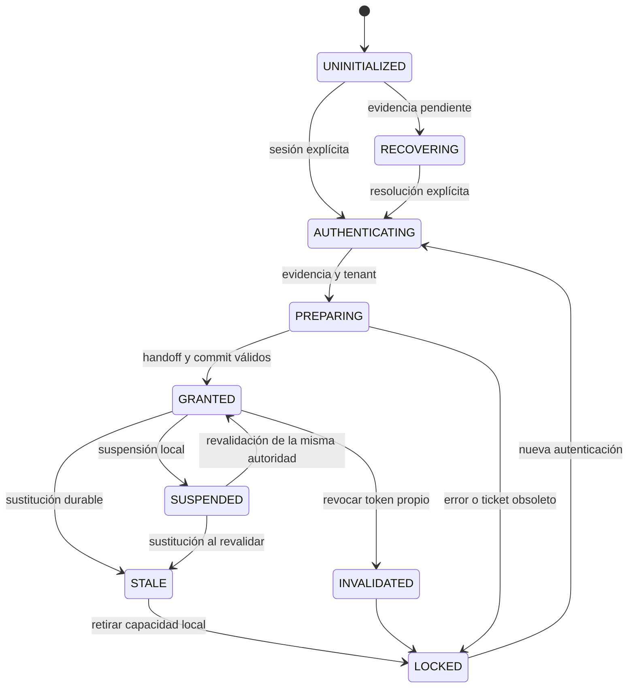
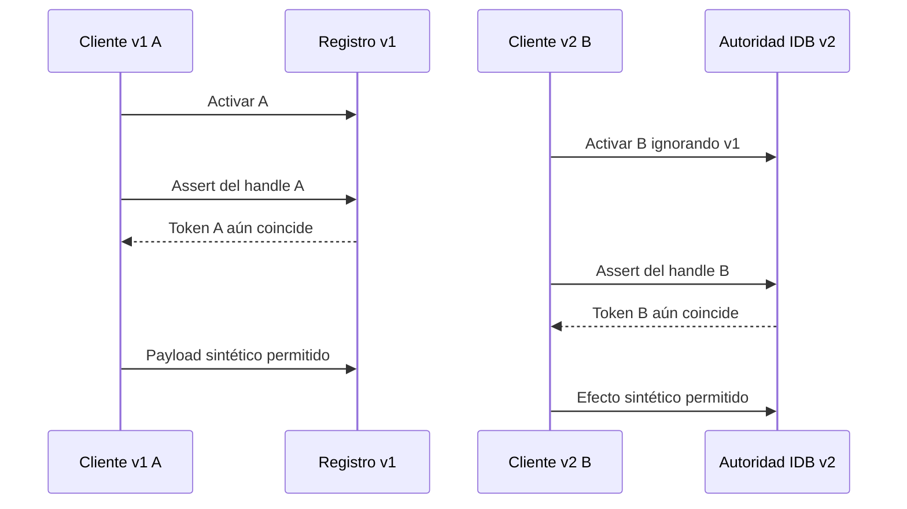

# LANZO POS — FASE 3.2A.2 — ARCHITECTURE RESEARCH

Fecha: **21 de octubre de 2026, America/Mexico_City**. Repositorio: `fdxruli/Lanzo-POS`.

## 1. Decisión ejecutiva

**ARCHITECTURE_DECISION_REQUIRED.** Se recomienda **D: contrato híbrido con autoridad IndexedDB transaccional única, registros por contexto, revocación dirigida y comprobación dentro de la transacción del efecto**. Es **VIABLE CON CONDICIONES entre participantes actualizados**, no una transición legacy certificada. No activar, integrar ni desplegar todavía.

Se recuperaron los checkpoints anteriores, se repitieron EXP-F02-14 y LC13 y se desarrolló un prototipo completamente separado de `src`. En el prototipo una invalidación de A sólo cambia el registro de A; si B ya es propietario, la autoridad de B permanece intacta. Una sustitución válida impide que el handle anterior cruce la frontera transaccional. Operaciones pendientes bloquean handoff y conservan su propietario; un efecto sintético confirmado conserva su identidad e idempotencia.

Se refutaron tres atajos: registros independientes sin elección de propietario; lectura localStorage seguida de escritura; y separar la autoridad nueva ignorando escritores v1. En la última variante, los dos handles permiten escrituras. También se comprobó que **actualizar únicamente el esquema no basta como fence Dexie**: la versión instalada reabrió una DB sintética posterior y permitió escribir.

Resultado final: **71 aserciones Vitest PASS**, de las cuales **cinco son detección de contraejemplos**, no aprobación de sus propiedades de seguridad. Chromium: **29 observaciones, 21 PASS acotados, 7 FAIL de seguridad/arquitectura y 1 PENDING**. No se realizaron ventas, pagos, migraciones ni operaciones de producción. Chrome/Edge físicos, PWA instalada y certificación comercial permanecen pendientes.

## 2. GitHub, recuperación y antecedentes

Main verificado: `f48aab53634663438a06dc5187fa7e6d17b74fb3`, árbol `19f238828452198226159303bb24dfd832a53416`. Rama original recuperada sin modificaciones: `fix/actor-scoped-storage-stale-events-r1`, HEAD D `1cdc1cd029982e0279177ab29be1f8fffacb6ed8`, árbol `38f3efbe011055580f572830330252341177011e`.

| Checkpoint recuperado | SHA | Contenido |
| --- | --- | --- |
| A | `b9e6bb7ac7df0a1ea13325b8c6590e8a525192e6` | Test EXP14 rojo sobre producto main |
| B | `8867fd00f6241cfced326a198e3d32617953c9d3` | Corrección focal de notificaciones |
| C | `de931651532ba4b99338e6f682f885cc9a26d1f8` | Runner y evidencia LC13 |
| D | `1cdc1cd029982e0279177ab29be1f8fffacb6ed8` | Cierre HOLD y documentación |

Hashes, árboles y archivos se recuperaron de GitHub y se contrastaron con Git local. El workspace anterior ya no existía; **el código se recuperó de los commits remotos, no se reconstruyó desde memoria**. El fixture EXP14 permanece identificado como reconstruido en la fase anterior. Se creó un clon limpio, sin stash ni modificaciones ajenas, y un worktree baseline A. Sólo el test EXP14 diferencia `src` de ese baseline respecto a main.

Se leyeron los cinco informes antecedentes completos disponibles y la evidencia C de la rama: auditoría 3.1, implementación 3.2, B-01, F02-only y hardening 3.2A.1. Se preservan sus límites: los resultados históricos no se suman a las nuevas ejecuciones. #365 y #366 ya estaban fusionados en main.

| PR abierto | Estado | HEAD | Base |
| --- | --- | --- | --- |
| #338 | OPEN/Draft | `fef7205f76b173025f503e60d0968f446f741e78` | main |
| #352 | OPEN/Draft | `d758f69b2119f1bc346eb0ac86ba0a74c0265668` | feat/restaurant-split-flexible-payments-r1 |

Rama de investigación: `research/actor-context-invalidation-contract-r1`, basada en D. Las dos configuraciones Vercel desactivan también esta rama, conservando la excepción de la rama original. Se verificó ausencia de despliegues de la original antes de publicar. No se restablecen despliegues.

## 3. Diagnóstico consolidado y niveles de autoridad

**F02-LATE-CONTEXT-01:** el handler original confunde una notificación histórica con evidencia actual. El subscriber bloquea al actor nuevo del mismo tenant. EXP14 reproduce granted/session-b/generation6 → locked/generation7, aunque el registro durable nuevo permanece intacto. El checkpoint focal reconsulta el durable y conserva session-b/generation6; nueva ejecución PASS.

**LC13-LATE-INVALIDATION:** `invalidateActorScopedStorage` retira el binding local y publica incondicionalmente locked sobre la misma clave tenant. Después de activar B, una llamada tardía de A sobrescribe B. Nueva reproducción Chromium: main/main, main/focal y focal/focal FAIL, B no conserva handle válido.

| Elemento | Función real | Lo que no demuestra por sí solo |
| --- | --- | --- |
| Sesión/evidencia Admin/Staff | Elegibilidad de autenticación, límites, device y tenant | Propiedad exclusiva de un documento |
| Actor Runtime | Estado y permisos en memoria, sesión/device/generaciones locales | Exclusión atómica entre documentos |
| Registro v1 por tenant | Correspondencia durable del binding de almacenamiento | Autenticación ni fencing universal de ventas |
| Handle de almacenamiento | Relectura durable antes de sus operaciones | Estado de todas las fronteras financieras |
| BC/StorageEvent | Aviso de posible cambio | Orden global, prueba de cierre o concesión |
| Handoff/checkout/intents/outbox | Propiedad y recuperación comercial específicas | Coordinación automática con un protocolo nuevo |
| Service Worker | Recursos, actualización y recarga coordinada | Sustitución instantánea del JS de todos los documentos |

La prueba nueva `runtime-boundary.test.mjs` usa controller, storage y `runWithActorHandle` **reales**: tras cambiar el registro durable y antes de entregar la notificación, el handle storage rechaza, pero el handle Runtime todavía admite un callback de contador sintético. Esto **refuta una certificación financiera basada sólo en storage**; no demuestra dos ventas, un cobro indebido ni un bypass del servidor.

## 4. Inventario de funciones y efectos

Auditoría de los seis módulos requeridos y búsqueda completa de referencias textuales en `src`, excluyendo tests `*.test.*` y `__tests__`: **197 coincidencias en 67 archivos**, incluyendo comentarios y un harness de `src/test`. El catálogo íntegro con rutas/líneas está en `scripts/qa/actor-context-contract/evidence/consumer-inventory.txt`. Es un inventario estático; no se presenta como cobertura E2E de cada consumidor.

| Función / ejecutor | Contexto poseído y estado modificado | Durable / avisos | Ejecución tardía o cambio extranjero | Fallo de almacenamiento / impacto indirecto |
| --- | --- | --- | --- | --- |
| prepare / bridge de autenticación | Tenant, actorKey y próxima generación; active→null, pending, writes suspendidos | Lee legacy; emite prepared | assertCurrent tras SHA; preparación vieja debe descartarse | Denegación; hidratación no puede atribuir cart ajeno |
| activate / bridge tras grant | Binding preparado coincidente; genera token, active, suspendido | Escribe granted v1; BC; activated | Puede sustituir autoridad de otro documento; generaciones no ordenan documentos | Throw; bridge retira grant; no asumir éxito de publicación |
| readContextRecord / asserts y handler | Tenant explícito; no concede | Lee clave tenant; parse v1 o null | Lectura es una instantánea, no reserva | Null; operación protegida rechaza |
| publishContextRecord / activate e invalidate | Registro proporcionado por caller | setItem v1, después BC best effort | Sobrescribe sin CAS; origen de LC13 | Error acotado; no fallback que conceda |
| handleForeignContext / eventos | Binding local capturado en focal | Relee durable; suspende; foreign_context | Focal ignora hint viejo si coincide durable; nunca publica un grant | Falta/corrupción falla cerrado; no prueba transacción financiera |
| assertActiveContextCurrent / writes y handle | Binding activo, token/actor/generación | Lee durable; puede suspender | Handle sustituido rechaza; lectura no protege un write futuro externo | Throw stale; cart/history no se escribe |
| suspend / logout, handoff, bridge | Flag local de writes | Ninguno | No significa cierre voluntario ni libera propietario | No concede autoridad; puede parar edición |
| resume / bridge | Binding activo ya granted | Assert durable; cambia flag | No puede revivir un binding extranjero | Rechaza; no renovación de sesión |
| invalidate / bridge y tenant cleanup | active o pending actual, sin token esperado del caller | Publica locked v1 y BC; invalidated | Defecto confirmado: A puede destruir durable B | Autoridad local se retira aun si falla publicación |
| capture / consumidor storage | Copia inmutable del binding | Cada assert relee durable | Token/generación/tenant distintos rechazan | Fail-closed; no es un handle financiero |
| lockActorRuntime / auth, logout y licencia | Actor actual del singleton; generación aumenta | Suspende e invoca invalidate | Un caller asíncrono necesita prueba de pertenencia; no basta “actor actual” | Deniega local; puede suspender operaciones y recovery |
| subscriber expiración / controller | Snapshot locked al vencer Admin | Invalida storage con binding anterior disponible | Debe dirigirse al contexto que venció; no a un sucesor | No concede; no limpia ventas/outbox |
| subscriber foreign / bridge | Granted mismo tenant y, en focal, actor/generación/token | Lock sólo local; evita ping-pong durable | Descarta decisión ajena al binding actual | No reautentica; es señal para Runtime |
| tenant namespace set/clear / router y guard | Cambia namespace, ready y suspensión | Invalida actor; no borra payloads | Cleanup tardío exige referencia al contexto anterior | Mantener DB/payload; nunca reasignar identidad |
| open/close runtime / tenant guard | DB física y generación tenant; proxy | Directory/binding IDB, aviso tenant BC/storage | Handles de otro tenant/generación rechazan | Recovery fail-closed; no reconstruir DB ajena |
| restore/grant bridge / Admin y Staff | Autenticación explícita, sesión/device, ticket de generación | Lee sync_cache, checkout; prepara/hidrata/activa | Revalida tras awaits; resultado viejo se descarta | No fallback genérico; no asumir sesión por device_role |
| runTracked / servicios operativos | Handle inmutable; mapa de pending y propiedad checkout | Checkout usa SALES; callback conserva owner | GuardedWrite revalida Runtime; no traslada pending a B | Retiene evidencia; no compensar/reintentar un cobro por cambio de actor |

## 5. Consumidores y fronteras que una implementación deberá integrar

| Grupo | Consumidores representativos | Consecuencia para el contrato |
| --- | --- | --- |
| Login/logout/licencia | licenseAdminActions, StaffActions, ProcessingActions, BootstrapActions, BackgroundValidationActions | Capturar origen antes de awaits; invalidación local inmediata y durable dirigida; respetar clasificación transporte y 168h |
| Hidratación/edición | useActiveOrders, tenantScopedZustandStorage, ai/salesProfitabilityHistory | Reads de preparación sin writes; conservar namespaces y legacy sin auto-claim |
| Tenant y DB | localTenantGuard/Policy, tenantRuntimeRouter, databaseRuntime, workerContext | Mismo tenant y DB física; no usar una DB de coordinación separada como si fuera atómica con la comercial |
| Venta/caja/crédito | processSaleCore, db/sales, cashFinancialGate, customerCreditRepository, layaways | Revisar fence dentro del commit local; no limitarse al assert antes/después del await |
| Intents/recovery | financialIntentLedger, RecoveryCoordinator, ReceiptReconciliation, ProjectionRepair | Conservar receipt/lease/owner; un resultado ya confirmado no se deshace por perder autoridad |
| Nube/restaurante | salesCloudCashierService, restaurantOrderCheckoutClose, splitDraft, salesService | RPC en vuelo y settlement son otra frontera; no transferir ni duplicar operación |
| Outbox/sync | syncOutboxService, actorPermission, licenseSyncActions | OriginActor inmutable; idempotencia no reescribe origen; recovery no puede reclamar filas ajenas |
| UI/PWA/diagnóstico | App/Layout, ErrorBoundary, startup recovery, modal, messages, useActorRuntimeSnapshot | Observar estado, no conceder; no forzar reload para fingir desaparición de clientes |
| Inventario/IA/configuración | productInventoryAuthority, useSettingsAccess, SetupModal, profile, aiAgentAuthorization | Permisos siguen en Runtime; protocolo de storage no crea wildcard ni acceso Staff offline |

Revisión comercial relevante: `processSaleCore` hace asserts antes/después de `executeSaleTransactionSafe`; `db/sales` contiene venta+deltas/outbox+proyección en una transacción. El ledger tiene sus propias transacciones/leases e idempotencia. Son garantías existentes útiles, **no** un fence interdocumento v2 ya instalado.

## 6. Modelo analítico de estados

Estos estados **no se agregan al producto**. GRANTED/LOCKED/AUTHENTICATING se relacionan con Runtime; los demás explican almacenamiento y lifecycle.



| Estado / entrada | Evidencia y titular | Permitido / prohibido | Durable afectado y reacción de pares | Ante fallo |
| --- | --- | --- | --- | --- |
| UNINITIALIZED / nuevo documento | No hay handle local; durable puede existir | Inspección; no operar ni restaurar GRANTED desde un registro | Ninguno; no se libera al propietario existente | Mantener sin autoridad |
| AUTHENTICATING / sesión explícita | Ticket local, tenant, actor/session/device verificados por contratos existentes | Validar; no writes comerciales | No conceder por BC ni por timestamp | LOCKED; descartar respuesta vieja |
| PREPARING / handoff | Ticket vigente, stores hidratados en suspensión, pending inspeccionado | Reads del namespace propio; no escribir/resetear payload anterior | Preparación no reclama registros legacy | Abort, conservar datos |
| GRANTED / commit propietario | Binding exacto durable + Runtime actual + permisos/plazo | Writes que cruzan fence; no delegar a otro actor | Propietario único dentro del dominio coordinado | Rechazar si falta cualquier prueba |
| SUSPENDED / no operable temporalmente | Mismo handle, sin inferir logout | Revalidación; no writes hasta superar guardas | No cambia ownership por hidden/freeze | STALE/LOCKED si fue sustituido |
| STALE / durable ya diferente | Handle anterior, sin propiedad vigente | Diagnóstico; no reanudar/renovar por evento | No escribir locked sobre sucesor | Retirada local; no auto-grant |
| LOCKED / fallo/expiración | Sin capacidad operativa local | Login/recuperación explícitos; no finalizar como actor nuevo | No borrar intents/outbox ni registros ajenos | Permanecer cerrado |
| INVALIDATED / revocación propia | Token capturado exacto | Retirar local y revocar sólo ese contexto | Quitar owner sólo si sigue siendo ese token | Local retirado; durable incierto no autoriza |
| RECOVERING / pending/receipts | Propietario original, idempotencyKey y estado durable | Reconciliar según contrato; no atribuir al usuario recién autenticado | Pending no desaparece por cerrar la pestaña | No declarar “no cobrado” por un timeout |

## 7. Invariantes y cobertura

| Invariante | Prototipo / evidencia | Límite de certificación |
| --- | --- | --- |
| INV-01 no resurrection | Tokens retirados/handles locales obsoletos rechazan; hints nunca grant | Restauración comercial completa pendiente |
| INV-02 no stale revocation | Target A no cambia owner B en la misma transacción | v1 sigue violándola |
| INV-03 replacement | CAS esperado elige un ganador; commit lee owner | Mixed main/prototipo FAIL |
| INV-04 tenant | Claves compuestas y handles emitidos al cliente; cambio descarta ticket | No sustituye el guard físico tenant del producto |
| INV-05 actor | Binding inmutable; otro actor no hereda pending | Permisos/autenticación son modelos de fixture |
| INV-06 device | Cambio de device invalida handle/ticket | Registro/canonical device real no ejecutado |
| INV-07 financial owner | Pending bloquea handoff; efecto sintético conserva owner | No certifica POS, RPC ni todas las transacciones comerciales |
| INV-08 no implicit grant | Sólo grant explícito; hints revalidan | authorized=true del fixture NO es prueba de sesión real |
| INV-09 fail closed | Corrupción, proveedor no disponible y abort rechazan | Evicción, quota y política real del navegador pendientes |
| INV-10 offline | Protocolo local sin red ni reloj de lease | Se mantiene la política real Admin/Staff; no se reemplaza con el fixture |
| INV-11 legacy | Contraejemplos ARCH05/06/07 y writer sin fence | **FAIL** como garantía universal |
| INV-12 generaciones | A/B pueden tener generación local 1; se usa token esperado | revision IDB es orden transaccional propio, no comparación de generaciones locales |
| INV-13 durable | Head/contextos/efecto se actualizan atómicamente en un dominio | LocalStorage y DB distintas no comparten transacción |
| INV-14 lifecycle | Freeze no libera; reload no restaura handle | SO/BFCache/descarte/PWA físicos pendientes |
| INV-15 no destructive recovery | No deleteDatabase, limpieza ni cierre de caja | GC y recuperación comercial aún sin implementar |

## 8. Arquitectura recomendada D: una autoridad, varias vistas

| Pieza | Fuente y propietario | Contrato |
| --- | --- | --- |
| Autoridad compartida | Una fila por tenant en IndexedDB | protocol, status, binding exacto y revision generada en esa misma transacción |
| Contexto individual | Clave tenant+contextToken | Actor/session/device/generación local y estado propio; no bearer tokens |
| Revocación | Referencia inmutable emitida al contexto | Revoca sólo ese token; limpia el owner sólo si aún coincide dentro de la transacción |
| Operaciones | Clave tenant+operationId y origen inmutable | Pending bloquea handoff; no se reasigna al nuevo actor |
| Efecto local | Misma DB/transacción que autoridad y operación | Fence antes de escribir, idempotencia y commit conjunto |
| Runtime local | Controller existente y ticket vigente | Permisos, identidad, plazo y generación; condición adicional necesaria |
| Notificaciones | BC y storage hints | Sólo provocan lectura; no son otra autoridad ni reconocen ausencia |
| Restauración | Sesión/evidencia existente + handoff explícito | Nuevo documento no obtiene handle por encontrar durable granted |

La implementación futura debería alojar el fence local **en la DB física del tenant**, participando en las transacciones de las tablas afectadas. El prototipo comparte una DB sintética para demostrar ese dominio. Una DB coordinadora separada de la DB de ventas no hace atómico el intervalo entre validar y escribir.

El propietario esperado se captura al iniciar una autenticación válida. La transacción grant exige que siga coincidiendo; si cambió, devuelve conflicto, no reintenta ciegamente hasta ganar. Dos grants con el mismo predecesor no pueden ambos sustituirlo. La revision IDB sirve de orden del coordinador; no convierte generaciones locales en reloj global ni usa updatedAt.

## 9. Puntos de linealización y contratos propuestos

**Grant:** tras validación real de sesión/device/tenant y revisión de pending, transacción readwrite sobre authority+contexts+operations; comprobar expectedToken, ticket y formato; sustituir head y contextos juntos; esperar complete; revalidar generación local antes de exponer handle/Runtime granted. Si la finalización local ya es obsoleta, retirar sólo el token de ese intento; nunca invalidar al sucesor. El prototipo comprueba el ticket antes, dentro y al completar; no es integración del bridge comercial.

**Invalidate:** suspender local inmediatamente si el handle capturado todavía pertenece al estado actual; abrir transacción; marcar ese contexto revoked; si head sigue teniendo exactamente ese binding, cambiarlo a locked; si pertenece a B, no tocarlo. Un evento/cleanup de A no elige “lo que esté activo ahora”. La incapacidad de persistir nunca permite que A opere; tampoco autoriza una reparación que sobrescriba B.

**Commit local:** dentro de una misma transacción de autoridad+contextos+operación+tablas del efecto, comprobar head, Runtime, identidad e idempotencia; escribir efecto y estado conjuntamente. No esperar RPC, timers ni interacción del usuario dentro de la transacción IndexedDB. Validar fuera y luego escribir en otra transacción sólo reduce la ventana: no es el contrato recomendado.

**Integración API futura:** mantener `assertCurrent()` síncrono para checks locales no lo convierte en prueba interdocumento. Introducir una frontera asíncrona/transaccional explícita para efectos protegidos. Auditar mocks y callers, suscribir expiración con el token que realmente expiró y dar a logout/cleanup referencias capturadas antes de awaits. La activación actual del bridge/controller requiere diseño de orden y rollback dirigido; no se modifica ahora.

```mermaid
sequenceDiagram
  participant A as Contexto A
  participant C as Coordinador IDB
  participant B as Contexto B
  participant E as Efecto local
  A->>C: Capturar binding A
  B->>C: Grant esperado A, sin pending
  C->>C: Sustituir A por B en readwrite
  C-->>B: Commit B
  A->>C: Revocar token A
  C->>C: A revoked; head B intacto
  A->>C: Intentar commit con A
  C-->>A: STALE, sin efecto
  B->>C: Operación con binding B
  C->>E: Fence y efecto en misma transacción
  C-->>B: Commit e identidad original
```

Este diagrama describe participantes actualizados. Un writer que no cruza C no queda excluido por dibujarlo fuera de la secuencia.

## 10. Alternativas A–E

| Alternativa | Resultado técnico | Dictamen |
| --- | --- | --- |
| A: registros individuales | A puede revocarse sin escribir sobre B. Falta elegir propietario; dos registros granted permiten dos handles | **INSUFICIENTE sola**; componente útil de D |
| B: IndexedDB transaccional | Head condicional atómico entre participantes; abort conjunto. Necesita fencing del efecto y vinculación Runtime | **VIABLE CON CONDICIONES**; legacy no participa automáticamente |
| C: revocación dirigida | Identifica inequívocamente qué se retira. Sin owner/fence no demuestra retirada de A cuando llega B | **INSUFICIENTE sola**; componente obligatorio de D |
| D: híbrido con autoridad única | B+A+C, hints, Runtime y fence de efecto. Prototipo positivo; no dos autoridades paralelas | **RECOMENDADA, VIABLE CON CONDICIONES**; transición y finanzas pendientes |
| E: mitigar v1 | Releer durable resuelve evento antiguo; check previo reduce invalidación obsoleta secuencial | **INSUFICIENTE como solución definitiva**; R1 refuta atomicidad y legacy sin actualizar persiste |

Se rechazan como garantías: timestamps/TTL, generaciones locales comparadas globalmente, Web Locks sólo nuevos, record-per-context sin head, aceptar silencio como ausencia y upgrade de esquema como único fence. No se rechaza mejorar v1 de forma acotada si el propietario acepta expresamente el riesgo residual; no equivale a cerrar LC13.

## 11. Matriz comparativa

| Criterio | A | B | C | D recomendado | E |
| --- | --- | --- | --- | --- | --- |
| Tenant | Separación de claves; falta coordinación | Validar key/binding en TX | Validar target | Key/binding/DB física + Runtime | Conserva namespace, no atomicidad |
| Revocación dirigida | Sí sobre registro propio | Sí con token condicional | Sí, su objetivo | Sí, contexto y head juntos | Best effort con lectura previa |
| Concurrencia | No elige owner | TX readwrite solapadas | No por sí sola | TX de owner y efecto | No CAS en Web Storage |
| Legacy | No lo retira | No participa | Ignora target nuevo | **No certificada** | Antiguo sigue escribiendo |
| Offline | Local | Local | Local | Local; evidencia Admin existente | Local, mismos defectos |
| HTTP/LAN | Sin lock nuevo; validar APIs | IDB probado en origen IP sintético | Sin reloj/lock nuevo | PASS laboratorio; app/LAN físico pendiente | Mantiene requisitos previos |
| Chrome/Edge | Pendiente físico | Chromium laboratorio | Pendiente físico | Chromium 143; físico pendiente | Baseline observado |
| Android/PWA | Pendiente | Pendiente | Pendiente | PENDING instalado, quota/lifecycle | Defecto v1 permanece |
| Integridad financiera | Insuficiente | Si efecto comparte TX; integración pendiente | Insuficiente | Fence y owner inmutable; E2E pendiente | No mejora exclusión de efectos |
| Complejidad | Media | Media/alta | Media | Alta pero contrato explícito | Baja, garantía limitada |
| Migración local | Probable | Nuevo store/versionado | Depende del almacenamiento | Sí, si se adopta; hoy sólo DB de fixture | No necesariamente |
| Migración Supabase | No para records | No para coordinación local | No para target local | No en prototipo; posible fence servidor separado | No |
| Rollback | Revisar registros nuevos | No bajar esquema | No revivir target | Forward-compatible, no volver a writer v1 a ciegas | Fácil código; defectos reaparecen |
| Despliegue gradual | No garantiza adopción | No garantiza adopción | No garantiza adopción | Sólo con precondición/enforcement demostrado | Mitigación, no certificación |
| Mantenimiento | Orphans/GC | Schema/blocked/TX | Capabilities y lineage | Auditoría de todos los efectos + transición | Menos código, carreras abiertas |
| Evidencia | Contraejemplo unitario | Prototipo/TX/abort | Prototipo de target | Tests positivos + mixed FAIL | EXP14 PASS focal, R1/LC13 FAIL |

## 12. Carreras R1–R8

| Carrera | Scheduling y evidencia | Conclusión |
| --- | --- | --- |
| R1 A lee, B concede, A invalida | Unitario conserva lectura A anterior, concede B y revoca A; Chromium ARCH04/24 | Target en TX conserva B. Modelo read→set v1 termina locked-A: FAIL |
| R2 logout A y grant B | Promesas simultáneas con orden de creación invertido; browser ensaya ambos órdenes serializados por barreras | Si A primero, B sustituye locked A; si B primero, revoke A no toca B |
| R3 hint viejo y publicación posterior | ARCH23 hints duplicados/desordenados; ARCH24 A revoca después de B | Hints no escriben autoridad; target inmutable evita ping-pong |
| R4 acceso perdido | Proveedor inyectado inaccesible; ARCH13, sin efecto permitido | Fail-closed probado en fixture; política/quota reales pendientes |
| R5 tenant durante validación | Hook síncrono después de lecturas TX cambia tenant; TX aborta. ARCH14 retira handles por cambio | Sin publicación parcial ni write bajo tenant nuevo por ticket viejo |
| R6 RPC tardía | Ticket de autenticación viejo se entrega después de preparar generación nueva | AUTH_STALE; prueba de scheduling, no una RPC real de Supabase |
| R7 v1 y v2 | ARCH05/06/07; writer sintético que omite autoridad; ensayo Dexie | **FAIL convivencia**; nuevo namespace o nueva TX no imponen contrato al antiguo |
| R8 grants y revoke próximos | Dos conexiones unitarias, ARCH09 dos grants; EXTRA-R8 tres documentos con revoke y dos grants | Exactamente un owner participante; ningún handle A recupera autoridad |

Las barreras se sitúan fuera de la transacción o como hook síncrono; no se mantiene una transacción abierta esperando una RPC. La atomicidad propuesta se deriva del scope readwrite del contrato IDB y del código, no de repetir cien veces un scheduling favorable.

## 13. Convivencia y transiciones

| Transición | Qué mejora | Contraejemplo / requisito restante | Dictamen |
| --- | --- | --- | --- |
| 1 preparatoria progresiva | Añadir protocolo/fence a versiones que sí se actualicen, sin activarlo todavía | Una pestaña v1 offline/frozen puede saltarse la preparatoria. ACK/porcentaje/tiempo no prueban cobertura | Útil preparación, **no prueba de retirada legacy** |
| 2 nuevo almacén autoritativo | v1 ya no puede escribir físicamente el head v2 | ARCH05/06: v1 conserva handle y escribe; aceptar o ignorar sus avisos no instala fence en sus efectos | Sólo viable con enforcement adicional demostrado |
| 3 actualización coordinada | Drenar/confirmar operaciones y adoptar versión verificada en alcance gestionado | SW waiting/claim no reemplaza código en memoria; lista de clientes/timeout no prueba ausencia universal | Investigar precondición verificable; no ejecutada ni aprobada |
| 4 capacidades restringidas | Nuevo modo no concede writes mientras su admisión sea ambigua; conserva datos y permite diagnóstico/lectura autorizada | No anunciar B como granted operativo si no puede retirar A. Una falta de mensajes no levanta la restricción | Contención acotada posible para nuevos participantes; UX/condiciones requieren decisión |

No se cierra ninguna pestaña, fuerza logout, borra caché, libera dispositivo ni recarga durante un pago. No se espera un plazo arbitrario como prueba. Un writer v1 puede seguir ejecutando su función fija sobre la clave v1 al despertar.

## 14. Respuesta a la garantía universal

**No podemos garantizar simultáneamente todos los invariantes con el contrato actual y los escritores v1 no coordinados.** Hay una distinción esencial:

1. **Proteger físicamente el head nuevo:** sí es posible separar el almacenamiento; una función antigua que escribe una clave v1 fija no escribe esa fila IDB nueva.
2. **Retirar además toda capacidad del cliente anterior:** esa separación no la proporciona. ARCH05/06 permiten escribir en ambas fronteras; ARCH07 conserva al antiguo después de freeze/thaw. El counterexample de efecto sin fence muestra el mismo límite en IndexedDB.

Si v1 sigue siendo requisito autoritativo de B, LC13 bloquea injustificadamente B. Si se ignora v1 sin otro enforcement, no se demuestra retirada de A. La propiedad faltante es un punto de admisión/commit que **todos los escritores relevantes estén obligados a cruzar**, con identidad de propietario y sustitución condicional. Esperar/adopción/no respuesta no crea ese punto.



El diagrama resume ARCH05: dos fronteras de escritura válidas, sin una venta real ni garantía de exclusividad financiera.

Esto no es una imposibilidad absoluta de mejorar Lanzo ni una prueba de imposibilidad de cualquier mecanismo futuro. Se refutan las alternativas concretas evaluadas y se mantiene pendiente un enforcement completo sobre los clientes históricos. Un preflight/guard real podría aportar condiciones adicionales que deben demostrarse en todos los caminos, incluidas operaciones en vuelo y offline.

## 15. Upgrade de esquema como fence: resultado específico

Se inspeccionaron `databaseSchema.js` (versión canónica nativa actual 330), preflight y router. El preflight de main rechaza una versión superior como unsupported_newer. Eso es relevante, pero no se extrapola a todo documento ya abierto ni a todas las rutas de reapertura.

La dependencia instalada desde el lockfile es **Dexie 4.4.3**. Su código, ante VersionError al abrir una versión explícita, reintenta sin versión. En el ensayo real, A declara esquema 1, B amplía a 2, el handler default cierra A; luego `old.open()` vuelve a abrir y escribe en el store existente. Dos filas sintéticas permanecen, incluida `after-upgrade`. `EXTRA-IDB-UPGRADE-FENCE = FAIL` para la propiedad “upgrade por sí solo impide todo writer anterior”.

No se probó que ese camino atraviese todos los guards de Lanzo; **no se presenta como venta legacy confirmada**. Para aceptar un fence por versión habrá que demostrar preflight, auto-open, tablas capturadas, middleware, router, workers y RPC en vuelo. No se usa borrado/renombrado de DB ni un upgrade real del usuario como experimento.

## 16. Matriz ARCH-01..25

Para protocolos legacy, Runtime comercial = **NOT_LOADED_storage_only**. Para v2, Runtime = **modelo sintético**. En los casos pertinentes se ejecuta una escritura real de la frontera del handle: payload sintético v1 o una operación/efecto sintético IDB v2. **Nunca se ejecuta una venta POS.** `initial`, snapshots intermedios, `finalBeforeWriteProbe`, `writes` y `final` del JSON conservan registros antes/después, identidad del owner y errores de cada handle. El inicio del caso es un perfil vacío; cada procedimiento describe la concesión inicial que realiza.

| ARCH | Versiones / autoridad inicial del procedimiento | Operación y resultado esperado | Observado / estado | Límite |
| --- | --- | --- | --- | --- |
| 01 | main/main, A granted | B sustituye A; invalidate A no debe retirar B | **FAIL**: locked v1 y ambos probes finales rechazados | Storage real; Runtime comercial no cargado |
| 02 | main/focal, A granted | Igual LC13 | **FAIL**, B pierde durable y handle | No se suaviza por ser preexistente |
| 03 | focal/focal, A granted | Igual LC13 | **FAIL**, arreglo de hints no corrige publicación | No candidata aprobada |
| 04 | v2/v2, A owner | B adquiere con expected A; A revoca propio | **PASS**: A denegado, B current y write permitido | Sólo participantes del modelo |
| 05 | main/v2, A v1 owner | Sustitución debe retirar A | **FAIL**: A y B current; writes=true/true | Contraejemplo de separar e ignorar v1 |
| 06 | v2/main, A v2 owner | Nueva autoridad B debe retirar A | **FAIL**: ambos current y writes=true/true | No coordinación inversa automática |
| 07 | main/v2, A granted y frozen | B adquiere, A despierta sin conservar autoridad sustituida | **FAIL**: ambos permiten writes después de CDP thaw | Freeze real, no suspensión física Windows |
| 08 | main/v2, B v2 frozen | A invalida v1; B revalida al despertar | **PASS acotado**: B intacto, A invalidado | No prueba exclusión ante nueva autenticación legacy |
| 09 | v2/v2, sin owner inicial | Dos grants mismo expected null | **PASS**: uno granted, otro conflicto, una frontera permite escribir | Concurrencia real con dos conexiones/documentos |
| 10 | v2, A owner | Dos revocaciones concurrentes de A | **PASS**: locked, handle y writes denegados | Idempotencia de revocación, no de pago real |
| 11 | v2/v2, A owner | Grant B/logout A; ambos órdenes definidos | **PASS**, dos observaciones; A no opera y B sí | Barreras seriales browser + promesas solapadas unitarias |
| 12 | v2, A owner | Corromper authority y comprobar cierre | **PASS**: handle/writes rechazados | Corrupción inyectada, sin reparar ni otorgar |
| 13 | v2, A owner | Proveedor de almacenamiento falla | **PASS**: acceso/write rechazados | Inyección controlada, no quota/policy real |
| 14 | v2, A tenant T | Cambiar a U durante validación y retirar handle T | **PASS** modelo; unitario aborta después de lecturas TX | No cambiar datos ni tenant de un negocio |
| 15 | v2, device A | Cambiar device sintético | **PASS**: handle anterior rechazado; nueva auth explícita en unitario | Registro real de dispositivo no probado |
| 16 | v2, AUTHENTICATING | Capturar durante handoff incompleto | **PASS**: sin handle/write | No handoff de tienda real |
| 17 | v2/v2, pending propiedad A | B intenta sustituir A | **PASS**: HANDOFF_PENDING, origen conservado, B no escribe | Efectos sintéticos; recuperación de pending no implementada |
| 18 | v2, A granted | Destruir JS y restaurar documento sin auto-grant | **PASS sólo reload**: sin handles, durable conservado | **PENDING descarte/BFCache/OS real**; reload no equivale a discard |
| 19 | PWA instalada y pestaña | Mismo contrato, lifecycle instalado | **PENDING** | No dispositivo/PWA instalada disponible |
| 20 | v2/v2, sin BC | Sustituir y revalidar antes de write | **PASS**; A rechaza, B escribe | Storage hints aún pueden existir; seguridad no depende del mensaje |
| 21 | v2/v2, HTTP IP | Operar sin Web Locks/secure context | **PASS laboratorio**: secure=false, IDB=true, locks=false, subtle=false | Origen IP interceptado; **LAN y app reales PENDING** |
| 22 | v2/v2, HTTPS | Mismo contrato en TLS | **PASS laboratorio**, secure=true | TLS local, certificado de fixture aceptado; no cadena pública ni Vercel |
| 23 | v2/v2, B owner | Hints viejos duplicados y fuera de orden | **PASS**: B current, no revocación ni grant implícito | Orden de hints controlado, no reloj global |
| 24 | v2/v2, A→B | Escritura B seguida de invalidate viejo A | **PASS**: head B conserva identidad; A no escribe | Misma TX domain; no legacy |
| 25 | v2, A owner | Revocación vigente verdadera | **PASS**: A pierde handle y write | No basta ignorar foreign_context |

Observaciones adicionales: **EXTRA-R8-GRANT-REVOKE PASS** (tres documentos, revocación y dos grants), **EXTRA-NATIVE-ABORT PASS** (rollback de head/contexto y efecto, pending preservado) y **EXTRA-IDB-UPGRADE-FENCE FAIL** (Dexie reabre y escribe). Así se obtienen 29 observaciones, no 29 casos ARCH diferentes ni 29 éxitos.

## 17. Pruebas, versiones y reproducción

| Grupo | Resultado nuevo |
| --- | --- |
| Baseline A, único test EXP14 agregado a src main | **1 FAIL**, salida íntegra preservada |
| Controller existente | 20 PASS |
| Bridge existente | 10 PASS |
| Operational handoff existente | 5 PASS |
| Actor scoped storage existente | 10 PASS |
| Integración EXP14 recuperada sobre focal D | 1 PASS |
| Propiedades positivas del prototipo | 20 PASS |
| Contraejemplos unitarios de arquitectura | 4 detectados; aserciones PASS, propiedades inseguras FAIL |
| Counterexample con Runtime real y callback sintético | 1 detectado; aserción PASS, no prueba financiera integral |
| Total final Vitest | **7 archivos, 71 aserciones PASS únicas** |
| Chromium | **143.0.7499.0**, 21 PASS acotados / 7 FAIL / 1 PENDING |
| ESLint scripts y git diff --check | PASS |
| Diff de src, package.json y lockfile respecto a D | Vacío |

No se suman ensayos previos ni se ocultan contraejemplos como aprobaciones. El runner final distingue errores del harness, violaciones esperadas y fallos inesperados de propiedades positivas. Exit 0 del runner de investigación significa reproducción coherente de la evidencia, **no** cierre de las siete propiedades FAIL. La reproducción C anterior sigue devolviendo exit 1 por LC13.

El test de Runtime real usa una instancia creada por la factory real, almacenamiento real de jsdom y un contador; no carga el bridge ni la DB financiera. Su objetivo es evaluar el intervalo anterior a la notificación. Los tests del prototipo usan `authorized=true` como fixture, no evidencia criptográfica ni autorización del producto. R6 retrasa la entrega de un ticket sintético; no se llamó verify_admin_session.

Código en `scripts/qa/actor-context-contract/`; instrucciones completas en README. Comando principal:

```sh
npx vitest run scripts/qa/actor-context-contract/*.test.mjs src/services/auth/__tests__/actorRuntimeController.test.js src/services/auth/__tests__/actorSessionRuntimeBridge.test.js src/services/auth/__tests__/actorOperationalHandoff.test.js src/services/auth/__tests__/actorLateContext.integration.test.js src/services/auth/__tests__/actorScopedStorage.test.js --maxWorkers=2
```

Chromium usa Playwright y binario externos al producto. Se conservan JSON/logs completos en `evidence/`: chromium, Vitest, baseline EXP14, reproducción C, inventario y lint. Un arranque inicial del nuevo runner no pudo enumerar NIC por restricción del host; se añadió un fallback explícitamente etiquetado a origen IP sintético. La ejecución final no tiene errores de harness. No se interpreta ese incidente de tooling como fallo del POS.

## 18. Impacto financiero y recuperación

| Situación | Contrato que debe conservarse / requisito futuro |
| --- | --- |
| Caja abierta | Ownership/cash station existentes; cambiar contexto no cierra caja ni mueve sus movimientos |
| Venta en preparación | Draft del actor; no se atribuye al recién autenticado; handoff pendiente explícito |
| Venta local confirmada | Commit durable conserva originActor e idempotencia; una revocación posterior no la borra ni la cobra otra vez |
| Pago en proceso | Persistir operación/intent antes de dispatch; bloquear sustitución mientras el resultado sea ambiguo |
| Abono | Mantener cliente, caja, actor y clave de operación originales; fence en la transacción que produce ledger/movimiento |
| Fiado | No recrear deuda ni reasignar origen por un retry con B |
| Split/restaurante | Preservar versión esperada y settlement/idempotencia del padre; storage v2 no sustituye el lock/contrato servidor |
| Outbox pendiente | OriginActor y tenant inmutables; no eliminar/recrear fila para poner actor B |
| Retry cloud | Consultar receipt/resultado autoritativo; timeout no significa “no cobrado”; conservar misma clave de intento |
| Cambio de actor | Pending A permanece A; B no hereda callback, permisos ni generación |
| Cambio de tenant | Ningún callback capturado T escribe en U; captura y validación dentro del efecto |
| Update PWA esperando | No saltar barrera de operaciones pendientes ni forzar reload para habilitar v2 |
| Resultado confirmado tardío | Registrar/reconciliar evidencia del intento A con su origen; no convertirlo en ejecución nueva de B |

El prototipo demuestra sólo un ledger sintético de operaciones y efectos. Si A comienza pending, B no consigue handoff; si A se invalida, pending no desaparece. La recuperación de ese pending tras crash es **una obligación comercial pendiente**, no un cleanup automático. El prototipo puede quedar bloqueado a propósito hasta resolverlo; no es una experiencia de recuperación terminada.

No se certificaron dos ventas simultáneas, cajas, pagos reales, crédito, split ni settlement cloud. El contraejemplo del callback real identifica que debe integrarse el fence en las fronteras efectivas, no que se haya producido duplicación comercial. Idempotencia y propiedad de actor son garantías diferentes: deduplicar una clave no concede a B el derecho de finalizar el intento de A.

## 19. Offline, HTTP/LAN, Windows y Android

La coordinación propuesta es local y no necesita Supabase disponible. La autorización sigue subordinada al evaluador real: Admin hasta su límite efectivo existente de 168h/sesión/licencia/evidencia; Staff conserva autorización online. El prototipo no calcula ni renueva esos plazos. Ningún hint, resume ni contexto durable amplía la elegibilidad.

El prototipo usa IDB y generación aleatoria disponible en el laboratorio, sin Web Locks ni SW como puerta de entrada. HTTP IP sintético funcionó aun sin locks/subtle; eso **no certifica** la autenticación de Lanzo en HTTP/LAN, que conserva sus requisitos criptográficos previos. No se configuró túnel, IP del propietario ni origen nuevo para sus datos/dispositivos.

Chrome y Edge físicos en Windows, Android con PWA instalada, suspensión/hibernación, BFCache, descarte y presión de almacenamiento están PENDING. Chromium headless Linux y CDP freeze/thaw son evidencia útil de protocolo, no una prueba de esos equipos. HTTPS local utilizó un certificado exclusivamente de fixture aceptado por el harness; no valida confianza TLS pública.

## 20. Lifecycle, errores, huérfanos y límites de almacenamiento

- Hidden/freeze no revoca por sí mismo. Al despertar, el handle debe comprobar el propietario durable antes de operar. El silencio de mensajes no libera un owner.
- Un documento nuevo empieza sin handle aunque exista granted durable; recuperación exige pruebas reales de sesión/device/tenant, handoff y un ticket nuevo. Reload no es un permiso heredado.
- IDB bloqueado, inaccesible, corrupto o con upgrade pendiente no tiene fallback a un localStorage de permisos. Mostrar diagnóstico y conservar datos; no borrar ni bajar esquema.
- El prototipo usa transacciones con durabilidad predeterminada: su evidencia es de atomicidad/commit lógico, no de resistencia universal ante corte eléctrico o evicción. Esto requiere QA y política de persistencia aparte; no se inventa un respaldo.
- Los registros por contexto necesitan retención/GC. Nunca retirar owner activo, pending ni evidencia de resultado ambiguo por TTL. Un registro huérfano no concede; borrarlo no puede hacer reutilizable un token antiguo. GC seguro y prevención durable de reutilización quedan sin implementar y requieren diseño explícito.
- Un crash durante una transacción abortada no publica head/efecto parcial. Un crash después de un commit puede perder la respuesta; recuperación debe consultar durable/idempotencia, no repetir ciegamente.
- No hay transacción única entre IDB, localStorage y Supabase. Una RPC en vuelo requiere contrato de resultado/receipt y posiblemente fence del servidor; un check local posterior no deshace su commit.

## 21. PWA y estrategia de actualización

Se revisaron adminServiceWorker, worker y upgrade/recovery guards. La espera de actualización y el reload guard actual deben permanecer. Activar un worker o reclamar clientes no sustituye atómicamente el JS que éstos ya ejecutan. La enumeración puntual de clientes no acredita la ausencia de documentos restaurables ni evita una apertura concurrente.

Un procedimiento de transición debe definir: versión/capacidades efectivamente ejecutadas, admisión de supervivientes, pending/receipts drenados o retenidos, tratamiento de workers y documentos no controlados, recuperación offline y estado de la DB. No basarlo sólo en “cerrar pestañas” o un contador de ACK. Sin precondición verificable o enforcement de todos los writers, v2 debe continuar sin activar.

No se cambió el arbitraje de pestañas de main, no se introdujeron Web Locks y no se implementó F-01. La autoridad por tenant del prototipo tampoco autoriza abrir dos POS ni sustituye las restricciones actuales de arranque. F-02 visual permanece separado.

## 22. Alternativa con soporte de servidor, sólo documental

No se determinó que haga falta SQL para el contrato local. Si se investiga fencing cloud, deberá tratarse como alcance separado:

| Aspecto requerido | Evaluación |
| --- | --- |
| Contrato | Capability/fence emitido y verificado por servidor, ligado a tenant, sesión, device, owner e intento; no confiar sólo en una versión declarada por cliente |
| Necesidad | Sólo si se requiere excluir dispatch legacy/remoto; IDB no puede condicionar un commit remoto que no lo consulta |
| Offline | No puede retirar universalmente la facultad Local de un v1 offline que no participa; no prometer mantener todas las garantías con conexión obligatoria encubierta |
| Free/PRO | Nube puede validar RPC; Local necesita fence local efectivo. No degradar Free a requerir red permanente |
| Legacy | Auditar todos los endpoints antiguos, credenciales aún válidas y operaciones ya en vuelo; un parámetro opcional no es enforcement |
| Riesgos | Particiones, receipts ambiguos, bloqueo de cliente válido y carrera entre sustitución e intento ya admitido |
| Migraciones hipotéticas | Registro de capability/fence y comprobaciones transaccionales en los contratos afectados, si se justifica; no se creó SQL aplicable |
| Recuperación/rollback | Preservar intentos y receipts originales, transición explícita; no revivir capacidades retiradas al volver a una versión anterior |
| Costos | Lecturas/escrituras y validaciones adicionales por admisión/efecto, latencia y mantenimiento; sin estimar precios ni carga no medida |

No se consultaron filas de negocio ni se modificó Supabase en esta mini-fase. Se revisaron contratos cliente y fuentes del repositorio; la ausencia de literales v2 en las migraciones no se presenta como auditoría completa de todos los endpoints de producción.

## 23. Compatibilidad con #338 y #352

Se compararon nombres de archivos con sus heads exactos, sin merge/rebase ni modificación de los PR. #338 solapa con controller, bridge, handoff, sales transaction, checkout, cloud cashier, restaurante y workflows; #352 añade autoridad de mesa/supervisión Staff, contratos cloud y cambios de SW/workflows. Ninguno participa en el prototipo aislado.

Una implementación futura deberá revisar el contrato de autoridad, pending, settlement e idempotencia sobre el main vigente y después integrar esas ramas por separado. No se certifica compatibilidad financiera ni mergeabilidad con sólo comprobar nombres. La rama de investigación cambia scripts/documentación y controles de no despliegue; su diff nuevo de `src` respecto a D es vacío. El fix focal heredado de D **sigue siendo parcial y no aprobado**.

## 24. Roadmap y gates

| Paso | Entrega concreta | Gate de salida |
| --- | --- | --- |
| Decisión previa | Aprobar contrato de owner/target, alcance del fence y estrategia respecto a writers históricos | Ninguna garantía legacy se da por supuesta; aceptar precondición/restricción concreta o continuar HOLD |
| 3.2A.3 contrato e integración | APIs capturadas, transacciones de autoridad/contextos, orden bridge/Runtime, fence en efectos locales y recovery sin reasignación | EXP14/LC13 y invariantes nuevos/nuevos; pending, abort, corrupción y no grant implícito |
| 3.2A.4 transición | Enforcements/admisión y rollback verificables para v1 vivo/frozen/offline, incluyendo rutas de reapertura | Demostrar simultáneamente protección de B y retirada operativa de A; o mitigación acotada expresamente aceptada |
| 3.2A.5 certificación | Actor/tenant/finanzas/outbox/recovery/PWA, matrices completas de navegador, build/postbuild/manifests, PR127 base/candidata y CI vigentes | Cero regresiones atribuibles, ningún FAIL de autoridad abierto sin tratamiento aceptado; QA física preparada |
| 3.2A.6 F-02 | Recuperar actualización visual al reanudar como cambio separado | Contrato de seguridad ya aprobado y revalidación sin renovar evidencia |

Las entregas 3.2A.3–3.2A.5 pueden formar una candidata única si evita activar un protocolo incompleto. Los nombres no autorizan merges intermedios ni una activación por feature flag sin garantías. Si una preparatoria pasiva conserva riesgos conocidos, requiere la decisión explícita correspondiente, no una aprobación inferida.

## 25. Criterios de aceptación futuros

1. EXP14 rojo atribuible al baseline y verde con contrato definitivo, sin renovación ni generación espuria.
2. LC13 verde para todos los participantes declarados compatibles; no locked de A sobre B.
3. Sustitución real rechaza handle y efecto antiguo; no basta que una UI cambie de color.
4. Token exacto, tenant, actor, sesión, device y generaciones locales se revalidan en los límites asíncronos; revocación no selecciona el actor nuevo por accidente.
5. Fence de efecto dentro de la misma transacción local, con idempotencia y origen inmutables; no nueva autoridad por hints.
6. Pending/receipt ambiguo bloquea transferencia; solución de recuperación explícita sin borrar ni cobrar de nuevo.
7. Prueba de writers históricos vivos, congelados y restaurados; no aceptar adopción porcentual/tiempo como ausencia.
8. Fallos de acceso/corrupción/upgrade no conceden y no disparan recuperación destructiva.
9. Offline Admin conserva todos los límites actuales; Staff no obtiene derechos offline.
10. HTTP/LAN y HTTPS con app real, Chrome/Edge, PWA Android, descarte/BFCache y presión de almacenamiento con resultados delimitados.
11. Regresiones comerciales, build/PWA, PR127 y CI sobre hashes exactos; ninguna extrapolación de los 71 asserts de investigación a certificación financiera.
12. Rollout y rollback sin revivir capabilities ni bajar esquema; no merge/Preview hasta cumplir los gates aplicables y la revisión del propietario.

## 26. Decisiones que necesita tomar el propietario

La recomendación actual es conservar HOLD de implementación y usar D como base de diseño. Antes de 3.2A.3 se requiere resolver:

- **Transición:** qué precondición/enforcement verificable se exigirá a writers v1; si no existe, mantener v2 desactivado. Una preparatoria por sí sola no satisface ese gate.
- **Disponibilidad acotada:** si se acepta que únicamente el modo nuevo permanezca sin capacidad de escritura ante admisión ambigua, conservando datos y diagnóstico; no anunciarlo como sesión operativa legítima ya concedida.
- **Alcance comercial:** autorizar la revisión/integración del fence en transacciones locales y recuperación de intents, o mantener la mini-fase de storage como mitigación limitada sin afirmar integridad financiera completa.

No se solicita autorización de SQL ni se aplica una arquitectura por defecto. Si el objetivo se restringe a mitigar disponibilidad v1, documentar y aceptar primero que una lectura seguida de setItem no cierra la garantía concurrente de LC13.

## 27. Riesgos residuales

| Riesgo | Estado / tratamiento |
| --- | --- |
| v1 overwrites locked | Confirmado; sigue abierto fuera de un contrato nuevo compatible |
| Mixed v1/v2 con dos fronteras válidas | Confirmado en fixtures; transición no certificada |
| Fencing sólo por upgrade Dexie | Refutado como mecanismo aislado; evaluar guards reales por completo |
| Efectos fuera de TX coordinada | Counterexample; integrar todos los commit paths relevantes |
| Pending eterno después de crash | Recuperación comercial pendiente; no resolver por TTL/borrado |
| RPC en vuelo después de sustitución | No hay atomicidad local/remota; preservar receipts/origen |
| Auth del prototipo | Sintética, no replace de Admin/Staff/device/evidencia |
| GC y reutilización de tokens | No implementados; ninguna política temporal de permiso |
| Semántica de power loss/evicción | No certificada por tests lógicos; QA y diseño de persistencia aparte |
| PWA/Windows/Android y LAN físico | PENDING |
| App completa y PR abiertos | No integrados con v2; revisión futura obligatoria |

## 28. Preservación y checkpoints de investigación

| Checkpoint | SHA remoto | Árbol | Contenido |
| --- | --- | --- | --- |
| R0 | `2e5eabfdf7a4d5cc0e1bc8ac52bc812a464de76b` | `fdf61b35c8cb94d54e5952be0d937813bbba26b1` | D recuperado, rama nueva y no despliegue |
| R1 | `911c8992913a5dfd09960ff89b3f212001ae924d` | `97636fd23906b8e5b373e96860622501be1d4f2a` | Prototipo, tests y runner iniciales |
| R2 | `2bd8f5cbee3bc50fc2a43deff1b28c794fa82072` | `9441b8f8363358e827b1498a51b054eab3608c3f` | Primera evidencia completa e inventario |
| R3 | Commit final que contiene este informe, SHA entregado en la constancia final | Verificado al guardar | Código final de investigación, 71 asserts, 29 observaciones y decisión |

Los checkpoints se publican mediante commits/árboles y actualización de ref con expected_sha, sin sobrescribir los anteriores. Se verifica GitHub y se compara el árbol de Git local. Los archivos grandes se guardan como blobs cuyo hash se contrasta con git hash-object antes de incorporarlos. La rama original D permanece intacta. El trabajo es recuperable aunque scratch desaparezca.

Rama: [research/actor-context-invalidation-contract-r1](https://github.com/fdxruli/Lanzo-POS/tree/research/actor-context-invalidation-contract-r1). R2: [2bd8f5cb](https://github.com/fdxruli/Lanzo-POS/commit/2bd8f5cbee3bc50fc2a43deff1b28c794fa82072). La constancia de entrega añade el hash final R3 sin pretender que un archivo pueda incluir el hash del commit que lo contiene.

## 29. Alcance final y recomendación

**No se modificó código comercial ejecutable en esta mini-fase.** `src`, package.json y lockfile son idénticos a D; scripts no se importan desde el runtime comercial. Sólo se añadieron prototipos/pruebas/evidencia/documentación y la regla de no despliegue de la nueva rama. No se creó PR de implementación, Preview ni merge. No se modificaron SW, F-01, F-02, licencia, dispositivo, caja ni política offline.

`MIGRATIONS_CREATED=NONE`, `MIGRATIONS_APPLIED=NONE`, `PRODUCTION_SQL_WRITES=NONE`, `PRODUCTION_DATA_WRITES=NONE`. No se borró IndexedDB ni caché de usuarios. Las DB del prototipo pertenecen a perfiles efímeros aislados; no se usa deleteDatabase. Si se adopta D, se necesitará un cambio local de almacenamiento/esquema cuidadosamente versionado; **no hay justificación actual para una migración Supabase**.

Build/postbuild/manifests, PR127 y CI de implementación **no ejecutados ni declarados verdes**: se trata de investigación sin integración comercial. QA físico PENDING. No se crean fases de implementación automáticamente.

**Recomendación:** aprobar el contrato D sólo como base técnica condicionada; decidir la transición/admisión y los límites de disponibilidad antes de implementar. No aprobar una garantía universal legacy ni activar el prototipo. La evidencia permite mejorar Lanzo de forma concreta, pero todavía no cerrar todos los invariantes bajo las restricciones actuales.

## 30. Fuentes y límites de atribución

- [Main fijado](https://github.com/fdxruli/Lanzo-POS/tree/f48aab53634663438a06dc5187fa7e6d17b74fb3), [checkpoint D](https://github.com/fdxruli/Lanzo-POS/commit/1cdc1cd029982e0279177ab29be1f8fffacb6ed8) y los seis informes antecedentes. Son la fuente del código y de la trazabilidad; los resultados nuevos están en los fixtures/JSON de esta rama.
- [HTML Web Storage](https://html.spec.whatwg.org/multipage/webstorage.html): no ofrece una primitiva CAS para varias llamadas; no se infiere locking global de setItem.
- [IndexedDB 3, transaction scheduling](https://www.w3.org/TR/IndexedDB/#transaction-scheduling): scopes readwrite solapados determinan la coordinación propuesta. La prueba valida la implementación aislada, no todas las versiones de navegador.
- [Service Workers](https://www.w3.org/TR/service-workers/): lifecycle/activación no equivalen a reemplazar el JS de todos los documentos.
- [Secure Contexts](https://www.w3.org/TR/secure-contexts/): clasificación de origen; no sustituye el ensayo físico de LAN.
- [Dexie versionchange](https://dexie.org/docs/Dexie/Dexie.on.versionchange), [Dexie VersionError](https://dexie.org/docs/DexieErrors/Dexie.VersionError) y **código instalado 4.4.3**: la conclusión sobre reopen procede de inspección y experimento propios, no de extrapolar documentación de otra versión.

Las recomendaciones de arquitectura son inferencias del código, el modelo y los contraejemplos descritos. Se termina la investigación con **ARCHITECTURE_DECISION_REQUIRED** y se espera revisión del propietario.
