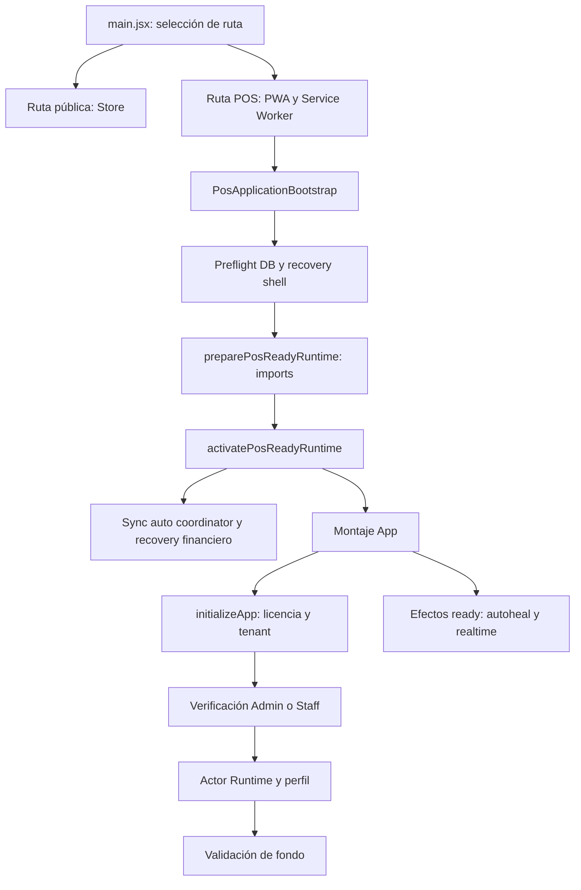

# LANZO POS — F01-2B — BOOTSTRAP LIFECYCLE R1

Estado de integración: **HOLD_BACKGROUND_LIFETIME**. Hay implementación focal,
con pruebas, de reutilización de autoridad vigente, single-flight por store,
observación optativa y separación preparación/activación. No equivale a haber
drenado toda la aplicación ni a tener F01-2 comercial lista.

Repositorio `fdxruli/Lanzo-POS`; exclusivamente PR #373, OPEN / Draft / NOT MERGED.
Base `feat/f01-single-instance-coordinator-r1` (#372). Inicio exacto
`5bfd0693224d92ae8957684bc85bc61ed6cbab90`; main
`52bb573e651529b323b6617e3161cd76ece14a39`; #372
`f1d69093ffe3ad180752773c178b7fbaefd92ce1`. Ningún cambio a main/#372, RPC,
claves financieras, migraciones, licencias o dispositivos. Sin Supabase projects,
sin operaciones reales, sin despliegue de producción ni merge.

## Diagnóstico y orden real

CE-BOOT-01 se reprodujo sobre el HEAD inicial: `initializePromise` compartía el
trabajo concurrente, pero al terminar se borraba. La siguiente invocación bloqueaba
el actor, reiniciaba el guard de tenant, autenticaba y restauraba otra vez.
Conservar para siempre esa promesa sería una caché obsoleta de autorización.
La implementación no conserva resultados exitosos.

El inicio de servicios **no esperaba originalmente a initializeApp**. El orden
real del shell y el de la licencia son dos fronteras diferentes:

`main` inicia SW/update monitor antes de completar el preflight. El recovery shell
puede mostrarse sin App. Tras DB READY se importan App y stores. La activación
instala `startPosSyncAutoBootstrap`, que instala el recovery financiero y una
suscripción al store; luego App se monta e invoca initializeApp en un efecto.
El GRANTED puede disparar recovery financiero antes de que termine el perfil.
App añade autoheal de crédito, legal online, realtime de licencia/notificaciones
y F-02/resume. No asumir un orden lineal DB→auth→todos los coordinadores.

## Grafo de efectos, recursos y cleanup

| Frontera | Clasificación | Dependencia/await y efectos | Recursos, invalidación y cleanup |
| --- | --- | --- | --- |
| Selección pública y shell | PREPARATION_SAFE | Selección síncrona; imports diferidos | No nuevo lock; ruta pública conserva su startup |
| Preflight DB | PREPARATION_SAFE | Promise compartida; prepara esquema; recovery puede interrumpir | `databaseRuntime`, shell y estado DB; cleanup no cancela apertura |
| Lectura licencia y tenant | AUTHORIZATION_REQUIRED | Await storage; assert tenant antes de DB/profile/session | Guard y leases existentes; mismatch bloquea; no limpia IndexedDB |
| Verify Admin/Staff | AUTHORIZATION_REQUIRED | Await sesión; callback antes de persistir; Staff lease existente | Credenciales/tenant; generación actor; no nuevo permiso |
| Restore actor | AUTHORIZATION_REQUIRED | Begin auth, restore/handoff/storage; awaits | Generaciones y handles existentes; timer diagnóstico limpiado en finally |
| Perfil/preferencias/Drive | UNOBSERVABLE_OR_UNKNOWN | `_loadProfile` awaited, pero RPC con timeout y refresh de preferencias/Drive detached | Generaciones perfil/tenant existentes; no contrato de drain de todos los hijos |
| `_validateInBackground` | BACKGROUND_OBSERVABLE | UI no espera; root y revalidate registrables antes de iniciar | Timeout público 8s; timer limpiado; guard actor/tenant y salud después de await |
| Transporte revalidate | BACKGROUND_OBSERVABLE | RPC original registrado optativamente; timeout interno 8s conserva resultado original | Raw task continúa observado aunque venza timeout; late rejection observado |
| Revalidación compartida previa | UNOBSERVABLE_OR_UNKNOWN | Map por licencia puede devolver promesa cuyo dueño no se observó | `shared_license_revalidation_owner` mantiene HOLD; no falsa cobertura |
| Procesar cambios remotos | UNOBSERVABLE_OR_UNKNOWN | Puede refrescar perfil y modo de sync | Se marca unknown antes de invocarlo; no se reescriben coordinadores |
| Recovery financiero automático | COMMERCIAL_ACTIVATION | Instalado por sync auto; subscribe actor/online; promesas con catch | Quitar listener no drena `activeRuns`; sin wiring lifetime F01-2B |
| Sync cloud/outbox/pulls | COMMERCIAL_ACTIVATION | Start/stop observados localmente; timers y pulls tienen vidas independientes | Listeners online/ruta/realtime y colas; stop no acredita servidor terminado |
| Recovery restringida futura | RECOVERY_RESTRICTED | Debe inyectar ticket y ejecutores observables antes de usar helpers | No se implementa su entrypoint; financiero conserva lease/receipt-first |
| App ready/autoheal | COMMERCIAL_ACTIVATION | Efectos React según appStatus | Unmount cancela scheduling, no prueba settlement de jobs ya iniciados |
| SW y monitor | PREPARATION_SAFE | Vida de documento/worker independiente, anterior a auth | No se cambia registro, actualización ni política de recarga |

PREPARATION_SAFE no significa autorización para leer datos de cualquier tenant.
La clasificación identifica la función del efecto; conserva todos sus guards.

## Reutilización de autoridad y eventos de invalidación

El single-flight se limita a **la instancia del store**. Durante un vuelo las
invocaciones comparten su promesa; no se reutiliza el resultado al resolver.
Una invocación posterior sólo evita la restauración si:

1. App está `ready` y Actor Runtime permite `capture()` con tenant vigente.
2. Actor/usuario, rol y licencia del store no cambian durante los awaits.
3. La licencia almacenada coincide íntegramente con la actual. La comparación
   canónica sólo normaliza orden de claves; no registra datos ni tokens.
4. `assertAuthenticatedActorSessionCurrent` prueba sesión/dispositivo y, para
   Admin, evidencia offline/plazo/monotonicidad existentes.
5. Online se verifica nuevamente la sesión Admin o Staff mediante sus APIs y
   callbacks existentes. Datos remotos distintos obligan al camino completo.
6. Admin online conserva el refresco positivo de autorización mediante el helper
   existente, sin nuevo epoch ni plazo propio. Una segunda prueba confirma la
   vinculación final. Offline no renueva ese plazo.

No hay nuevo TTL de autorización. Staff offline nunca toma el camino reusable.
Admin offline no recibe tiempo adicional. Si faltan identidad, licencia, sesión,
dispositivo o tenant, o falla la prueba, se reevalúa por el flujo original.
`force`, logout/login, actor/tenant generation, licencia/plan/estado, dispositivo,
autoridad, expiración y credenciales cambiadas invalidan la posibilidad de reuse.
Un actor nuevo durante un await produce `BOOTSTRAP_CONTEXT_STALE` y el vuelo viejo
no lo bloquea. Se añade la guarda que faltaba después de `hasStaffSessionToken`.
No se altera onboarding, setup, login, discovery ni recovery.

La igualdad estricta es conservadora: un cambio inocuo de datos también puede
forzar restore. Una verificación fallida durante el intento de reuse puede
repetirse por el flujo normal para aplicar su política actual. Se prefiere esa
reevaluación a inventar resultados/denegaciones. No se suprimen restores legítimos.
El single-flight no cancela una petición antigua; otro contexto debe esperar
su settlement/resultado stale y reintentar. No es el futuro controlador de admisión.

## Lifecycle optativo y drenaje

`src/services/bootstrap/bootstrapLifecycle.js` no importa Auth, Supabase, DB,
coordinador ni React. `track(factory)` registra síncronamente antes del microtask
que inicia la tarea. Observa fulfillment/rejection y retira el registro al terminar.
`quiesce()` rechaza registros y factories aún no iniciadas. No cancela transporte.
`assertCurrent()` ejecuta la guarda inyectada; no concede autoridad. Los escritores
siguen necesitando los handles/guards de autorización originales.

`initializeApp({ lifecycle })` registra su raíz y propaga el parámetro a los
background calls directos y a preparación Admin restaurada. `_validateInBackground`
registra su raíz, su llamada a revalidate y, dentro de revalidate, el RPC original.
El resultado público conserva timeout de 8s: **PUBLIC_BOOTSTRAP_READY** y
**BACKGROUND_WORK_SETTLED** son contratos distintos. Un rechazo de admisión
background queda observado aunque el caller lo separe del login.

`drain()` espera registros existentes sin timeout. `markUnobservable` es terminal
para ese scope: trabajo unknown mantiene el drain pendiente aunque pending=0.
No hay removeUnknown, escape hatch, timer de force-release ni referencia al
Web Lock. Un consumidor futuro deberá registrar este drain dentro de su executor
antes de liberar voluntariamente; todavía no existe ese wiring comercial.
La observación cliente no confirma efectos financieros del servidor.

Además del caso de owner compartido, se conservan unknown explícitos:
`bootstrap_profile_nested_work`, `bootstrap_offline_preparation_nested_work`,
`admin_profile_preparation_nested_work`, `background_profile_nested_work` y
`background_server_processing_sync_work`. Cubren hijos que no exponen lifetime
completo, sin modificar profile/Drive ni sincronización fuera de alcance.
**No convertir unknown en PASS porque el spinner desapareció o se quitó un listener.**

La continuación del catch de background ahora comprueba el contexto antes y
después del probe de internet. Un timeout antiguo ya no puede publicar salud de
servidor sobre un login/tenant nuevo. No se invalida Actor Scoped Storage como cleanup.

### Callers de validación revisados

| Caller | Inicio y promesa | Cobertura de esta fase |
| --- | --- | --- |
| licenseBootstrapActions: Staff restaurado | Después del perfil; detached respecto al resultado público | Propaga lifecycle optativo |
| licenseBootstrapActions: fallback Admin restaurado | Después del perfil si no existe helper Admin | Propaga lifecycle optativo |
| licenseBootstrapActions: legacy Admin | Tras modo offline, sólo online | Propaga lifecycle optativo; no fabrica actor |
| licenseAdminActions: completeAdminSession | Después de READY; login/resume/restore comparten función | Restore recibe scope; login/resume ordinarios conservan default sin scope |
| licenseStaffActions: loginStaff | Después de restaurar actor/perfil | Default existente sin scope; no se certifica login Staff entero drenado |

La promesa retornada por `_validateInBackground` puede ser observada sin convertirla
en bloqueo de UI. No se atribuyen al scope jobs originados por otros listeners,
login ordinario o servicios ya instalados. Las transiciones delegadas de licencia/
login conservan sus guards; no se presentan como drain de sus observadores externos.

## Preparación frente a activación

`preparePosReadyRuntime(loader)` comparte sólo la carga/preparación. No llama
`runtime.activate`. `activatePosReadyRuntime` lo compone y conserva la activación
por defecto, una vez. `PosApplicationBootstrap` sigue usando esa ruta comercial.
No cambia ni desactiva sync/autoheal en el producto actual.

Un futuro modo restringido puede preparar sin instalar el sync auto coordinator,
recovery automático ni product recovery guard que se instalan desde `activate`.
**No debe montar App restringida**: sus efectos `ready` instalarían autoheal y
realtime independientemente de la separación del loader. Importar App también
registra handlers; no se certifica que sus imports sean un sandbox sin efectos.
Para integrar F01-2 hay que verificar esos módulos y el grafo completo, además
de proporcionar recovery restringida/tickets y lifetime observable.

## Inventario para la siguiente fase (sólo diagnóstico)

| Pendiente | Callsite / dependencia | Diseño necesario, sin implementación aquí |
| --- | --- | --- |
| Caja 1 | cashRepository `resolveAdministrativeTargetStation`, AUDIT_DETAIL_MS | Registrar audit factory y último parseo; preservar estación objetivo |
| Caja 2 | cashRepository detalle de auditoría, AUDIT_DETAIL_MS | Cubrir fetch, applyCloudResponse y cache/finally |
| Caja 3 | adminCloseCashSession, STATION_RESOLUTION_MS | Registrar resolución de estación antes de start |
| Caja 4 | adminCloseCashSession, PREFLIGHT_MS | Incluir assertCloudStationKnownBeforeWrite y awaits hijos |
| Caja 5 | adminCloseCashSession, POST_SYNC_MS | Cubrir proyección y pullIncremental detached posterior |
| Caja 6 | useCaja `cerrarCajaAdministrativamente`, POST_SYNC_MS | Cubrir sincronizarEstadoCaja y continuación final del hook |
| Inventario | listFinancialIntentsForRecovery: originActorKey, createdAt sort, máximo 50 | Recorrido tenant completo separado de recuperación autorizada del actor |
| Handoff/checkout | actorOperationalHandoff, preparación/rehidratación actor storage | Preservar ownership durable; trabajo ajeno bloquea, no se atribuye al nuevo actor |
| Outbox | syncOutboxService / posSyncOrchestrator | Registrar drain de colas/pulls, no sólo startPromise ni unsubscribe |
| Recovery automático | financialIntentRecoveryCoordinator `activeRuns` | Diferir instalación; ticket/handle vigente; lifetime de cada run y recovery hijo |
| Perfil/Drive | createProfileSlice + getBusinessProfile | Propagar scope hasta RPC original y refresh auxiliares; usar sus guards |
| Sync y pulls | posSyncBootstrapCoordinator/Orchestrator | Timers ruta/realtime/online, promesas detached, continuación tras stop |

El inventario actual no es completo por tenant: lista filas del actor y recorta
hasta 50. Para el futuro: cursor estable compuesto `(createdAt, id)` dentro de
un tenant inmutable, high-water mark o política explícita de mutaciones durante
recorrido, páginas acotadas y guarda después de cada await. No usar offset sobre
un conjunto que cambia. Enumerar también actores ajenos y estados BLOCKED/CONFLICT
sin reclamarlos ni recuperarlos con el actor actual. Separar descubrimiento,
clasificación de pendientes y ejecución autorizada; conservar K/hash/origen,
receipt-first, leases y proyecciones. Casos >50, empates de createdAt, inserciones,
cambios de estado y actor ajeno necesitan evidencia propia antes de integración.

## Límites, rollback y siguiente fase

LC13 sigue **OPEN**. M-01 y F-02 no se modifican; sus suites y fuentes se conservan.
No M-03/Authority v2; Admin máximo 168h y Staff online-only intactos. El desarrollo
HTTP LAN sigue entrando por main/App originales y el coordinador no se activa.
Eso no certifica dos dispositivos reales ni PWA suspendida. QA física pendiente.

Rollback: revertir exclusivamente los commits F01-2B de #373; volver al HEAD inicial
conserva F01-1/F01-2A. No borrar datos, storage, dispositivos, cajas ni hacer SQL.
No hay migración que revertir. No modificar #372 ni hacer rollback de recibos.
Las pruebas nuevas se retiran junto al helper si se revierte el cambio.

Siguiente fase: decidir y observar las fronteras unknown de perfil/Drive y
processing→sync, diseñar la activación sin montar App prematuramente y resolver
el inventario/paginación y los seis callsites en su fase autorizada. Sólo entonces
integrar admisión temprana/recovery con ticket+actor+tenant y demostrar drain.
No se activa el entrypoint ni el gate en esta entrega; **HOLD_BACKGROUND_LIFETIME**.

Ver el informe de evidencia para BG-01..45, contraejemplo, diferencias, CI, builds,
hashes y reproducción. Los resultados sintéticos no constituyen QA física/comercial.
