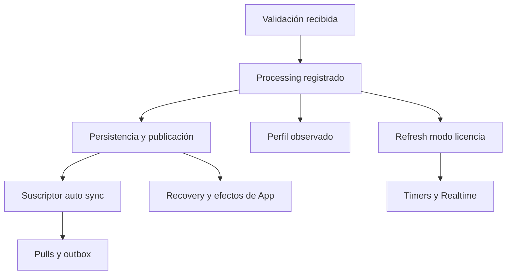

# LANZO POS — F01-2C — BACKGROUND EXECUTION LIFETIME R1

Fecha: 24 de octubre de 2026, America/Mexico_City.

**BACKGROUND_LIFETIME_PARTIAL / HOLD_BACKGROUND_LIFETIME.** Implementación focal
probada de perfil, preparación de token y propiedad de validaciones compartidas.
Persisten fronteras críticas de preparación y sincronización delegada. F01-2
comercial sigue desactivada; LC13 OPEN. No se declara toda la aplicación drenada.

## Identidad y alcance

Repositorio `fdxruli/Lanzo-POS`. Únicamente [PR #373](https://github.com/fdxruli/Lanzo-POS/pull/373),
OPEN / Draft / NOT MERGED. Rama `feat/f01-early-admission-recovery-r1`, base
`feat/f01-single-instance-coordinator-r1` (#372), sin retarget ni force push.

| Referencia verificada | SHA |
| --- | --- |
| Main, intacto | `52bb573e651529b323b6617e3161cd76ece14a39` |
| #372, intacto | `f1d69093ffe3ad180752773c178b7fbaefd92ce1` |
| #373 inicial / baseline diferencial obligatorio | `d007bfe1cc2569391a2959ddff73bb2ed1e9c8ff` |
| #373 final | SHA exacto en el cuerpo del PR y entrega; no hash autorreferente |

Worktrees propios detached para candidata y baseline, sin AGENTS.md aplicable.
No Docker ni modificación de dependencias. Antecedentes consultados: F01/LC13
Audit y Evidence, Design y Evidence, F01-0 Decisions y Evidence, F01-1, F01-2,
F01-2A y F01-2B con sus evidencias. Se contrastan con código, no se suman sus
resultados históricos a los nuevos. Los seis antecedentes documentales externos
son los identificados en Evidence F01-2; no se presume publicación de sus SHAs.

Siete fuentes preexistentes cambian: `bootstrap/bootstrapLifecycle.js`,
`services/supabase.js`, `store/slices/createProfileSlice.js` y las acciones de
licencia Bootstrap, Admin, BackgroundValidation y Processing. Se agregan laboratorio
`single-instance-f012c` y estos dos informes. UI/Drive providers no cambian.
Fuentes financieras, seis callsites de caja, controller/bridge/storage, tenant,
App/main, SW, SQL, workflows y manifiestos de dependencias permanecen idénticos.

## Fronteras iniciales y clasificación final

El alcance de OBSERVABLE_COMPLETE es la operación local explícitamente registrada,
con los providers concretos auditados. No incluye suscriptores comerciales ajenos
al contrato, todas las tareas de App, ni confirmación remota.

| Frontera inicial | Clasificación final | Evidencia y límite |
| --- | --- | --- |
| `bootstrap_profile_nested_work` | OBSERVABLE_COMPLETE para provider auditado | `_loadProfile` registra raíz, RPC original y awaits de cache/publicación. Provider sustituido sin contrato v1 conserva UNKNOWN |
| `background_profile_nested_work` | OBSERVABLE_COMPLETE para provider auditado | Misma propagación; timeout público no retira el transporte. Callbacks/providers async sustituidos son OBSERVABLE_PARTIAL + UNKNOWN |
| `bootstrap_offline_preparation_nested_work` | OBSERVABLE_PARTIAL | Perfil propagado; proceso offline completo, transiciones/cleanup y suscriptores no tienen lifetime integral probado. Marca conservada |
| `admin_profile_preparation_nested_work` | OBSERVABLE_PARTIAL | Perfil propagado; `completeAdminSession` también espera DB/session/grant/preparación, con efectos externos y contratos propios. Marca conservada |
| `background_server_processing_sync_work` | OBSERVABLE_PARTIAL | Raíz processing registrada; publicaciones disparan coordinadores/listeners, timers, pulls y recovery no registrados. HOLD de esa parte |
| `shared_license_revalidation_owner` | OBSERVABLE_COMPLETE si origen observado; SHARED_OWNER_UNKNOWN si origen no observado | Registro privado propio y unión explícita a completion. Origen inicialmente sin observer conserva UNKNOWN; no se inventa propiedad retrospectiva de callbacks externos |

No se asigna NOT_CRITICAL_FOR_DRAIN a un hijo por conveniencia. Los refresh reales
de UI/Drive son síncronos y quedan completos dentro de la raíz; no eran requests
remotos detached. Los aborts del HEAD de conectividad son una comprobación de
lectura: terminar/abortar ese fetch no confirma nada de negocio. Su timer residual
en el catch no escribe autoridad/tenant y no se usa como autorización de release.

## Perfil, preferencias y Drive

`createProfileSlice` conserva generaciones de carga/sesión **por instancia de
store**, no globales entre stores. Captura identidad inicial antes del microtask
de la raíz. Comprueba licencia (también su desaparición), rol/usuario, actor,
sesión, generación, device y tenant opaqueId/generación/databaseName. Si hay actor
GRANTED captura su handle y lo comprueba; un scope nunca crea un grant.

Se conservan TTL, cache por licencia, legacy import candidate, reglas de Setup,
foreground/background, Staff y fallbacks existentes. `saveProfileCache` sigue
escribiendo la fila por licencia y el espejo legacy dentro del tenant actual,
con guarda antes de cada write y del marcador TTL. No se crea cache global
intertenant. Las actualizaciones explícitas `handleSetup`/`updateCompanyProfile`
conservan sus handles y contratos; no se simulan uploads reales.

`getBusinessProfile` acepta scope/guarda opcionales. Registra factory del RPC antes
de comenzar y conserva el timeout público de **8.000ms**. Limpia su timer en
finally. Tras timeout, el transporte continúa observado; su respuesta tardía no
vuelve a entrar al pipeline de persistencia/publicación. La raíz incluye las
continuaciones awaitables posteriores al resultado público y los writes locales.
Un timer no libera Web Lock ni equivale a cancelación del request.

`refreshTenantUiPreferences` llama sin await a la política local de apertura y
publica el store. `refreshDriveSession` lee sessionStorage bajo el permiso
existente de cache tenant y publica el estado. No consulta OAuth/Google, no renueva
token, no lee backups, no inicia respaldos/restauraciones ni solicita permisos.
El lock de Drive sigue ocultando el token sin borrarlo; expiración/malformed
conservan su limpieza existente. Ni cerrar ventana ni observar lifecycle borra
credenciales. No se alteran los flujos de autenticación/backup de Google.

Cada refresh empieza con contexto vigente. Si un sustituto retorna promesa se
observa su rechazo y se conserva `profile_async_refreshTenantUiPreferences` o
`profile_async_refreshDriveSession`: conocer la promesa no demuestra guards dentro
del provider. `onPrepared` real es síncrono; un retorno async se observa y conserva
`profile_async_onPrepared`. La marca UNKNOWN puede registrarse después de quiesce o invalidación: registrar
evidencia no inicia trabajo ni concede autoridad. Se observa el rechazo del
retorno async antes de comprobar admisión. Si el callback cierra o invalida el
scope síncronamente y después devuelve una promesa, la unión se rechaza, pero
UNKNOWN conserva el drenaje bloqueado y el rechazo tardío queda manejado. Seis
extras cubren las dos intercalaciones para preferencias, Drive y onPrepared.
Estos providers/callbacks no se certifican como capaces
de escribir después de cambio de actor: necesitan contrato propio y permanecen
UNKNOWN. No copiar `bootstrapLifecycleVersion=1` a una implementación no auditada.

## Revalidación: propiedad, preparación, transporte y continuación

La clave del single-flight incluye licencia, binding de actor/sesión/device y
binding del tenant runtime. Una nueva generación/actor/tenant no reutiliza la
operación antigua aunque la licencia textual sea la misma.

Cada record privado posee una instancia del **mismo** `createBootstrapLifecycle`:
registra raíz antes del inicio y RPC original antes de start. Su completion
independiente espera raíz completa, precheck, device, credenciales, respuesta,
fallback, persistencias, finally/lease y transporte tardío. Los consumidores se
registran síncronamente mediante `observe(record.completion)`; no adquieren
cancelación ni la autoridad de persistencia del propietario. El owner mantiene
su guarda original. Un rechazo tardío queda observado y aparece en rejected,
sin cambiar un resultado público ya entregado.

`observe` sólo une un lifetime conocido, ya poseído por otra operación; no es
prueba de que una promesa arbitraria se registró antes de iniciar. Las tareas
nuevas siguen usando `track(factory)`. Si scope ya está quiesced no admite una
nueva unión. Quiescer un consumidor no cancela ni reparenta el transporte compartido.
El record ya admitido termina bajo su propio scope. La pérdida de autoridad del
owner no autoriza a otro consumidor a tomar sus continuaciones de escritura.

El Map conserva la política de eliminar el flight al terminar su resultado público;
si el raw sigue pendiente, su completion aún mantiene la referencia y la espera.
Una nueva validación legítima puede comenzar después del resultado público,
como antes; no se añade cache exitosa permanente ni se vuelve a ejecutar la
continuación de la operación anterior al llegar su raw tardío.

La consulta de conectividad se espera de extremo a extremo; su HEAD real es de
lectura. Device identity tiene su propia promesa compartida con continuaciones
awaitables y registro por dispositivo, no por tenant; no se cambia su identidad.
El helper de token sí podía escribir: tras leer credenciales vacías recuperaba
un token desde la licencia. Se agrega comprobación **dentro** del helper después
de esa lectura y persistencia mediante el guard de la validación, antes/después
del write. CE-TOKEN-04 reproduce la llamada de persistencia tardía en baseline;
los extras de actor/tenant la rechazan en candidata y conservan recuperación válida.
No cambian permisos, contenido de token, protocolo RPC ni autenticación.

El deadline de validación permanece **8.000ms**. Su rechazo se observa incluso
si todavía no terminó preparación; no se inicia RPC posteriormente si ya venció.
Como en el contrato anterior, el race público se alcanza después de preparar
conectividad/device/credenciales: no se inventa un límite end-to-end de ocho
segundos para un provider de preparación que nunca termina. Su lifetime permanece
pendiente y no se libera por tiempo. El fallback de licencia 72h y autorización
Admin máximo168h son contratos diferentes, ambos intactos.

## Procesamiento y sincronización delegada

`_processServerValidation` registra su raíz opcional y conserva UNKNOWN antes de
publicaciones que pueden activar servicios. Propaga scope al perfil en rutas de
renovación, upgrade, normal y fallback offline. Vuelve a comprobar contexto tras
perfil y antes de `refreshLicenseSyncMode`: un resultado viejo no inicia ese paso
sobre una sesión nueva. No cambia reglas de plan, permisos, checkout ni outbox.

Grafo relevante, no orden total de toda App:

`posSyncBootstrapAutoCoordinator` reacciona al store y separa `start/stop` con
catch, sin devolver a processing sus lifetimes. `posSyncBootstrapCoordinator`
contiene startPromise, scheduling y trabajos de outbox/snapshot detached.
`posSyncOrchestrator` tiene online/realtime, debounce, pull pendiente, statusQueue
y outbox. `financialIntentRecoveryCoordinator` conserva activeRuns y listeners de
actor/online. `licenseSyncActions` instala intervalos y listeners; `start` puede
lanzar `runLicenseSyncCheck` sin await. `licenseRealtimeActions` tiene reconexiones
y cleanup con timer. Ni stop/unsubscribe ni resolver startPromise prueban que
terminaron esos hijos. El producto normal sigue iniciándolos como antes.

| Afirmación | Alcance acreditado |
| --- | --- |
| PROCESSING_SETTLED | Raíz de processing observada terminó |
| CHILD_WORK_SETTLED | Terminaron únicamente hijos registrados explícitamente |
| SYNC_QUIESCED | **NO ACREDITADO**; no hay barrera integral de nuevas admisiones/hijos |
| REMOTE_STATE_CONFIRMED | **NO DEDUCIBLE**; requiere contrato remoto específico |

BGX-43/44 conservan contraejemplos sintéticos: processing resuelto mientras una
tarea delegada sigue pendiente. BGX-45 demuestra que pending=0 con UNKNOWN no
drena por esperar un minuto. No se cambia un coordinador general para maquillar
la prueba; se detiene esa parte según el encargo.

## Pruebas, certificación y conservación

Ver el informe Evidence, matriz BGX y JSON crudos. BGX-01..60 más once extras de
contexto/callback/token usan código real con providers sintéticos. Las suites
independientes cubren política real Admin/Staff, M-01/F-02, tenant/Actor Storage,
Dexie, finanzas/recovery/outbox/caja/ventas y PWA/SW. Los mocks BGX no certifican
autenticación Staff ni un pago. Los cuatro probes baseline son PASS de reproducción
de contraejemplos, no seguridad aprobada. Chromium NOT_EXECUTED por binario ausente;
no se reaprovecha como actual una ejecución de fases anteriores.

Cuatro builds secuenciales por árbol y auditoría de precache/bundles. No fixtures
F01-2C ni coordinador activo en assets. `coreLocalRouteAssets=[]` del auditor no
certifica navegación offline fría. Sin cambios a flags de navegador ni certificados.
CI remoto se consulta sobre SHA publicado; si no hay runs queda NOT_TRIGGERED,
nunca SUCCESS. No se retargetea a main para disparar workflows.

## Siguiente fase, HOLD y rollback

F01-2 puede continuar **como investigación/diseño**, no activarse con esta entrega.
Se necesita F01-2D focal para lifetime delegado: describir propiedad por generación
actual de coordinadores, registrar tareas reales de start/pull/outbox/recovery,
impedir nuevas admisiones en el scope restringido y separar unsubscribe de drain.
Usar un adaptador compatible con este helper, sin cancelar commits remotos ni
cambiar recuperación financiera. Probar timers/reconexiones, callbacks viejos,
root terminado con raw pendiente, y rechazados tardíos. Cualquier cambio general
de sync necesita su propio alcance aprobado; aquí sólo se entrega este plan.

Preparación Admin/offline amplia sigue requiriendo su auditoría de hijos. Los seis
callsites de caja y el inventario financiero completo/paginación permanecen en
su fase reservada. Después habrá que integrar entrada mínima/recovery restringida,
comprobar ticket+actor+tenant/sesión tras awaits y evitar montaje prematuro de App.
LC13, legacy/perfiles/orígenes distintos y hibernación/PWA física siguen abiertos.

Rollback focal: revertir sólo el delta F01-2C y sus archivos QA/docs, conservando
F01-1/F01-2A/F01-2B. No borrar DB, cache, outbox, intents, receipts, credenciales,
licencias, dispositivos ni respaldos. No hay SQL/migración que revertir. Revertir
código no cancela trabajo ya enviado ni termina documentos abiertos; cualquier
futura integración activa debe drenar sus propios ejecutores antes de release.

M-01/F-02, Admin offline máximo168h, Staff online-only y autoridades financieras
se conservan. Tickets de navegador no conceden autorización. Sin Authority v2,
M-03, BC-only, steal, force-release ni cierre de LC13.

Supabase production writes NONE; llamadas a proyectos Supabase NONE; SQL/migraciones
NONE; Google Drive real NO MODIFICADO; operaciones financieras reales NONE;
licencias/dispositivos SIN CAMBIOS; main/#372 SIN CAMBIOS; despliegue producción
NOT PERFORMED; merge NOT PERFORMED.
