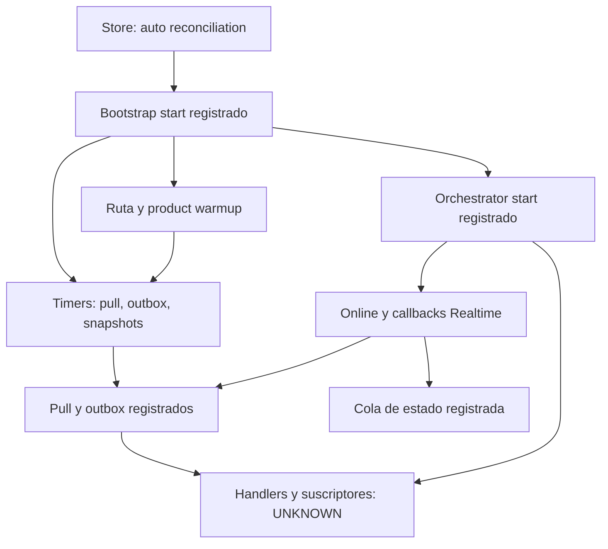

# LANZO POS — F01-2D — DELEGATED SYNC LIFETIME R1

Fecha de trabajo: 24 de octubre de 2026, America/Mexico_City.

**SYNC_LIFETIME_PARTIAL / HOLD_SYNC_LIFETIME.** D1 implementado; D2 y D3
implementados sólo en las fronteras descritas. No se demuestra drenaje integral
de sincronización, licencia, preparación Admin/offline ni de toda la aplicación.
El gate comercial continúa OFF; LC13 OPEN. No READY_FOR_PRODUCTION.

## Identidad

Repositorio `fdxruli/Lanzo-POS`; únicamente [PR #373](https://github.com/fdxruli/Lanzo-POS/pull/373),
OPEN/Draft/sin merge. Rama `feat/f01-early-admission-recovery-r1`; base conservada
`feat/f01-single-instance-coordinator-r1`, PR #372. Sin retarget ni force push.

| Referencia verificada | SHA |
| --- | --- |
| Main, intacto | `52bb573e651529b323b6617e3161cd76ece14a39` |
| #372, intacto | `f1d69093ffe3ad180752773c178b7fbaefd92ce1` |
| #373 inicial / baseline exacto | `c20e3538c8be897dc7b3c937429000ac8006f42d` |
| #373 final | Commit que contiene esta entrega; SHA exacto y CI en el PR y respuesta final, evitando un hash autorreferente |

Copias de trabajo aisladas; dependencias existentes del mismo lockfile, sin
instalaciones ni Docker. La validación definitiva utiliza otro checkout con
cinco fuentes SHA-256 idénticas, congeladas durante builds y suites. No se edita
main, #372 ni otros trabajos. Los documentos F01 Audit, Design y F01-0 Decisions
se recuperaron completos; F01-1, F01-2, F01-2A/B/C y sus evidencias se consultaron
en el árbol de referencia. Los antecedentes no cuentan como QA nueva.

## D1 — Contrato de tareas, continuaciones y fuentes

Archivo nuevo: `src/services/sync/syncExecutionScope.js`. Sin imports de Auth,
DB, Supabase, React, licencia o Web Locks. No crea actor, tenant, sesión, permiso,
lease ni autoridad financiera. No se importa desde el arranque comercial.

Identidad local congelada `{id,generation,context}`; context es metadata capturada
superficialmente, por lo que el caller debe usar valores escalares inmutables y
no credenciales. La guarda inyectada debe capturar actor/sesión/tenant/generaciones
originales. No consultar simplemente un actor nuevo y declararlo vigente. La
guarda sólo restringe; los servicios conservan todas sus comprobaciones reales.

| Transición | Condición y significado |
| --- | --- |
| ACTIVE → QUIESCING | `quiesce` cierra admisión síncronamente; cancela timers aún no disparados; registra cada cleanup antes de invocarlo |
| QUIESCING → DRAINING | `settleObserved` o `drain` espera las tareas registradas; llamar mientras ACTIVE es error |
| DRAINING → DRAINED | No hay tareas, fuentes ni timers propios pendientes y no existe UNKNOWN |
| DRAINING → UNKNOWN | Termina trabajo local observado pero persiste alguna frontera desconocida |
| UNKNOWN → DRAINING → UNKNOWN | Reconsulta sin borrar evidencia; no elimina UNKNOWN por tiempo |
| DRAINED → UNKNOWN | Sólo nueva evidencia de una frontera omitida; nunca una nueva admisión |

No hay reset/removeUnknown ni transición de vuelta a ACTIVE. Una generación
legítima nueva necesita otro scope y el anterior debe estar DRAINED. Una operación
que rechaza puede estar localmente terminada; el contador rejected no acredita
éxito de negocio. Un cleanup que falla registra UNKNOWN y bloquea drain. ERROR
no es un estado adicional implementado: errores de admisión se rechazan y fallos
de teardown se clasifican conservadoramente como UNKNOWN.

`run(label,factory)` registra antes de la microtask/factory y vuelve a comprobar
admisión/contexto al comenzar. `schedule` registra el trabajo programado antes
de instalar el timer; al dispararse registra el ejecutor antes de retirar el
registro de programación. Cancelar un timer disparado devuelve false y no retira
la ejecución. No se equipara el reconocimiento de scheduling con settlement.

El token de una tarea sólo expone `track`, `assertCurrent` y `markUnobservable`.
`track` es una continuación interna necesaria, nunca una nueva fuente comercial.
Puede registrarse después de quiesce mientras la rama previamente admitida siga
viva y el contexto sea vigente. El token persiste si el resultado público terminó
pero un hijo registrado aún necesita continuar; se cierra al terminar toda esa
rama. No ofrece timers, listeners, permisos o cancelación remota.

Los observers de diagnóstico síncronos/async que rechazan quedan contenidos sin
retirar tareas; no se confía en ellos para autorizar o acreditar settlement.
UNKNOWN se puede registrar tras quiesce/context loss porque es evidencia.

`stopScheduling` es el contrato de cleanup de una fuente, no un método que drene.
`quiesce` cierra admisión; `settleObserved` informa DRAINED/UNKNOWN tras esperar
lo observado; `drain` sólo resuelve DRAINED, sin timeout. Un no-settlement permanece
pendiente. Ninguna API libera Web Locks. Una futura integración deberá mantener
el drain dentro del executor de instancia antes de pedir salida, sin esperarse a
sí misma. Esa integración comercial no está implementada aquí.

## D2 — Bootstrap, orchestrator y grafo real

Tres fuentes preexistentes modificadas: `posSyncBootstrapAutoCoordinator.js`,
`posSyncBootstrapCoordinator.js`, `posSyncOrchestrator.js`.

El inventario exhaustivo de las rutas auditadas está en
`scripts/qa/single-instance-f012d/evidence/task-inventory.json`: cada fila incluye
Owner, Scope, Context, Trigger, Start, Public settlement, Raw settlement, Children,
Timers, Writes, Cleanup, Quiesce, Drain y Unknown. Es inventario de estas rutas,
no inventario financiero completo por tenant.

La reserva es síncrona y valida toda la cadena antes de instalar fuentes; bootstrap
reserva también el orchestrator antes de su primera factory/await. El auto valida
recovery antes de reservar. Esto evita una ventana de apropiación entre capas.
Una ejecución default anterior no puede adoptarse retrospectivamente, ni después
de stop; sus hijos ocultos no se vuelven propios por terminar la promesa pública.
Un scope activo/UNKNOWN tampoco se sustituye por otro. La ruta sin scope sigue
los métodos originales y no crea un scope automáticamente.

Auto conserva suscripción única; registra reconciliaciones y propaga el scope.
Callbacks antiguos no inician trabajo después de quiesce. Bootstrap registra
start, route demand, warmup, timers y callbacks ya disparados. La promesa start no
sustituye sus hijos. Epoch y firma impiden publicar estado de start/snapshot viejo.
Un cambio de contexto debe invalidar la guarda original; no se inventa otra
resolución de tenant ni se concede autorización por coincidencia de licencia.

Orchestrator registra start/pull/outbox/scheduling/focus; callbacks online capturan
owner y vuelven a comprobarlo tras outbox. Realtime usa guards de generación y
admisión; debounce registrado y cancelable. Un callback de status registra la cola
antes del await. Pagination, credenciales y RPC de `posSyncClient` siguen awaitables
en el pull; los handlers de eventos mantienen UNKNOWN para descendientes externos.

`stop` optativo dispara teardown registrado y conserva la semántica del stop
original, incluida invalidación de runtime/generación. **No es graceful completion
exitosa de cada operación:** una respuesta tardía puede descartarse según esas
guardas, mientras su tarea permanece observada hasta terminar localmente. No se
hace pasar stop por drain ni por commit remoto confirmado. El caller puede esperar
`settleObserved` para diagnóstico; UNKNOWN no autoriza salida voluntaria.

### Outbox y snapshots

Se reutilizan `syncOutboxService`, handlers, identidad durable, K/hash, estados,
orden, persistencia y retry existentes, sin edits a sus archivos. Quiesce no borra
filas. Un handler iniciado permanece observado por su promesa pública; su raw y
suscriptores no expuestos mantienen `pos_handler_lifetime:push:<entity>`. Un stop
puede dejar processing para recuperación existente; no se fuerza reenvío ni se
cambia el contrato durable. El catch scoped evita publicar un fallo/retry sobre
contexto runtime reemplazado. La ruta default conserva su comportamiento previo.

Snapshots usan los providers actuales y guards antes del handler y publicación.
`completedSnapshots` no se restaura desde una generación vieja. Cancelar snapshot
programado prueba sólo ausencia de inicio; snapshot ya iniciado se retiene y marca
`snapshot_handler_lifetime:<resource>`, sin certificar todos sus hijos.

### Frontera Realtime sin resolver

`posRealtime` puede ejecutar removeChannel con catch detached y scheduleReconnect
por timer/online desde sus callbacks internos. `stopPosRealtimeListener` es best
effort y no expone el lifetime de toda esa cola. No se modifica ese proveedor ni
se declaran desactivadas universalmente sus fuentes; se registra
`pos_realtime_internal_reconnect_lifetime`. Los callbacks del orchestrator quedan
cercados, pero los canales internos no están certificados. **D2 PARTIAL.**

## D3 — Recovery focal; licencia y Admin/offline en HOLD

Cuarta fuente preexistente modificada: `financialIntentRecoveryCoordinator.js`.
Root registrada antes de list/recovery; activeRuns conserva promesas y un registro
separado de owner. Compartir un run del mismo scope no duplica dispatch; un origen
no observado/diferente sólo se une a completion pública y conserva
`shared_financial_recovery_owner`, sin apropiación ni derechos de cancelación.
La instalación usa scope optativo y listeners cercados; uninstall cierra admisión
antes de retirarlos y no elimina runs vivos. Pasar null no evade un owner instalado.

Se propaga el parámetro `executionScope` YA existente de F01-2A. Raw receipt/dispatch
explícitamente registrados siguen vivos tras timeout público. No se modifican
ledger, recovery state machine, projection registry, dispatcher, withFinancialTimeout,
leases, receipts, idempotencia, checkout ni retry. La autoridad del handle financiero
sigue siendo obligatoria; no se considera un lock de navegador lease financiero.

Una proyección aplicada/fallida o primer dispatch puede activar suscriptores DOM/
store ajenos al runner; mantiene `financial_projection_subscriber_lifetime`.
Una recuperación rechazada conserva `financial_recovery_rejected_descendants`.
PROCESSING remoto conserva su significado financiero y receipt-first; DRAINED
local nunca significa REMOTE_STATE_CONFIRMED ni autorización para reenviar.

`licenseSyncActions.js` y `licenseRealtimeActions.js` se auditaron y conservan sus
blobs. Intervalo, initial check detached, online/recovery, refresh de modo,
publicaciones al store, perfil, verifySessionIntegrity, fallback y callbacks de
seguridad/modal no comparten un contrato completo de ownership/raw settlement.
Además usan estado de scheduling a nivel módulo y acciones delegadas por `get()`.
Envolver sólo start/stop daría una garantía falsa. No se instrumenta esa parte sin
un contrato por sesión/store, continuaciones y pruebas de todos sus consumers.
No se necesita ampliar permisos/topics ni se justifica reescribir la política.
Se entrega HOLD_SYNC_LIFETIME de esa integración, no una falsa solución de licencias.

Admin/offline: saveLicense, clearStaffCache, preparación DB, bridge grant, perfil,
onPrepared/READY, background validation y suscriptores pertenecen a distintas
fronteras. El perfil/raw ya observado en F01-2C no acredita todo el completion.
Se conservan `bootstrap_offline_preparation_nested_work`,
`admin_profile_preparation_nested_work` y `background_server_processing_sync_work`.
No se conecta el nuevo scope a initialize/App; no se reescribe restauración.
No se demuestra necesidad de Authority v2: primero hace falta auditoría/contrato
focal de esas transiciones; si exige cambiar autoridad deberá autorizarse aparte.
**D3 PARTIAL. No se declara la fase completa.**

## Checkpoints y rollback

| Checkpoint | Archivos y evidencia | Estado / riesgo / rollback focal |
| --- | --- | --- |
| D1 | scope nuevo + scope/instance tests y trazas | Implementado; requiere que los hijos reales usen el contrato. Retirar helper/QA sólo junto a consumidores opcionales |
| D2 | auto/bootstrap/orchestrator + sync tests | PARTIAL por handlers/Realtime; no activar gate. Revertir estas tres fuentes al baseline F01-2C |
| D3 | recovery coordinator + recovery tests; auditoría licencia/Admin | PARTIAL por proyección/subscriptores/licencia/preparación. Revertir sólo coordinator; no tocar ledger/receipts |

Los checkpoints son fronteras de implementación y evidencia, no tres despliegues
ni certificaciones de producto. Revertir la entrega completa conserva F01-1/A/B/C.
No hay migraciones ni datos que revertir; no borrar DB/outbox/intents/credenciales,
cerrar cajas ni liberar dispositivos. Un rollback de código no cancela documentos
abiertos ni commits remotos; una futura cohorte necesita su política propia.

## Validación y continuación

Resultados definitivos, matriz D-01..60, intentos intermedios, hashes, builds,
comparador original PR127 y limitaciones en el informe Evidence. Global no verde:
los fallos preexistentes se reproducen y se comparan literalmente. Chromium de esta
fase NOT_EXECUTED por falta de binario; el LockManager sintético no lo sustituye.

F01-2 puede continuar como trabajo focal de diseño/instrumentación. Activar gate:
**NO**. Antes hacen falta contratos de handlers/Realtime/licencia/preparación,
puente entre los lifecycles observados y el executor de instancia, inventario
financiero completo y los seis callsites de caja reservados, además de QA física.
Caja/inventario como integración comercial certificada: **NO**; sólo propuesta o
fase posterior autorizada. Ningún UNKNOWN crítico se eliminó artificialmente.

Actor Runtime/Scoped Storage, M-01/F-02, Admin máximo 168h, Staff online-only,
tenant, permisos, finanzas durables, Ecommerce FREE, App/main, SW, dependencias y
workflows conservan sus fuentes. Supabase project calls/production writes NONE;
migraciones NONE; operaciones financieras reales NONE; licencias/dispositivos y
Google Drive real SIN CAMBIOS; producción NOT DEPLOYED; merge NOT PERFORMED.
